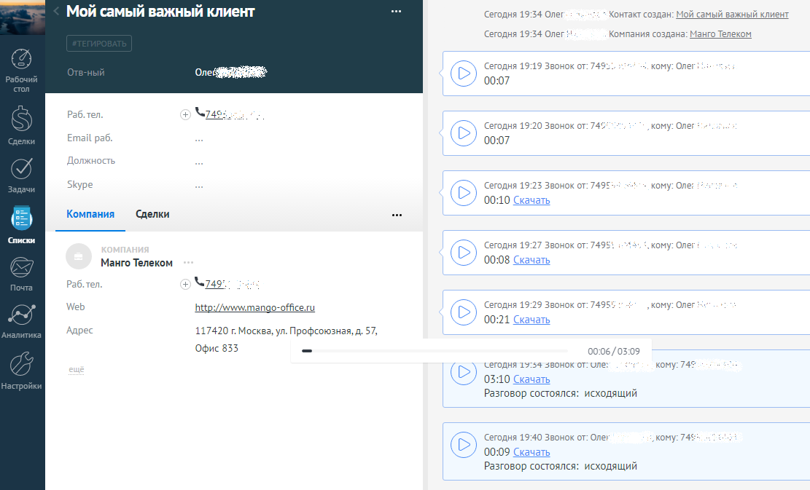

# 6. История вызовов

> Трассировка: PDF §6 · сквозные стр. 92-93 · источники: ч.1 `kb/sources/integration_amocrm/Mango_office_integration_amoCRM.pdf` с.92-93.

Каждый звонок от контакта отображается в истории взаимоотношений с контактом. Если в Виртуальной АТС включена услуга записи разговоров, то здесь же можно прослушать или скачать запись разговора. Примечания: 1) запись разговора может отобразиться в карточке контакта с небольшой задержкой; 2) если контакт будет удален, то из amoCRM удалится вся информация о звонках с удаляемым контактом.

> **Описание иллюстрации INTAMO-§6-1** (к §6 «История вызовов», стр. 92; 1111×673 px). Снимок экрана / схема.
> Относится к тексту руководства: «…ожет отобразиться в карточке контакта с небольшой задержкой; 2) если контакт будет удален, то из amoCRM удалится вся информация о звонках с удаляемым контактом.».
> Текст на изображении (OCR, требует сверки): Мой самый важный клиент; самы; важный клиент; ‘Сегодня 19:54 Олег; Контакт создан: М; ‘Сегодня 19:34 Олег?"; Компания создана: Манго Телеком; ‘Сегодня 19:19 Звонок от: 749; кому: Олег:; 00:07; Pa6. ten.; АЯ; ‘Сегодня 19:20 Звонок от: 74%; кому: Оле; Email раб.; Должность; Skype; ‘Сегодня 19:23 Звонок от: 7495; кому: Оле:; 00:10 Скачать; Компания; Сделки; Свиски; ‘Сегодня 19:27 Звонок от: 7495!; .кому: Олег:; Манго Телеком; 00:08 Скачать; Раб.тел.; 3 749.; Web; ht; an; ffice.ru; ‘Сегодня 19:29 Звонок от: 74955; „кому: Олег; 00:21 Скачать; Адрес; 117420 г Москва, ул. Профсоюзная, д. 57,; oso.; О…

Интеграция Виртуальной АТС MANGO OFFICE и amoCRM | Версия от 25.08.2025
