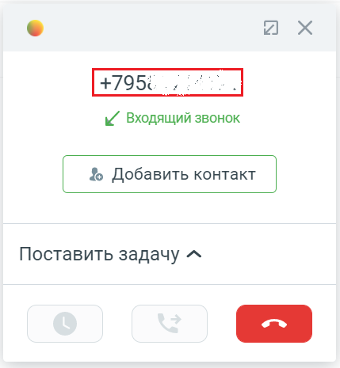
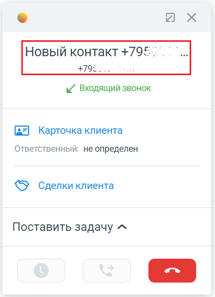
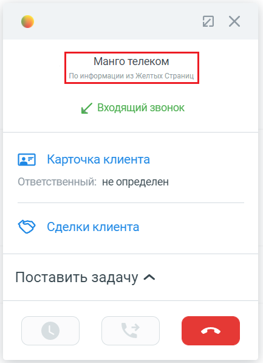
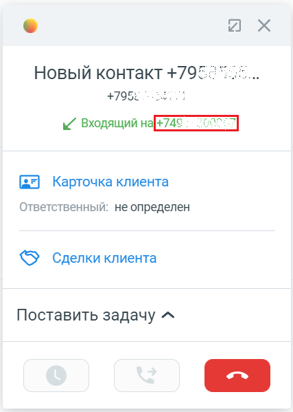
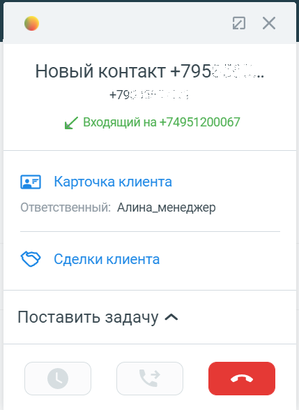
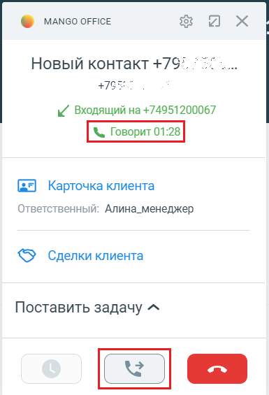

# 7.3. Об интерфейсе карточки звонка

> Трассировка: PDF §7.3 · сквозные стр. 95-97 · источники: ч.1 `kb/sources/integration_amocrm/Mango_office_integration_amoCRM.pdf` с.95-97.

При входящем / исходящем звонке При входящем либо исходящем звонке в развернутой карточке звонка можно видеть: 1) номер телефона: - номер абонента при звонке с нового номера, ЛИБО • данные контакта (например, сообщение “Новый ДД:ММ ДД.ММ.ГГГГ”), если абонент ранее был сохранен в amoCRM, ЛИБО • контактные данные абонента, если они определены по данным из amoCRM / Адресной книге: Интеграция Виртуальной АТС MANGO OFFICE и amoCRM | Версия от 25.08.2025

> **Описание иллюстрации INTAMO-§7.3-1** (к §7.3 «Об интерфейсе карточки звонка», стр. 96; 429×465 px). Снимок экрана / схема.
> Относится к тексту руководства: «…Новый ДД:ММ ДД.ММ.ГГГГ”), если абонент ранее был сохранен в amoCRM, ЛИБО • контактные данные абонента, если они определены по данным из amoCRM / Адресной книге:».
> Текст на изображении (OCR, требует сверки): vA; ы/ Входящий звонок; % Добавить контакт; Поставить задачу ^

> **Описание иллюстрации INTAMO-§7.3-2** (к §7.3 «Об интерфейсе карточки звонка», стр. 96; 433×597 px). Снимок экрана / схема.
> Относится к тексту руководства: «…Новый ДД:ММ ДД.ММ.ГГГГ”), если абонент ранее был сохранен в amoCRM, ЛИБО • контактные данные абонента, если они определены по данным из amoCRM / Адресной книге:».
> Текст на изображении (OCR, требует сверки): vA; Новый контакт +795.; ы/ Входящий звонок; (= Карточка клиента; Ответственный: не определен; © _ Сделки клиента; Поставить задачу ^

> **Описание иллюстрации INTAMO-§7.3-3** (к §7.3 «Об интерфейсе карточки звонка», стр. 96; 433×597 px). Снимок экрана / схема.
> Относится к тексту руководства: «…Новый ДД:ММ ДД.ММ.ГГГГ”), если абонент ранее был сохранен в amoCRM, ЛИБО • контактные данные абонента, если они определены по данным из amoCRM / Адресной книге:».
> Текст на изображении (OCR, требует сверки): Юй Хх; ы/ Входящий звонок; (= Карточка клиента; Ответственный: не определен; <5) Сделки клиента; Поставить задачу ^

а) б) в) 2) направление звонка (входящий или исходящий); 3) номер линии ВАТС, через который идет вызов. Отображается, только если включена настройка “Указывать источник при входящих звонках”. 4) кнопка “Добавить контакт” при звонке с нового номера, либо, если абонент сохранен в контактах amoCRM, то вместо кнопки “Добавить контакт” будут показаны: - ссылка на карточку Клиента. Кликнув по этой ссылке, будет открыта карточка Клиента в amoCRM; • ссылка на список сделок amoCRM по данному клиенту; 5) имя ответственного сотрудника (отображается при входящем звонке), либо информационное сообщение “Ответственный: не определен”; 5) данные коллтрекинга только для входящего звонка от нового Клиента;

> **Описание иллюстрации INTAMO-§7.3-4** (к §7.3 «Об интерфейсе карточки звонка», стр. 96; 70×37 px). Фрагмент интерфейса (кнопка, переключатель или поле).
> Относится к тексту руководства: «…ажается при входящем звонке), либо информационное сообщение “Ответственный: не определен”; 5) данные коллтрекинга только для входящего звонка от нового Клиента;».
> Текста на изображении нет; назначение элемента — см. текст, к которому он относится.

7) кнопка “Отбой” , при помощи которой можно завершить вызов.

> **Описание иллюстрации INTAMO-§7.3-5** (к §7.3 «Об интерфейсе карточки звонка», стр. 96; 427×599 px). Снимок экрана / схема.
> Относится к тексту руководства: «…тветственный: не определен”; 5) данные коллтрекинга только для входящего звонка от нового Клиента; 7) кнопка “Отбой” , при помощи которой можно завершить вызов.».
> Текст на изображении (OCR, требует сверки): vA; ь/ Входящий на|+748 ° 22:; (= Карточка клиента; Ответственный: не определен; © _ Сделки клиента; Поставить задачу ^

> **Описание иллюстрации INTAMO-§7.3-6** (к §7.3 «Об интерфейсе карточки звонка», стр. 96; 429×587 px). Снимок экрана / схема.
> Относится к тексту руководства: «…тветственный: не определен”; 5) данные коллтрекинга только для входящего звонка от нового Клиента; 7) кнопка “Отбой” , при помощи которой можно завершить вызов.».
> Текст на изображении (OCR, требует сверки): vA; Новый контакт +795: 2; ь/ Входящий на +74951200067; (= Карточка клиента; Ответственный: Алина_менеджер; <5} Сделки клиента; Поставить задачу ^

> **Описание иллюстрации INTAMO-§7.3-7** (к §7.3 «Об интерфейсе карточки звонка», стр. 96; 284×396 px). Снимок экрана / схема.
> Относится к тексту руководства: «…тветственный: не определен”; 5) данные коллтрекинга только для входящего звонка от нового Клиента; 7) кнопка “Отбой” , при помощи которой можно завершить вызов.».
> Текст на изображении (OCR, требует сверки): @ wanco orrice; эх; rm; ия; По авы из лы страниц; 792.; \ входящий на 74957798955; Данные ДКТ:; Город: Москва; Время на сайте, сек: 248; Ключевое слово: money; Рекламная кампания: teampaign; Источник/канал: Googdex/spark/bestgoods; Текущая страница: drupal.dev; Имя виджета: Mysite.ru

а) б) в) Во время звонка Когда звонок принят в развернутой карточке, к указанным выше элементам добавляется: Интеграция Виртуальной АТС MANGO OFFICE и amoCRM | Версия от 25.08.2025 - длительность звонка;

> **Описание иллюстрации INTAMO-§7.3-8** (к §7.3 «Об интерфейсе карточки звонка», стр. 97; 70×38 px). Фрагмент интерфейса (кнопка, переключатель или поле).
> Относится к тексту руководства: «…- длительность звонка;».
> Текста на изображении нет; назначение элемента — см. текст, к которому он относится.

- кнопка “Перевод вызова” :

> **Описание иллюстрации INTAMO-§7.3-9** (к §7.3 «Об интерфейсе карточки звонка», стр. 97; 385×565 px). Снимок экрана / схема.
> Относится к тексту руководства: «…- длительность звонка; - кнопка “Перевод вызова” :».
> Текст на изображении (OCR, требует сверки): о мА\со огАСЕ; их; Новый контакт +797. °°.; +765:; ы/ Входящий на +74951200067; ($=) Карточка клиента; Ответственный: Алина_менеджер; <5) Сделки клиента; Поставить задачу ^
