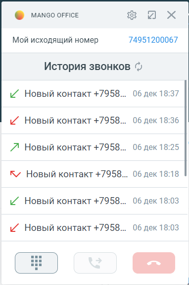
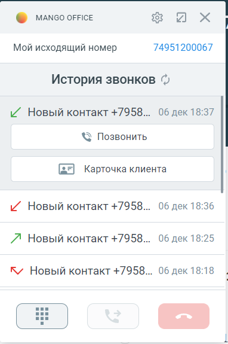

# 7.8. История звонков

> Трассировка: PDF §7.8 · сквозные стр. 102-104 · источники: ч.1 `kb/sources/integration_amocrm/Mango_office_integration_amoCRM.pdf` с.102-104.

Общее Функция “История звонков” позволяет загружать из ВАТС данные о звонках, совершенных/принятых/пропущенных определенным сотрудником, прямо в карточку звонка. Данные о звонке импортируются в карточку звонка из ВАТС сразу после завершения вызова. Интеграция Виртуальной АТС MANGO OFFICE и amoCRM | Версия от 25.08.2025 Импортированные данные дополняют данные о ранее совершенных вызовах. В результате в карточке звонка будет показана история вызовов по конкретному сотруднику. Как посмотреть историю звонков Для этого в карточке звонка, необходимо: 1) развернуть карточку звонка, если она была в свернутом состоянии;

> **Описание иллюстрации INTAMO-§7.8-1** (к §7.8 «История звонков», стр. 103; 38×19 px). Пиктограмма (значок элемента интерфейса).
> Относится к тексту руководства: «…кретному сотруднику. Как посмотреть историю звонков Для этого в карточке звонка, необходимо: 1) развернуть карточку звонка, если она была в свернутом состоянии;».
> Текста на изображении нет; назначение элемента — см. текст, к которому он относится.

2) нажать на кнопку в нижней части карточки звонка. Будет показан список звонков, принятых, либо пропущенных, соответствующих сотруднику. По каждому звонку отображается номер телефона второго абонента (участника звонка), дата и время его фиксации, а также тип звонка:

> **Описание иллюстрации INTAMO-§7.8-2** (к §7.8 «История звонков», стр. 103; 20×23 px). Пиктограмма (значок элемента интерфейса).
> Относится к тексту руководства: «…х, соответствующих сотруднику. По каждому звонку отображается номер телефона второго абонента (участника звонка), дата и время его фиксации, а также тип звонка:».
> Текста на изображении нет; назначение элемента — см. текст, к которому он относится.

входящий принятый звонок;

> **Описание иллюстрации INTAMO-§7.8-3** (к §7.8 «История звонков», стр. 103; 24×22 px). Пиктограмма (значок элемента интерфейса).
> Относится к тексту руководства: «…ику. По каждому звонку отображается номер телефона второго абонента (участника звонка), дата и время его фиксации, а также тип звонка: входящий принятый звонок;».
> Текста на изображении нет; назначение элемента — см. текст, к которому он относится.

входящий пропущенный звонок;

> **Описание иллюстрации INTAMO-§7.8-4** (к §7.8 «История звонков», стр. 103; 21×21 px). Пиктограмма (значок элемента интерфейса).
> Относится к тексту руководства: «…жается номер телефона второго абонента (участника звонка), дата и время его фиксации, а также тип звонка: входящий принятый звонок; входящий пропущенный звонок;».
> Текста на изображении нет; назначение элемента — см. текст, к которому он относится.

входящий звонок отклонен;

> **Описание иллюстрации INTAMO-§7.8-5** (к §7.8 «История звонков», стр. 103; 22×21 px). Пиктограмма (значок элемента интерфейса).
> Относится к тексту руководства: «…ого абонента (участника звонка), дата и время его фиксации, а также тип звонка: входящий принятый звонок; входящий пропущенный звонок; входящий звонок отклонен;».
> Текста на изображении нет; назначение элемента — см. текст, к которому он относится.

исходящий принятый звонок;

> **Описание иллюстрации INTAMO-§7.8-6** (к §7.8 «История звонков», стр. 103; 23×16 px). Пиктограмма (значок элемента интерфейса).
> Относится к тексту руководства: «…нка), дата и время его фиксации, а также тип звонка: входящий принятый звонок; входящий пропущенный звонок; входящий звонок отклонен; исходящий принятый звонок;».
> Текста на изображении нет; назначение элемента — см. текст, к которому он относится.

исходящий звонок, отклоненный вызываемым абонентом;

> **Описание иллюстрации INTAMO-§7.8-7** (к §7.8 «История звонков», стр. 103; 24×24 px). Пиктограмма (значок элемента интерфейса).
> Относится к тексту руководства: «… входящий принятый звонок; входящий пропущенный звонок; входящий звонок отклонен; исходящий принятый звонок; исходящий звонок, отклоненный вызываемым абонентом;».
> Текста на изображении нет; назначение элемента — см. текст, к которому он относится.

исходящий пропущенный звонок. Как обновить историю звонков Она обновляется автоматически, но если нужно принудительно обновить историю звонков

> **Описание иллюстрации INTAMO-§7.8-8** (к §7.8 «История звонков», стр. 103; 22×22 px). Пиктограмма (значок элемента интерфейса).
> Относится к тексту руководства: «…ваемым абонентом; исходящий пропущенный звонок. Как обновить историю звонков Она обновляется автоматически, но если нужно принудительно обновить историю звонков».
> Текста на изображении нет; назначение элемента — см. текст, к которому он относится.

нужно нажать на кнопку . Как перезвонить по номеру 1) нажать на строку с данными нужного Вам номера. Будут открыты дополнительные элементы интерфейса; 2) нажать на кнопку “Перезвонить”. Будет совершен исходящий звонок на выбранный вами номер: Интеграция Виртуальной АТС MANGO OFFICE и amoCRM | Версия от 25.08.2025

> **Описание иллюстрации INTAMO-§7.8-9** (к §7.8 «История звонков», стр. 104; 382×574 px). Снимок экрана / схема.
> Относится к тексту руководства: «…ужного Вам номера. Будут открыты дополнительные элементы интерфейса; 2) нажать на кнопку “Перезвонить”. Будет совершен исходящий звонок на выбранный вами номер:».
> Текст на изображении (OCR, требует сверки): о мА\со огАСЕ; их; Мой исходящий номер; 74951200067; История звонков ©; Z Новый контакт +7958... 06 дек 18:37; ZY Новый контакт +7958; 06 дек 18:36; 7) Новый контакт +7958; 06 дек 18:25; Kv Новый контакт +7958; 06 дек 18:18; Z Новый контакт +7958; 06 дек 18:03

> **Описание иллюстрации INTAMO-§7.8-10** (к §7.8 «История звонков», стр. 104; 382×575 px). Снимок экрана / схема.
> Относится к тексту руководства: «…ужного Вам номера. Будут открыты дополнительные элементы интерфейса; 2) нажать на кнопку “Перезвонить”. Будет совершен исходящий звонок на выбранный вами номер:».
> Текст на изображении (OCR, требует сверки): MANGO OFFICE; их; Мой исходящий номер; 74951200067; История звонков ©; ZY Новый контакт +7958... 06 дек 18:37; © Позвонить; [2= Карточка клиента; ZY Новый контакт +7958... 06 дек 18:36; Л Новый контакт +7958... 06 дек 18:25; Kv Новый контакт +7958... 06 дек 18:18

а) б) Как сохранить номер после разговора 1) нажать на строку с данными нужного Вам номера. Будут открыты дополнительные элементы интерфейса; 2) нажать на кнопку “Добавить контакт”. Будет открыта форма “Новый контакт” в amoCRM, нужно заполнить ее и сохранить.
