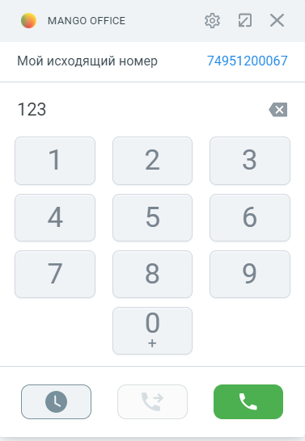

# 7.9. Номеронабиратель

> Трассировка: PDF §7.9 · сквозные стр. 104-105 · источники: ч.1 `kb/sources/integration_amocrm/Mango_office_integration_amoCRM.pdf` с.104-105.

Это функция, которая позволяет вам прямо из карточки звонка набрать номер и позвонить тому или иному абоненту. Как позвонить Чтобы позвонить с помощью номеронабирателя, необходимо: 1) развернуть карточку звонка, если она была в свернутом состоянии; 2) выполнить одно из следующих действий: Интеграция Виртуальной АТС MANGO OFFICE и amoCRM | Версия от 25.08.2025 • если в карточке звонка открыта “История звонков”, то следует нажать на кнопку

> **Описание иллюстрации INTAMO-§7.9-1** (к §7.9 «Номеронабиратель», стр. 105; 71×38 px). Фрагмент интерфейса (кнопка, переключатель или поле).
> Относится к тексту руководства: «…• если в карточке звонка открыта “История звонков”, то следует нажать на кнопку».
> Текста на изображении нет; назначение элемента — см. текст, к которому он относится.

; • вместо “Истории звонков” может открывается номеронабиратель;

> **Описание иллюстрации INTAMO-§7.9-2** (к §7.9 «Номеронабиратель», стр. 105; 69×37 px). Фрагмент интерфейса (кнопка, переключатель или поле).
> Относится к тексту руководства: «…• если в карточке звонка открыта “История звонков”, то следует нажать на кнопку ; • вместо “Истории звонков” может открывается номеронабиратель;».
> Текста на изображении нет; назначение элемента — см. текст, к которому он относится.

3) набрать номер на экранной клавиатуре и нажать на кнопку .

> **Описание иллюстрации INTAMO-§7.9-3** (к §7.9 «Номеронабиратель», стр. 105; 377×546 px). Снимок экрана / схема.
> Относится к тексту руководства: «…нков”, то следует нажать на кнопку ; • вместо “Истории звонков” может открывается номеронабиратель; 3) набрать номер на экранной клавиатуре и нажать на кнопку .».
> Текст на изображении (OCR, требует сверки): о млмсо огАСЕ; вх; Мой исходящий номер; 74951200067; 123; bX
