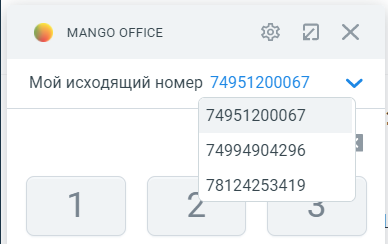

# 7.10. Мой исходящий номер

> Трассировка: PDF §7.10 · сквозные стр. 105-106 · источники: ч.1 `kb/sources/integration_amocrm/Mango_office_integration_amoCRM.pdf` с.105-106.

Важно. Чтобы использовать эту функцию необходимо использовать расширенный пакет интеграции, а также включить опцию “Разрешить выбирать линию при исходящем звонке” в настройках интеграции. Кроме этого, надо проверить, что в настройках Виртуальной АТС ВЫКЛЮЧЕНА настройка “Не указан номер – нет исходящей связи”. Функция “Мой исходящий номер” позволяет увидеть, с какого Вашего номера Виртуальной АТС совершаются исходящие звонки. Кроме этого, можно выбрать любой номер ВАТС и позвонить с выбранного номера телефона. Как изменить исходящий номер: 1) развернуть карточку звонка, если она была в свернутом состоянии; 2) в поле “Мой исходящий номер” будет показан Ваш исходящий номер;

> **Описание иллюстрации INTAMO-§7.10-1** (к §7.10 «Мой исходящий номер», стр. 105; 17×16 px). Пиктограмма (значок элемента интерфейса).
> Относится к тексту руководства: «…изменить исходящий номер: 1) развернуть карточку звонка, если она была в свернутом состоянии; 2) в поле “Мой исходящий номер” будет показан Ваш исходящий номер;».
> Текста на изображении нет; назначение элемента — см. текст, к которому он относится.

3) нажать на кнопку в поле “Мой исходящий номер”; 4) в выпадающем списке показаны все Ваши номера Виртуальной АТС. Нужно нажать на тот или иной номер, который будет использован для совершения звонков. Интеграция Виртуальной АТС MANGO OFFICE и amoCRM | Версия от 25.08.2025

> **Описание иллюстрации INTAMO-§7.10-2** (к §7.10 «Мой исходящий номер», стр. 106; 388×244 px). Снимок экрана / схема.
> Относится к тексту руководства: «…й номер”; 4) в выпадающем списке показаны все Ваши номера Виртуальной АТС. Нужно нажать на тот или иной номер, который будет использован для совершения звонков.».
> Текст на изображении (OCR, требует сверки): о мА\со огАСЕ; и х; Мой исходящий номер 74951200067; 74951200067; 74994904296; 78124253419; Zz
