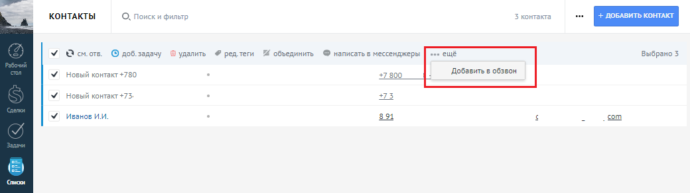
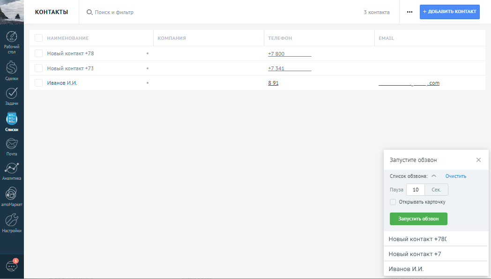
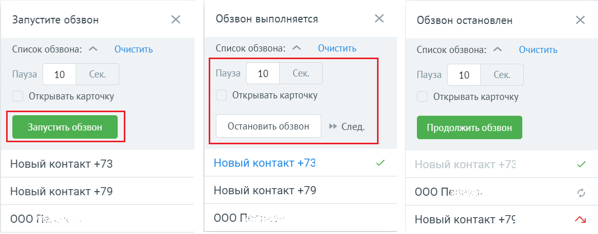
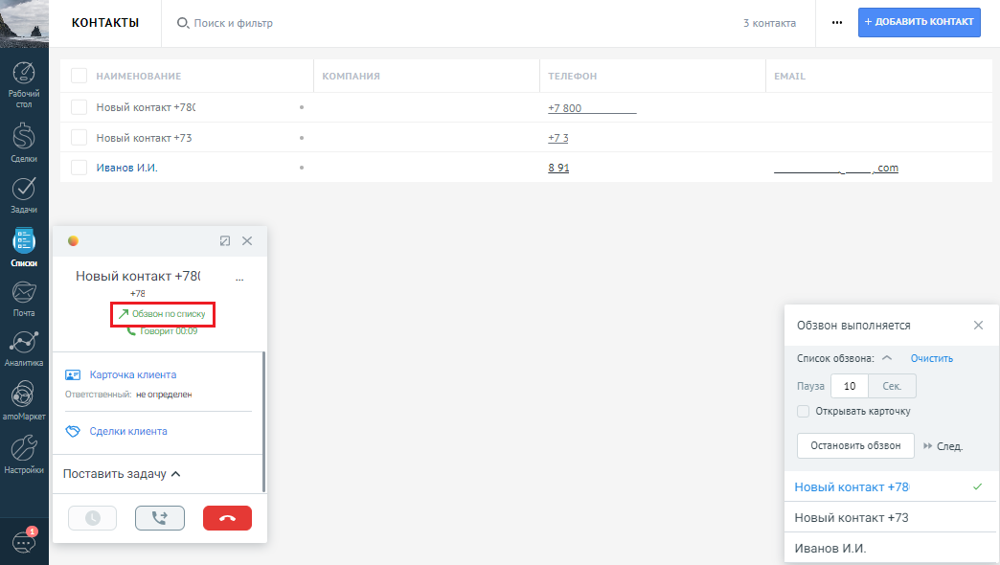
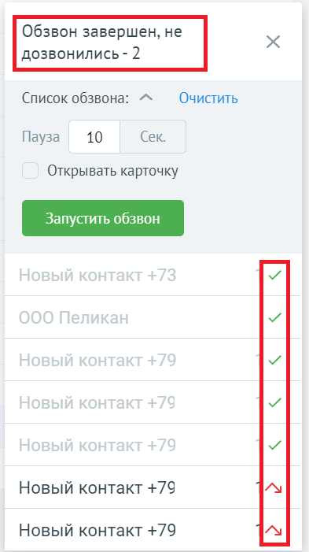

# 8. Список обзвона

> Трассировка: PDF §8 · сквозные стр. 108-111 · источники: ч.1 `kb/sources/integration_amocrm/Mango_office_integration_amoCRM.pdf` с.108-111.

Для удобства совершения массовых исходящих звонков, сотрудник может воспользоваться специальным инструментом – списком обзвона. Список обзвона можно создать из списка контактов, сделок и компаний. Сотрудник всегда может добавить в список еще контакты и/или компании и/или сделки. Внимание! Список обзвона доступен только при подключении расширенных возможностей интеграции. И только если выключен флаг “Интеграция с Контакт центром”. Если флаг “Интеграция с Контакт центром” включен, то виджет передает данные для обзвона в кампанию исходящего обзвона (один из важных инструментов Контакт Центра). Сотрудник в любой момент может поменять интервал между попытками дозвона по списку или установить флаг “Открывать контакт”. Если флаг “Открывать контакт” включен, то при звонке по строке из списка обзвона автоматически откроется соответствующая карточка контакта/компании. Сотрудник также может открыть карточку контакта/компании - кликнув на имя в карточке звонке. Для добавления записей в список обзвона – выбрать элементы в списке и на вкладке “еще” нажать на “Добавить в обзвон”:

> **Описание иллюстрации INTAMO-§8-1** (к §8 «Список обзвона», стр. 108; 1040×292 px). Снимок экрана / схема.
> Относится к тексту руководства: «…мпании - кликнув на имя в карточке звонке. Для добавления записей в список обзвона – выбрать элементы в списке и на вкладке “еще” нажать на “Добавить в обзвон”:».
> Текст на изображении (OCR, требует сверки): КОНТАКТЫ; О. поиски фильтр; 3 Ko; та; У сов О доб задачу; `В удалить; 4 редтеги; объединить; © написатьв мессенджеры:; ешё; Выбрано 3; Добавить в обзвон; У новый контакт +780; #7800.; У новый контакт +75.; 573; У иванов ии,; aot; com; око

Выбранные элементы будут добавлены в конец списка обзвона:

> **Описание иллюстрации INTAMO-§8-2** (к §8 «Список обзвона», стр. 108; 1048×596 px). Снимок экрана / схема.
> Относится к тексту руководства: «…аписей в список обзвона – выбрать элементы в списке и на вкладке “еще” нажать на “Добавить в обзвон”: Выбранные элементы будут добавлены в конец списка обзвона:».
> Текст на изображении (OCR, требует сверки): КОНТАКТЫ; On; Ku oH; 3K; aL; новый контакт +78; #7800.; новый контакт +73; #7341; Иванов ИМ.; aot; ит; com; око; Запустите обзвон; Список обзвона:; Очистить; 10; Открывать карточку; новый контакт +7; Иванов ИМ

При этом, одинаковые контакты фильтруются и в список добавляется только одна запись. Нажать на кнопку запуска обзвона – начнется обзвон. Первый звонок начнется сразу после запуска, а последующие – через указанную паузу после завершения предыдущего звонка. Интеграция Виртуальной АТС MANGO OFFICE и amoCRM | Версия от 25.08.2025

> **Описание иллюстрации INTAMO-§8-3** (к §8 «Список обзвона», стр. 109; 1169×459 px). Снимок экрана / схема.
> Относится к тексту руководства: «…кнопку запуска обзвона – начнется обзвон. Первый звонок начнется сразу после запуска, а последующие – через указанную паузу после завершения предыдущего звонка.».
> Текст на изображении (OCR, требует сверки): Запустите обзвон; Обзвон выполняется; Обзвон остановлен; ‘Список обзвона: ^^; Очистить; 10; Cex.; Пауза; Открывать карточку; Остановить обзвон; Новый контакт +73; Новый контакт +79; 000 Ne»:; 000 fis; 000 Berns; Новый контакт +76

а) б) в) Если список обзвона нужно удалить - нажать на “Очистить”. Если контакт в списке нужно удалить - нажать на кнопку “Корзина”, которая появляется при наведении курсора мыши на соответствующую строку. Если обзвон нужно приостановить во время обзвона – нажать на кнопку “Пауза”. Обзвон остановится до следующего нажатия на кнопку “Запуска обзвона”. Во время обзвона виджет сначала звонит сотруднику. После поднятия трубки сотрудником – начинается звонок Клиенту. При звонке в рамках обзвона – в карточке звонка будет указано “Обзвон по списку”.

> **Описание иллюстрации INTAMO-§8-4** (к §8 «Список обзвона», стр. 109; 1044×590 px). Снимок экрана / схема.
> Относится к тексту руководства: «…нит сотруднику. После поднятия трубки сотрудником – начинается звонок Клиенту. При звонке в рамках обзвона – в карточке звонка будет указано “Обзвон по списку”.».
> Текст на изображении (OCR, требует сверки): КОНТАКТЫ; Ku oH; Новый контакт +78; #7800.; Новый контакт +73,; +23; Иванов ИМ.; aot; ит; com; око; Новый контакт +78(; (063208 выполняется; три; Список обзвона:; Очистить; GB Корточка клиента; па; 10; ve onpenenen; Открывать карточку; © сделкиклиента; остановить обзвон; » след; Поставить задачу ^; новый контакт +73; Иванов ИМ

Если с Клиентом был начат разговор, то соответствующая строка в списке обзвона становиться

> **Описание иллюстрации INTAMO-§8-5** (к §8 «Список обзвона», стр. 109; 25×27 px). Пиктограмма (значок элемента интерфейса).
> Относится к тексту руководства: «… рамках обзвона – в карточке звонка будет указано “Обзвон по списку”. Если с Клиентом был начат разговор, то соответствующая строка в списке обзвона становиться».
> Текста на изображении нет; назначение элемента — см. текст, к которому он относится.

серого цвета и в ней появляется значок . А, если до Клиента не дозвонились, то строка

> **Описание иллюстрации INTAMO-§8-6** (к §8 «Список обзвона», стр. 109; 30×28 px). Пиктограмма (значок элемента интерфейса).
> Относится к тексту руководства: «…был начат разговор, то соответствующая строка в списке обзвона становиться серого цвета и в ней появляется значок . А, если до Клиента не дозвонились, то строка».
> Текста на изображении нет; назначение элемента — см. текст, к которому он относится.

помечается значком и перемещается в конец списка. Обзвон по списку автоматически останавливается, когда по всем элементам списка был звонок. При этом указывается, по какому числу контактов не было разговора. Сотрудник может кликнуть Интеграция Виртуальной АТС MANGO OFFICE и amoCRM | Версия от 25.08.2025 еще раз на запуск обзвона и обзвон будет совершен только по тем контактам, по которым сотрудник ранее не дозвонился.

> **Описание иллюстрации INTAMO-§8-7** (к §8 «Список обзвона», стр. 110; 393×701 px). Снимок экрана / схема.
> Относится к тексту руководства: «…еще раз на запуск обзвона и обзвон будет совершен только по тем контактам, по которым сотрудник ранее не дозвонился.».
> Текст на изображении (OCR, требует сверки): Список обзвона: /^; Очистить; Пауза; 10; Сек.; Открывать карточку; Новый контакт +79

Примечания: 1. если во время обзвона сотрудник не примет вызов, то чтобы продолжить обзвон – ему нужно остановить и продолжить обзвон. Либо обзвон автоматически через некоторое время будет поставлен на паузу. 2. обзвон по списку может выполняться только в одной вкладке браузера, чтобы не создавались ошибочно несколько обзвонов и запускать их одновременно. После очистки обзвона – его можно создать в любой другой вкладке браузера. Интеграция Виртуальной АТС MANGO OFFICE и amoCRM | Версия от 25.08.2025
