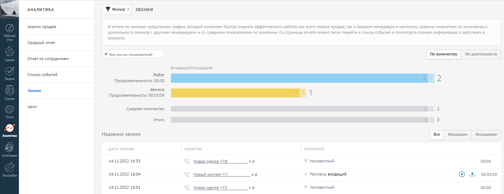

# 9. Аналитика

> Трассировка: PDF §9 · сквозные стр. 111-112 · источники: ч.1 `kb/sources/integration_amocrm/Mango_office_integration_amoCRM.pdf` с.111-112.

Каждый звонок учитывается в стандартных инструментах аналитики в amoCRM:

> **Описание иллюстрации INTAMO-§9-1** (к §9 «Аналитика», стр. 111; 1412×546 px). Снимок экрана / схема.
> Относится к тексту руководства: «…9 Аналитика Каждый звонок учитывается в стандартных инструментах аналитики в amoCRM:».
> Текст на изображении (OCR, требует сверки): АНАЛИТИКА; Усы >; звонки; Анализ продаж.; В очете по звонкам представлен график, который позволяет быстро оценить эффективность работы как всего отдела продаж,так и каждого менеджера в частности, сравнив показатели по количествуи; длительности звонков с другими менеджерами и со средними показателями по компании. Со страницы отчета можно легко перейти к списку событий и посмотреть полную информацию о действиях в; аккаунте; ‘Сводный отчет; У ве групы nan; По количеству; To длительности; Отчет no сотрудникам; pau; ‘список событий; Робот; Продолжительность: 00:00; dawovo; Продолжительность: 00:03:…

Интеграция Виртуальной АТС MANGO OFFICE и amoCRM | Версия от 25.08.2025
