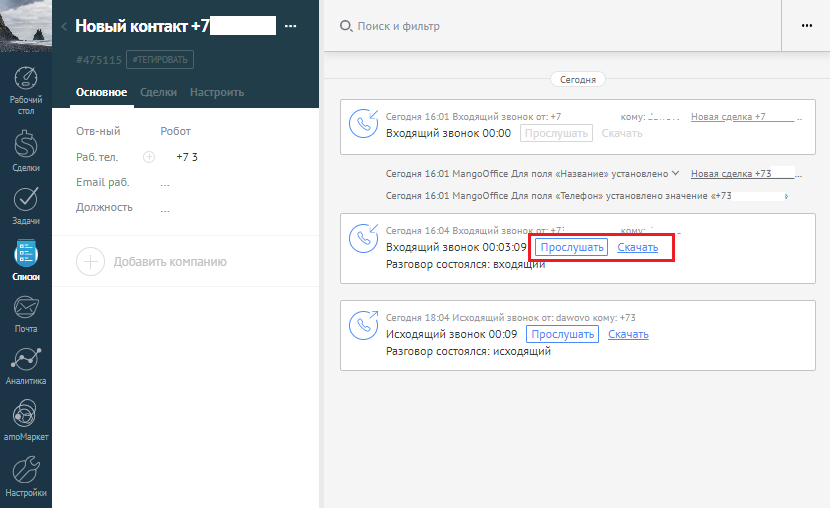

# 10. Запись разговоров

> Трассировка: PDF §10 · сквозные стр. 112-113 · источники: ч.1 `kb/sources/integration_amocrm/Mango_office_integration_amoCRM.pdf` с.112-113.

Если в Виртуальной АТС подключена услуга записи разговоров, то при наличии записи разговора ее можно прослушать или скачать в amoCRM:

> **Описание иллюстрации INTAMO-§10-1** (к §10 «Запись разговоров», стр. 112; 830×508 px). Снимок экрана / схема.
> Относится к тексту руководства: «…10 Запись разговоров Если в Виртуальной АТС подключена услуга записи разговоров, то при наличии записи разговора ее можно прослушать или скачать в amoCRM:».
> Текст на изображении (OCR, требует сверки): on; Новый контакт +7 ---; Сегодня; Основное; Отв-ный; Входящий звонок; 00:00; Pa6. Ten; +73; Сегодня 16:01 MangoOffice Для поля «Название» установлено У; Новая сделка +73; Email; Сегодня 16:01 MangoOffice Для поля «Телефон» установлено значение «+; Должность; хи; Входящий 3 онок 00:05:09; Разго вор состоялся: входя!; ars; Исходящий вонок 00:09; лушать; Ск; ть; Разговор состоялся: исходящий

1. запись разговора может отобразиться в карточке контакта с небольшой задержкой. 2. если длительность разговора менее 6 сек, то запись разговора не сохранится в Виртуальной АТС и соответственно не отобразится в amoCRM. Если в ходе обработки вызова, сотрудники переводили его на других сотрудников, то в amoCRM будет сохранены все записи разговоров Клиентам с каждым из сотрудников; 3. при прослушивании записи разговора осуществляется проверка прав доступа сотрудника к записи согласно модели прав доступа Виртуальной АТС. Права доступа настраиваются в разделе “Безопасность и ограничения” на вкладке “Настройка доступа”. Если прав доступа недостаточно, то пользователь не сможет прослушать запись разговора. Интеграция Виртуальной АТС MANGO OFFICE и amoCRM | Версия от 25.08.2025
