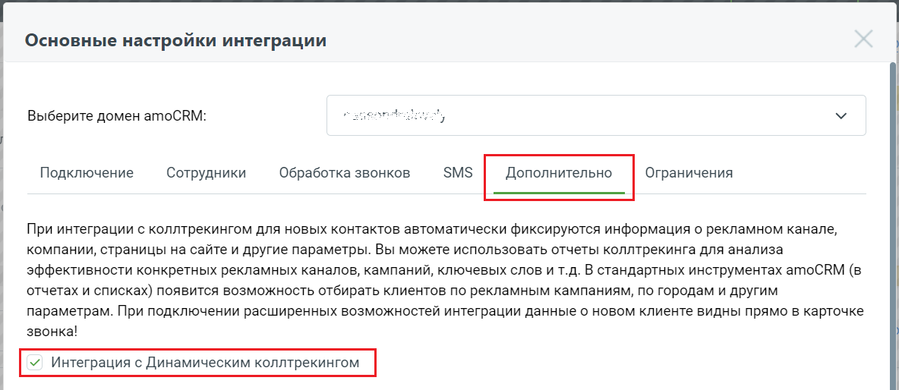

# 11.2. Как настроить

> Трассировка: PDF §11.2 · сквозные стр. 113 · источники: ч.1 `kb/sources/integration_amocrm/Mango_office_integration_amoCRM.pdf` с.113.

Чтобы настроить интеграцию amoCRM с коллтрекингом MANGO OFFICE, в форме настройки виджета установить флаг “Интеграция с динамическим коллтрекингом”, затем нажать кнопку “Сохранить” внизу окна “Основные настройки интеграции”.

> **Описание иллюстрации INTAMO-§11.2-1** (к §11.2 «Как настроить», стр. 113; 1184×514 px). Снимок экрана / схема.
> Относится к тексту руководства: «…в форме настройки виджета установить флаг “Интеграция с динамическим коллтрекингом”, затем нажать кнопку “Сохранить” внизу окна “Основные настройки интеграции”.».
> Текст на изображении (OCR, требует сверки): Основные настройки интеграции; Выберите домен атоСВМ:; ean; ee; Подключение; Сотрудники; Обработка звонков; SMS; Дополнительно; Ограничения; При интеграции с коллтрекингом для новых контактов автоматически фиксируются информация о рекламном канале,; компании, страницы на сайте и другие параметры. Вы можете использовать отчеты коллтрекинга для анализа; эффективности конкретных рекламных каналов, кампаний, ключевых слов и т.д. В стандартных инструментах amoCRM (в; отчетах и списках) появится возможность отбирать клиентов по рекламным кампаниям, по городам и другим; параметрам. При подключении ра…
