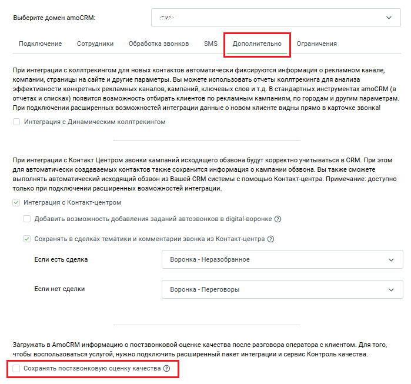
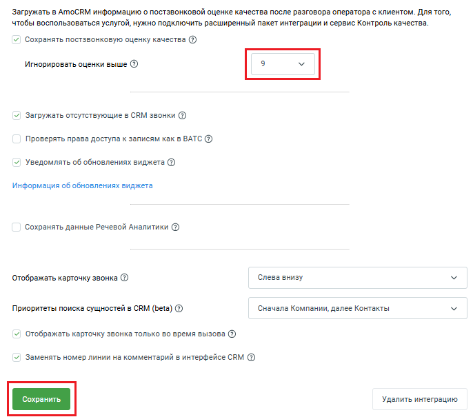

# Как настроить

> Трассировка: PDF §12 · сквозные стр. 118-119 · источники: ч.1 `kb/sources/integration_amocrm/Mango_office_integration_amoCRM.pdf` с.118-119.

Чтобы настроить передачу постзвонковой оценки качества в вашу amoCRM, в окне “Основные настройки интеграции” необходимо: 1. откройте вкладку “Дополнительно” 2. активируйте переключатель “Сохранять постзвонковую оценку качества”. Будет открыто дополнительное поле;

> **Описание иллюстрации INTAMO-§12-1** (к §12 «Как настроить», стр. 118; 699×653 px). Снимок экрана / схема.
> Относится к тексту руководства: «…ации” необходимо: 1. откройте вкладку “Дополнительно” 2. активируйте переключатель “Сохранять постзвонковую оценку качества”. Будет открыто дополнительное поле;».
> Текст на изображении (OCR, требует сверки): Выберите домен amoCRM:; Подключение; Сотрудники; Обработка звонков; SMS; Ограничения; При интеграции с коллтрекингом для новых контактов автоматически фиксируются информация о рекламном канале,; компании, страницы на сайте и другие параметры. Вы можете использовать отчеты коллтрекинга для анализа; эффективности конкретных рекламных каналов, кампаний, ключевых слов и т.д. В стандартных инструментах атоСКМ (в; отчетах и списках) появится возможность отбирать клиентов по рекламным кампаниям, по городам и другим параметрам.; При подключении расширенных возможностей интеграции данные о новом клиент…

3. выберите порог принятия решения - оценку, выше которой нужно игнорировать оценки; 4. нажмите кнопку “Сохранить”. Интеграция Виртуальной АТС MANGO OFFICE и amoCRM | Версия от 25.08.2025

> **Описание иллюстрации INTAMO-§12-2** (к §12 «Как настроить», стр. 119; 686×605 px). Снимок экрана / схема.
> Относится к тексту руководства: «…ачества”. Будет открыто дополнительное поле; 3. выберите порог принятия решения - оценку, выше которой нужно игнорировать оценки; 4. нажмите кнопку “Сохранить”.».
> Текст на изображении (OCR, требует сверки): Загружать в АтоСВМ информацию о постзвонковой оценке качества после разговора оператора с клиентом. Для того,; чтобы воспользоваться услугой, нужно подключить расширенный пакет интеграции и сервис Контроль качества.; У! Сохранять постзвонковую оценку качества @); Игнорировать оценки выше @; [ОЕ; У Загружать отсутствующие в CRM звонки (@); Проверять права доступа к записям как в ВАТС (2); v| Уведомлять об обновлениях виджета (@); Информация об обновлениях виджета; Сохранять данные Речевой Аналитики (2); Отображать карточку звонка @); Слева внизу; Приоритеты поиска сущностей в CRM (beta) @; Снач…
