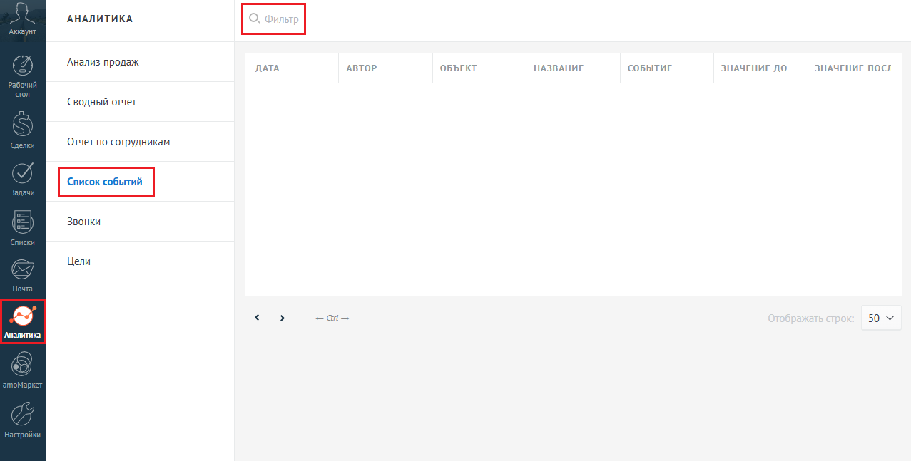
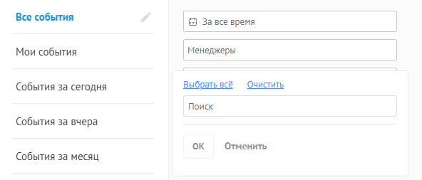
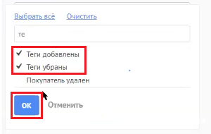
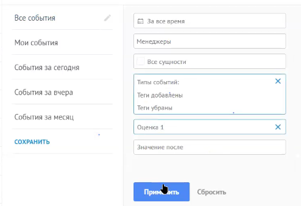
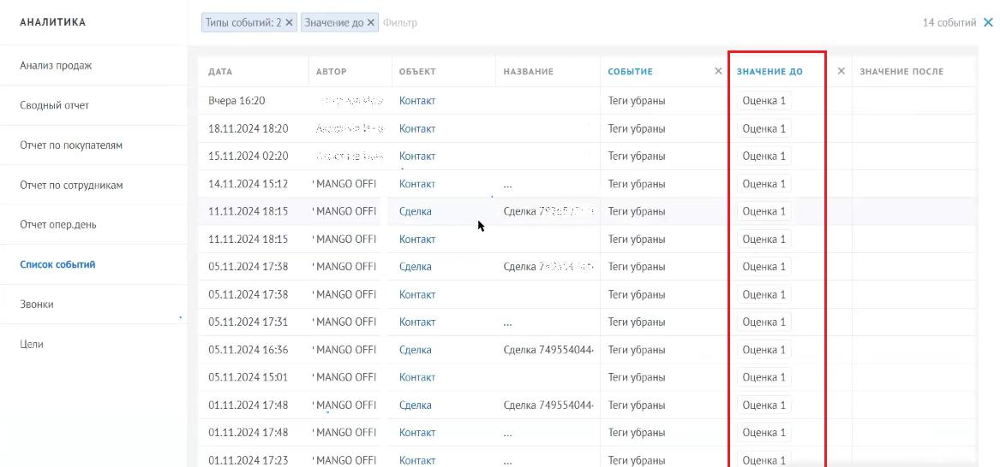
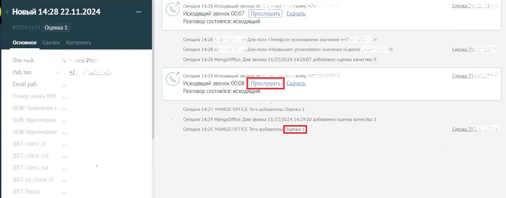

# Как посмотреть звонки с оценкой ниже, чем максимальный порог

> Трассировка: PDF §12 · сквозные стр. 119-122 · источники: ч.1 `kb/sources/integration_amocrm/Mango_office_integration_amoCRM.pdf` с.119-122.

Вы можете отфильтровать данные о звонках с оценкой качества, ниже чем установленный вами порог качества, при помощи стандартных инструментов amoCRM. Для этого, в amoCRM необходимо: 1. перейдите в раздел “Аналитика”, затем выберите пункт “Список событий” 2. нажмите на поле “Фильтр”;

> **Описание иллюстрации INTAMO-§12-1** (к §12 «Как посмотреть звонки с оценкой ниже, чем максимальный порог», стр. 119; 1277×647 px). Снимок экрана / схема.
> Относится к тексту руководства: «…ртных инструментов amoCRM. Для этого, в amoCRM необходимо: 1. перейдите в раздел “Аналитика”, затем выберите пункт “Список событий” 2. нажмите на поле “Фильтр”;».
> Текст на изображении (OCR, требует сверки): АНАЛИТИКА; Анализ продаж.; ДАТА; АВТОР; ОБЪЕКТ; НАЗВАНИЕ; СОБЫТИЕ; ЗНАЧЕНИЕ ДО; ЗНАЧЕНИЕ ПОС; Сводный отчет; Отчет no сотрудникам; Звонки; Цели; 50 v

3. в поле “Типы событий”. Будет открыто дополнительное поле; 4. введите слово “Тег” в поле “Поиск”; Интеграция Виртуальной АТС MANGO OFFICE и amoCRM | Версия от 25.08.2025

> **Описание иллюстрации INTAMO-§12-2** (к §12 «Как посмотреть звонки с оценкой ниже, чем максимальный порог», стр. 120; 592×253 px). Снимок экрана / схема.
> Относится к тексту руководства: «…2. нажмите на поле “Фильтр”; 3. в поле “Типы событий”. Будет открыто дополнительное поле; 4. введите слово “Тег” в поле “Поиск”;».
> Текст на изображении (OCR, требует сверки): Все события; | За все время; Мои события; | Менеджеры; Выбрать всё; Очистить; События за сегодня; Поиск; События за вчера; ок; Отменить; События за месяц

5. установите галочку в полях “Теги добавлены” и “Теги убраны” и нажмите кнопку “Ок”;

> **Описание иллюстрации INTAMO-§12-3** (к §12 «Как посмотреть звонки с оценкой ниже, чем максимальный порог», стр. 120; 300×190 px). Снимок экрана / схема.
> Относится к тексту руководства: «…5. установите галочку в полях “Теги добавлены” и “Теги убраны” и нажмите кнопку “Ок”;».
> Текст на изображении (OCR, требует сверки): Выбрать всё Очистить; У Tema; влены; У Теги убраны; Покупатель удален

6. в поле “Значение до” укажите значение “Оценка минимальная оценка звонка, выше которой звонки вас не интересуют”. Например, укажите значение “Оценка 1”; 7. нажмите кнопку “Применить”;

> **Описание иллюстрации INTAMO-§12-4** (к §12 «Как посмотреть звонки с оценкой ниже, чем максимальный порог», стр. 120; 494×338 px). Снимок экрана / схема.
> Относится к тексту руководства: «…кажите значение “Оценка минимальная оценка звонка, выше которой звонки вас не интересуют”. Например, укажите значение “Оценка 1”; 7. нажмите кнопку “Применить”;».
> Текст на изображении (OCR, требует сверки): Все события; Я За все время; Мои события; [ Менеджеры; Все сущности; (События за сегодня; Типы событий:; События за вчера; Теги добавлены; Теги убраны; (События за месяц; Оценка 1; СОХРАНИТЬ; Значение после

8. будут отфильтрованы данные о всех звонках, оценка которых меньше либо равна указанного вами порогу оценки качества. Применительно к примеру, будут отфильтрованы все звонки с оценкой качества 1 или ниже. Интеграция Виртуальной АТС MANGO OFFICE и amoCRM | Версия от 25.08.2025

> **Описание иллюстрации INTAMO-§12-5** (к §12 «Как посмотреть звонки с оценкой ниже, чем максимальный порог», стр. 121; 1167×546 px). Снимок экрана / схема.
> Относится к тексту руководства: «… оценка которых меньше либо равна указанного вами порогу оценки качества. Применительно к примеру, будут отфильтрованы все звонки с оценкой качества 1 или ниже.».
> Текст на изображении (OCR, требует сверки): АНАЛИТИКА; Типы событий: 2; Значение до Х |; 14 событий Ж; Анализ продаж; ДАТА; АВТОР; ОБЪЕКТ; НАЗВАНИЕ; СОБЫТИЕ; ЗНАЧЕНИЕ ДО; ЗНАЧЕНИЕ ПОСЛЕ; Вчера 16:20; Контакт; Теги убраны; Оценка 1; Сводный отчет; 18.11.2024 1820; Отчет no покупателям; 15.14.2024 02:20; Kowa; 14.11.2024 15:12; "MANGO OFFI; Tern убраны; Отчет по сотрудникам; 11.11.2024 1845; ‘Сделка; Сделка 75; Отчет опер.день; Список событий; 05.11.2024 17:38; Сделка; 05.11.2024 1738; Звонки; 05.11.2024 1734; Цели; 05.11.2024 16:36; Сделка 749554044.; 05.11.2024 1591; 01.11.2024 17:48; Сделка 749554044; ‘Оценка 1; 01.11.2024 1723; Tern у…

Чтобы прослушать запись разговора, которому поставлена та или оценка, нажмите на поле “Контакт” в нужной вам строке с данными звонка. Будет открыта карточка контакта, в которой вы можете прослушать запись разговора.

> **Описание иллюстрации INTAMO-§12-6** (к §12 «Как посмотреть звонки с оценкой ниже, чем максимальный порог», стр. 121; 1129×443 px). Снимок экрана / схема.
> Относится к тексту руководства: «…та или оценка, нажмите на поле “Контакт” в нужной вам строке с данными звонка. Будет открыта карточка контакта, в которой вы можете прослушать запись разговора.».
> Текст на изображении (OCR, требует сверки): fe; ка.; Новый 14:28 22.11.2024; Исходящий звонок 00:07; yu; разговор состоялся: исходящий; 'Оценка 1; Основное; 428; Ava non; Сати; 4:28 4; Aa non; Hasna; rawosnewo значение; ка; елка; Седня; 42; oOFTce: Для звонка 1; 2024145; енка качества:; Pi; conn >; on; san; Исходящий soowox 0098 [ ipocryusr |; Pasrosop состоялся: исходят; Gea; Cera; sauce; ги добавлены: Ou; roa; вост; Для звонка 41/2; 2024 14:29:20 добавлена оценка качеств: 1; roan 14; MANGO OF; eT; нов; ‘Snenea 25

Интеграция Виртуальной АТС MANGO OFFICE и amoCRM | Версия от 25.08.2025
