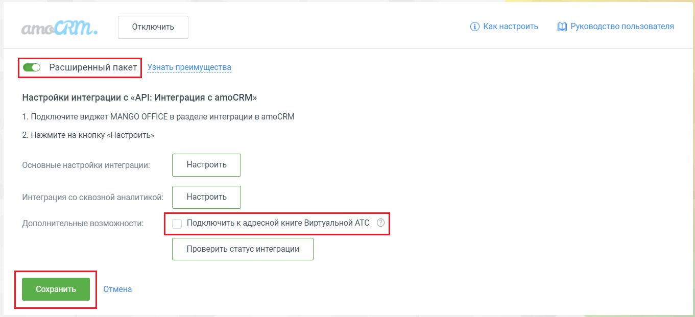
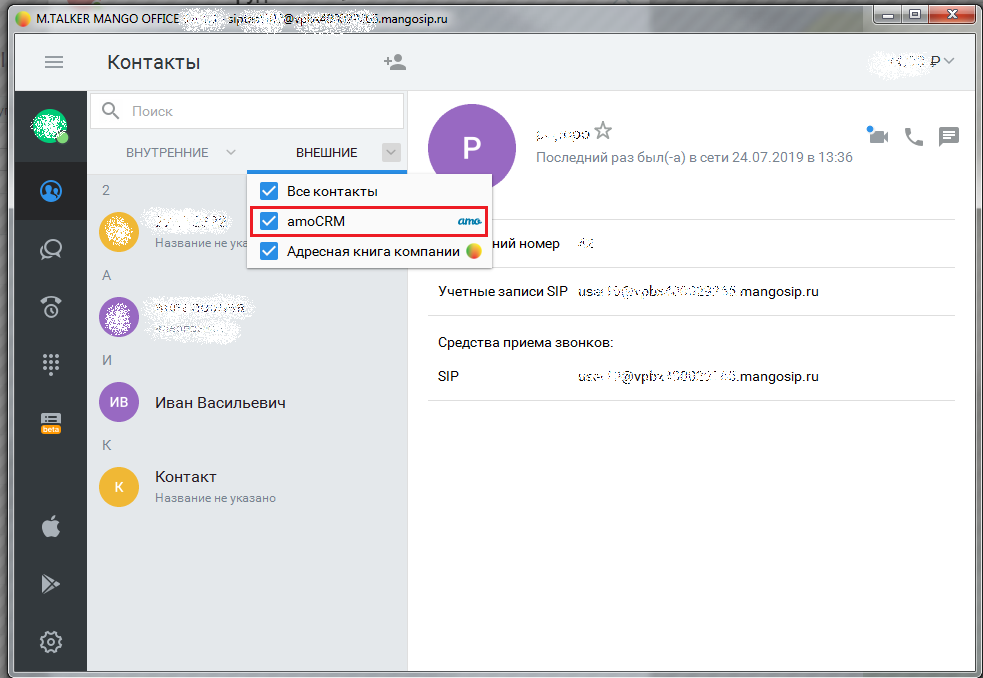
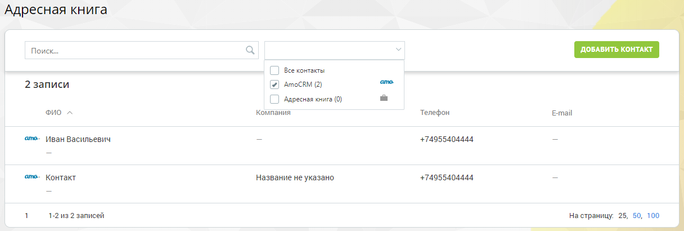
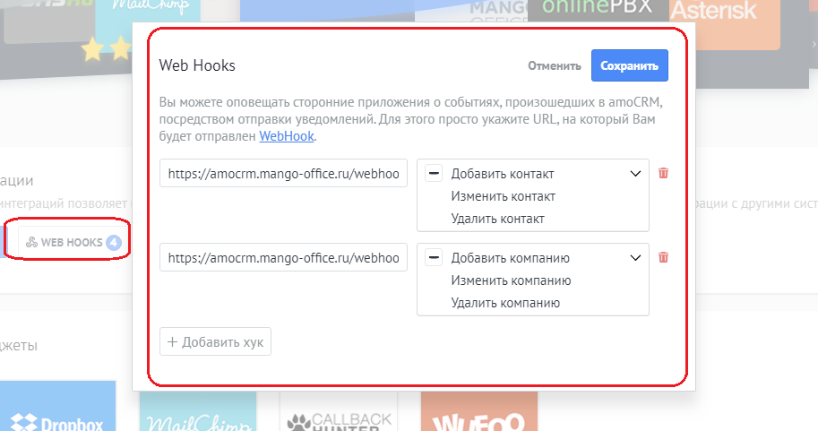

# 13. Интеграция с адресной книгой Виртуальной АТС

> Трассировка: PDF §13 · сквозные стр. 122-124 · источники: ч.1 `kb/sources/integration_amocrm/Mango_office_integration_amoCRM.pdf` с.122-124.

Если в Виртуальной АТС подключена услуга “Расширенные возможности интеграции”, то в Личном кабинете можно подключить amoCRM как внешний источник контактов в адресную книгу MANGO OFFICE. Вам нужно установить флаг “Подключить к адресной книге Виртуальной АТС” и нажать “Сохранить”. Начнется отображение контактов и компаний из amoCRM в адресной книге Виртуальной АТС:

> **Описание иллюстрации INTAMO-§13-1** (к §13 «Интеграция с адресной книгой Виртуальной АТС», стр. 122; 1361×621 px). Снимок экрана / схема.
> Относится к тексту руководства: «…ь флаг “Подключить к адресной книге Виртуальной АТС” и нажать “Сохранить”. Начнется отображение контактов и компаний из amoCRM в адресной книге Виртуальной АТС:».
> Текст на изображении (OCR, требует сверки): Отключить; @ какнастроить; (0 Руководство пользователя; CRM.; Узнать преимущества; Настройки интеграции с «API: Интеграция с amoCRM»; 1. Подключите виджет MANGO OFFICE в разделе интеграции в amoCRM; 2. Нажмите на кнопку «Настроить»; Основные настройки интеграции:; Интеграция со сквозной аналитикой:; Дополнительные возможности:; Подключить к адресной книге Виртуально; \TC

Контакты и компании из amoCRM будут видны: - в Личном кабинете Виртуальной АТС в разделе “Адресная книга”; - в Mango Talker; - в Контакт Центр MANGO OFFICE. В MANGO TALKER:

> **Описание иллюстрации INTAMO-§13-2** (к §13 «Интеграция с адресной книгой Виртуальной АТС», стр. 122; 983×678 px). Снимок экрана / схема.
> Относится к тексту руководства: «…омпании из amoCRM будут видны: - в Личном кабинете Виртуальной АТС в разделе “Адресная книга”; - в Mango Talker; - в Контакт Центр MANGO OFFICE. В MANGO TALKER:».
> Текст на изображении (OCR, требует сверки): © МТАКЕЕ Manco office >.; рее Depa; ae; By; Контакты; Q Пос; ed; ВНУТРЕННИЕ; ВНЕШНИЕ; Последний pas был(а) в сети 24.07.2019 в 13:36; Boe контакты; amoCRM; amo.; Название He ук; Адресная книга компании; @ "иЯномер 5; Yuernpie записи ЭР и; есь; 48 mangosip.ru; ‘Средства приема звонков:; SIP; use; “Dupre 192; Hy; mangosip.ru; Иван Васильевич; beta; Контакт; Название не указано,; iz

В Личном кабинете Виртуальной АТС: Интеграция Виртуальной АТС MANGO OFFICE и amoCRM | Версия от 25.08.2025

> **Описание иллюстрации INTAMO-§13-3** (к §13 «Интеграция с адресной книгой Виртуальной АТС», стр. 123; 1216×410 px). Снимок экрана / схема.
> Относится к тексту руководства: «…Личном кабинете Виртуальной АТС в разделе “Адресная книга”; - в Mango Talker; - в Контакт Центр MANGO OFFICE. В MANGO TALKER: В Личном кабинете Виртуальной АТС:».
> Текст на изображении (OCR, требует сверки): Адресная книга; Поиск.; [| Все контакты:; 2 записи; [2 AmocRM (2); } Адресная книга (0); ono ^; Компания; Телефон; Email; ато. Иван Васильевич; +74955404444.; ато. Контакт; Название не указано; 1-2 из 2 записей; На страницу; 25, 50, 100

При обновлении контактов/компаний в amoCRM, информация о них будет автоматически обновлена в адресной книге Виртуальной АТС. Это обеспечивается с помощью автоматически устанавливаемых WebHook в amoCRM:

> **Описание иллюстрации INTAMO-§13-4** (к §13 «Интеграция с адресной книгой Виртуальной АТС», стр. 123; 913×481 px). Снимок экрана / схема.
> Относится к тексту руководства: «…M, информация о них будет автоматически обновлена в адресной книге Виртуальной АТС. Это обеспечивается с помощью автоматически устанавливаемых WebHook в amoCRM:».
> Текст на изображении (OCR, требует сверки): vv; Wann; АМС,; Web Hooks; omen EY; Вы можете оповещать сторонние приложения о событиях, произошедших в amoCRM,; посредством отправки уведомлений. Для этого просто укажите URL, на который Вам; будет отправлен WebHook.; https://amocrm.mango-office.ru/webhoo; — Добавить контакт; ации; Изменить контакт; Удалить контакт; Добавить компанию; Изменить компанию; Удалить компанию; жеты; + Добавить хук; СА; ho; yy; BACK; АС

Адреса для web-hook: - контакт - https://amocrm.mango-office.ru/webhook/contact/ххх - компания - https://amocrm.mango-office.ru/webhook/company/ххх Если удалить web-hook, то информация о контактах и компаниях не будет автоматически обновляться в адресной книге Виртуальной АТС. Внимание! Можно просматривать карточку контакта/компании, но нельзя ее редактировать. Редактировать ее можно только из amoCRM Интеграция Виртуальной АТС MANGO OFFICE и amoCRM | Версия от 25.08.2025
