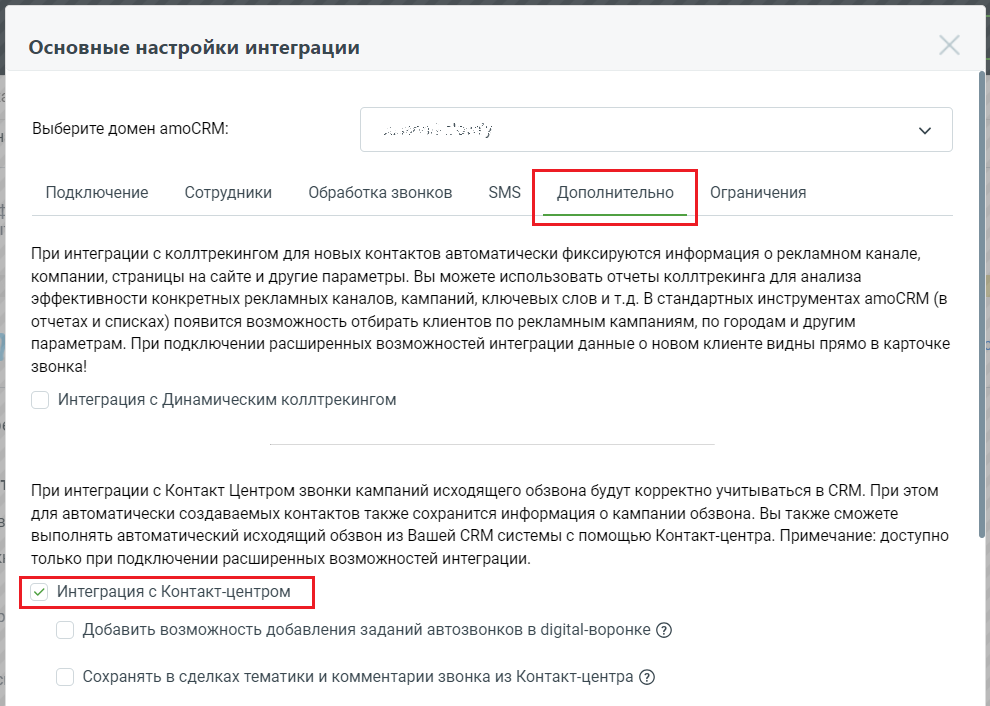
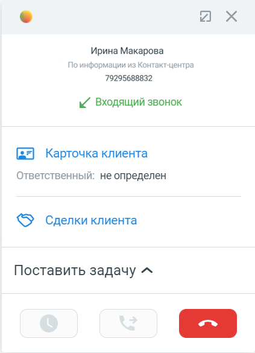

# 14.1. Учет кампаний исходящего обзвона в amoCRM

> Трассировка: PDF §14.1 · сквозные стр. 124-125 · источники: ч.1 `kb/sources/integration_amocrm/Mango_office_integration_amoCRM.pdf` с.124-125.

Если Вы подключили Контакт Центр MANGO OFFICE (далее по тексту – КЦ) к Виртуальной АТС, то в рамках интеграции с amoCRM будет доступна дополнительная возможность: учет кампаний исходящего обзвона в amoCRM. То есть, звонки, выполненные в рамках кампаний исходящего обзвона КЦ, обрабатываются (с показом карточки) и фиксируются в amoCRM только при включенной опции “Интеграция с Контакт-центром”.

> **Описание иллюстрации INTAMO-§14.1-1** (к §14.1 «Учет кампаний исходящего обзвона в amoCRM», стр. 124; 990×706 px). Снимок экрана / схема.
> Относится к тексту руководства: «… в рамках кампаний исходящего обзвона КЦ, обрабатываются (с показом карточки) и фиксируются в amoCRM только при включенной опции “Интеграция с Контакт-центром”.».
> Текст на изображении (OCR, требует сверки): Основные настройки интеграции; Выберите домен amoCRM:; Подключение; Сотрудники; Обработка звонков; SMS; Дополнительно; Ограничения; При интеграции с коллтрекингом для новых контактов автоматически фиксируются информация о рекламном канале,; компании, страницы на сайте и другие параметры. Вы можете использовать отчеты коллтрекинга для анализа; эффективности конкретных рекламных каналов, кампаний, ключевых слов и т.д. В стандартных инструментах amoCRM (в; ‘отчетах и списках) появится возможность отбирать клиентов по рекламным кампаниям, по городам и другим; параметрам. При подключении расширенны…

Кроме того, если запущена кампания исходящего обзвона из КЦ, то при входящем звонке будет показана информация о контакте из настроек кампании:

> **Описание иллюстрации INTAMO-§14.1-2** (к §14.1 «Учет кампаний исходящего обзвона в amoCRM», стр. 124; 423×585 px). Снимок экрана / схема.
> Относится к тексту руководства: «…Контакт-центром”. Кроме того, если запущена кампания исходящего обзвона из КЦ, то при входящем звонке будет показана информация о контакте из настроек кампании:».
> Текст на изображении (OCR, требует сверки): vA; Ирина Макарова; По информации из Контакт-центра; 79295688832; ы/ Входящий звонок; (= Карточка клиента; Ответственный: не определен; <5) Сделки клиента; Поставить задачу ^

Если контакт создается в amoCRM автоматически (согласно настройкам виджета) или создается из карточки звонка, то в контакте автоматически сохранятся данные:

| Поле в amoCRM | Описание |
| --- | --- |

Интеграция Виртуальной АТС MANGO OFFICE и amoCRM | Версия от 25.08.2025

| ЦОВ: Привлечен кампанией исходящего обзвона | Имя кампании |
| --- | --- |
| ЦОВ: Идентификатор кампании исходящего обзвона | Уникальный идентификатор кампании |
| ЦОВ: Идентификатор Клиента | Уникальный идентификатор кампании из кампании |
