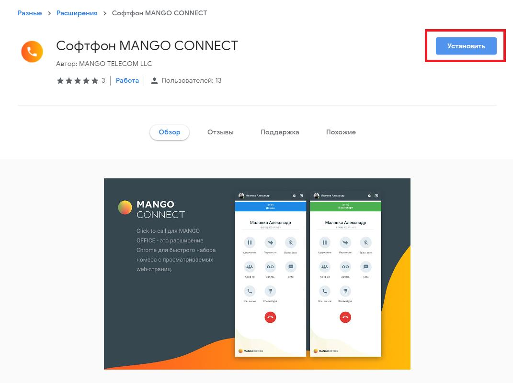
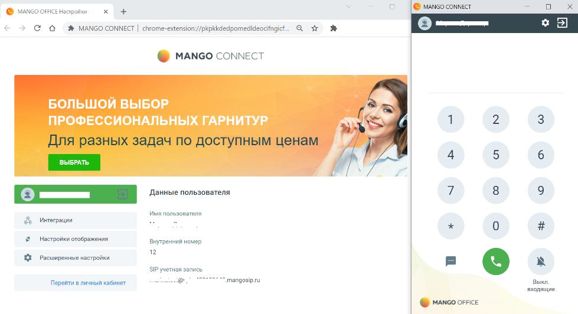
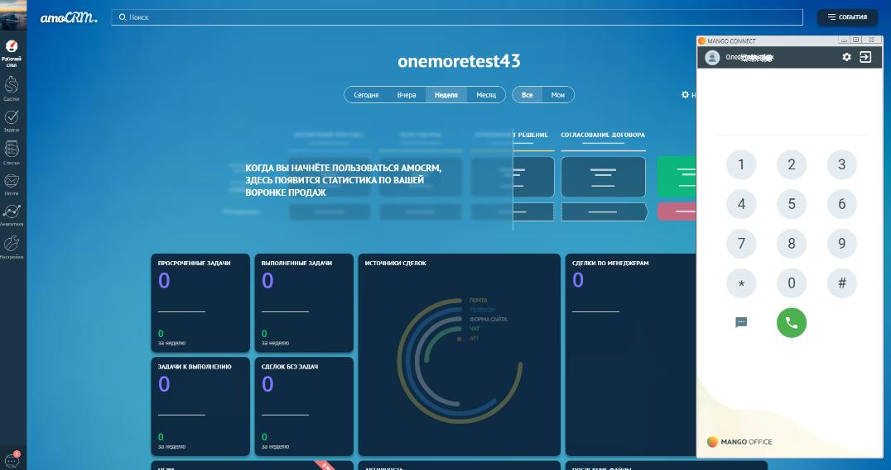
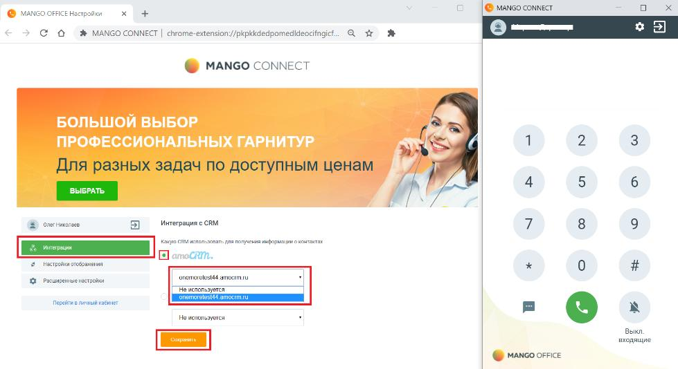

# 15.2. Установка и первый запуск работы

> Трассировка: PDF §15.2 · сквозные стр. 140-143 · источники: ч.1 `kb/sources/integration_amocrm/Mango_office_integration_amoCRM.pdf` с.140-143.

Установку расширения необходимо выполнить каждому сотруднику. 1) нажать “Установить”:

> **Описание иллюстрации INTAMO-§15.2-1** (к §15.2 «Установка и первый запуск работы», стр. 140; 1071×801 px). Снимок экрана / схема.
> Относится к тексту руководства: «…15.2 Установка и первый запуск работы Установку расширения необходимо выполнить каждому сотруднику. 1) нажать “Установить”:».
> Текст на изображении (OCR, требует сверки): Разные > Расширения > Софтфон MANGO CONNECT; Софтфон MANGO CONNECT; Автор: MANGO TELECOM LLC; & Пользователей: 13; ЖЖЖж ЖЗ | Работа; Обзор; Отзывы; Поддержка; Похожие; MANGO; CONNEC; Manna Алеко; Mannan Алеконако; Hl an; ea; Gaerne

Интеграция Виртуальной АТС MANGO OFFICE и amoCRM | Версия от 25.08.2025 2) подтвердить разрешение на установку:

> **Описание иллюстрации INTAMO-§15.2-2** (к §15.2 «Установка и первый запуск работы», стр. 141; 456×218 px). Снимок экрана / схема.
> Относится к тексту руководства: «…2) подтвердить разрешение на установку:».
> Текст на изображении (OCR, требует сверки): @ Установить "Софтфон MANGO CONNECT"?; Разрешения:; Просмотр и изменение ваших данных на посещаемых сайтах; Показывать уведомления

3) ввести данные SIP ID сотрудника и пароля; 4) нажать на кнопку “Войти”:

> **Описание иллюстрации INTAMO-§15.2-3** (к §15.2 «Установка и первый запуск работы», стр. 141; 1515×1075 px). Снимок экрана / схема.
> Относится к тексту руководства: «…2) подтвердить разрешение на установку: 3) ввести данные SIP ID сотрудника и пароля; 4) нажать на кнопку “Войти”:».
> Текст на изображении (OCR, требует сверки): 8 MANGO CONNECT; 2s; 400017574/members/index/autoopen/11249149; Добро пожаловать в Mango Connect; Для использования приложения введите данные; вашей учетной записи; АВЕ АИ; olegat; mangosip.ru; Учетная запись SIP; Закреплена 2a; ия; ‘сотрудником; Ц Oner; Неверно указан логин или пароль; 51Р-адрес; Claes; Пароль; ировать HC; ый; Расширенные настройки у; х Удалить учетную запись; Отменить; (©) МАМСО orice

5) после успешной авторизации пользователя будут показаны настройки расширения и окно софт фона: Интеграция Виртуальной АТС MANGO OFFICE и amoCRM | Версия от 25.08.2025

> **Описание иллюстрации INTAMO-§15.2-4** (к §15.2 «Установка и первый запуск работы», стр. 142; 979×532 px). Снимок экрана / схема.
> Относится к тексту руководства: «…данные SIP ID сотрудника и пароля; 4) нажать на кнопку “Войти”: 5) после успешной авторизации пользователя будут показаны настройки расширения и окно софт фона:».
> Текст на изображении (OCR, требует сверки): @ Manco oFsice нопройки; © Manco CONNECT; < > © © %® MANGO CONNECT | chrome-extension//pkpkkdedpomedideocifngict. Qtr №; @ Manco connect; БОЛЬШОЙ ВЫБОР; ПРОФЕССИОНАЛЬНЫХ ГАРНИТУР; ВЫБРАТЬ; Данные пользователя; имя пользователя; До инерции; настройки отображения; Внутренний номер; 2 Pacumperne настройки; SIP учетная запись; Перейти в личный кабинет; smangosip.u; sen,; ona; @ mance oFnce

6) после авторизации уже можно звонить и принимать звонки:

> **Описание иллюстрации INTAMO-§15.2-5** (к §15.2 «Установка и первый запуск работы», стр. 142; 1076×569 px). Снимок экрана / схема.
> Относится к тексту руководства: «…6) после авторизации уже можно звонить и принимать звонки:».
> Текст на изображении (OCR, требует сверки): Сы; = cone; amoCRM.; rest; onemoretest43; hepa; едем ео; Peace cornacounin noroword; КОГДА ВЫ НАЧНЕТЕ ПОЛЬЗОВАТЬСЯ AMOCRM,; ЗДЕСЬ ПОЯВИТСЯ СТАТИСТИКА ПО ВАШЕЙ; BOPOHKE ПРОДАЖ,; rmoconraasr wt; uname aye; roar сделок; asm no Menem; aaa x выполномо; aro 2A; RE

7) в настройках расширения указать ваш домен в amoCRM и нажать кнопку “Сохранить”:

> **Описание иллюстрации INTAMO-§15.2-6** (к §15.2 «Установка и первый запуск работы», стр. 142; 979×534 px). Снимок экрана / схема.
> Относится к тексту руководства: «…6) после авторизации уже можно звонить и принимать звонки: 7) в настройках расширения указать ваш домен в amoCRM и нажать кнопку “Сохранить”:».
> Текст на изображении (OCR, требует сверки): © Manco соммест; тройки; С о о % MANGOCONNECT | chrome-extension’//pkpkkdedpomedideocitngic; @ MANGo CONNECT; БОЛЬШОЙ ВЫБОР; ПРОФЕССИОНАЛЬНЫХ ГАРНИТУР; ro; ВЫБРАТЬ; Интеграция САМ; Ат; a Toon; saa; ara; eons; Номос; Выкл; sroqaune; @ mance oFce

8) Софтфон MANGO CONNECT настроен на работу с amoCRM. Интеграция Виртуальной АТС MANGO OFFICE и amoCRM | Версия от 25.08.2025
