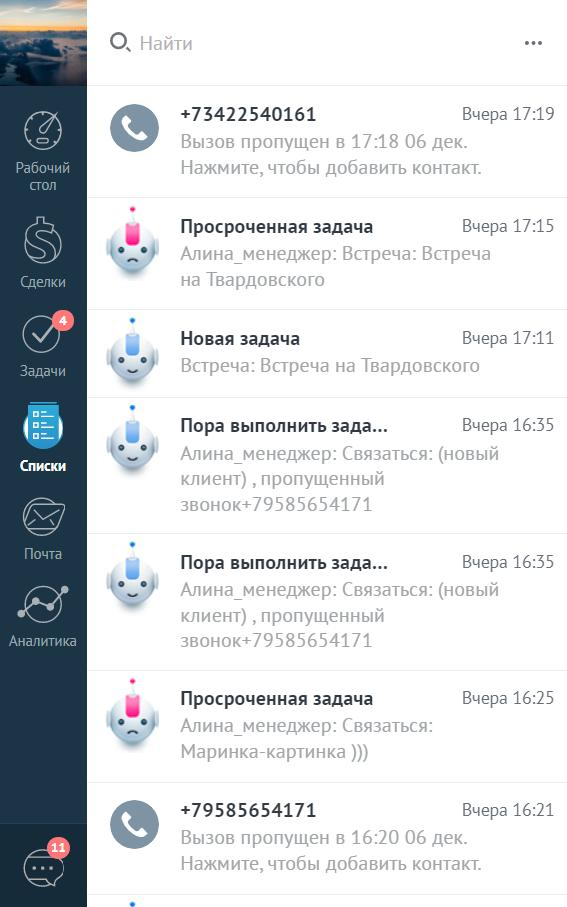

# 17.1. Обзор

> Трассировка: PDF §17.1 · сквозные стр. 145-146 · источники: ч.1 `kb/sources/integration_amocrm/Mango_office_integration_amoCRM.pdf` с.145-146.

Можно самостоятельно устранить некоторые ошибки, связанные с интеграцией amoCRM и виртуальной АТС MANGO OFFICE, или отправить заявку на исправление этих ошибок в службу поддержки Клиентов MANGO OFFICE. При возникновении ошибки, в левом нижнем углу экрана amoCRM появляется специальное уведомление. Эти уведомления отмечаются заголовком Нажать для справки. Внимание! Это уведомление отображается на экране в течение 5 секунд.

> **Описание иллюстрации INTAMO-§17.1-1** (к §17.1 «Обзор», стр. 145; 445×80 px). Снимок экрана / схема.
> Относится к тексту руководства: «…является специальное уведомление. Эти уведомления отмечаются заголовком Нажать для справки. Внимание! Это уведомление отображается на экране в течение 5 секунд.».
> Текст на изображении (OCR, требует сверки): Нажмите для справки

Затем, специальное уведомление об ошибке можно найти в области уведомлений amoCRM:

> **Описание иллюстрации INTAMO-§17.1-2** (к §17.1 «Обзор», стр. 145; 567×907 px). Снимок экрана / схема.
> Относится к тексту руководства: «…справки. Внимание! Это уведомление отображается на экране в течение 5 секунд. Затем, специальное уведомление об ошибке можно найти в области уведомлений amoCRM:».
> Текст на изображении (OCR, требует сверки): eee; Вчера 17:19; +7 ны; Вчера 17:15; Просроченная задача; Новая задача; Buepa 17:11; Пора выполнить зада; ми 16:35; Списки; Вчера 16:35; ee; Buepa 16:25; Проероченная задача; Vas; Buepa 16:21; РВВ; 11

Текст каждого уведомления содержит краткое описание и код ошибки. При нажатии на уведомление, в зависимости от ошибки, будет открыта новая вкладка браузера, в которой показано подробное описание варианта решения проблемы ИЛИ будет открыта страница “Поддержка” сайта www.mango-office.ru Интеграция Виртуальной АТС MANGO OFFICE и amoCRM | Версия от 25.08.2025
