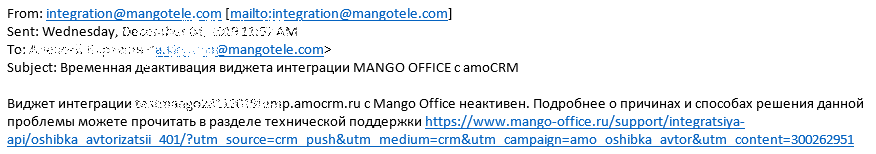

# 17.4. Пример уведомления о блокировке виджета

> Трассировка: PDF §17.4 · сквозные стр. 148 · источники: ч.1 `kb/sources/integration_amocrm/Mango_office_integration_amoCRM.pdf` с.148.

Если ваш виджет интеграции был заблокирован по той или иной причине, то сервис интеграции отправит вам специальное электронное письмо об этом, например, такое:

> **Описание иллюстрации INTAMO-§17.4-1** (к §17.4 «Пример уведомления о блокировке виджета», стр. 148; 876×154 px). Снимок экрана / схема.
> Относится к тексту руководства: «… Если ваш виджет интеграции был заблокирован по той или иной причине, то сервис интеграции отправит вам специальное электронное письмо об этом, например, такое:».
> Текст на изображении (OCR, требует сверки): From: integration@mangotelk; m [mailto:integration@mangotele.com]; 322; Sent: Wednesday, Ge.; Ty AN; @mangotele.com>; Subject: Временная деактивация виджета интеграции MANGO OFFICE camoCRM; Ye); Виджет интеграции 7х; Бр; p.amocrm.ru с Mango Office неактивен. Подробнее о причинах и способах решения данной; проблемы можете прочитать в разделе технической поддержки https://www.mango-office.ru/support/integratsiya-; pi/oshibka а\мограей 401/?ит source=crm_ push&utm medium=crm&utm campaign=amo oshibka avtor&utm content=300262951

В письме указан домен заблокированного виджета и ссылка на страницу “Поддержка” сайта www.mango-office.ru, нажав на которую, будет открыта страница с описанием причины блокировки и способах решения данной проблемы.
