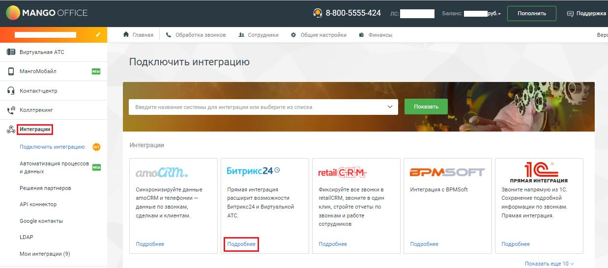
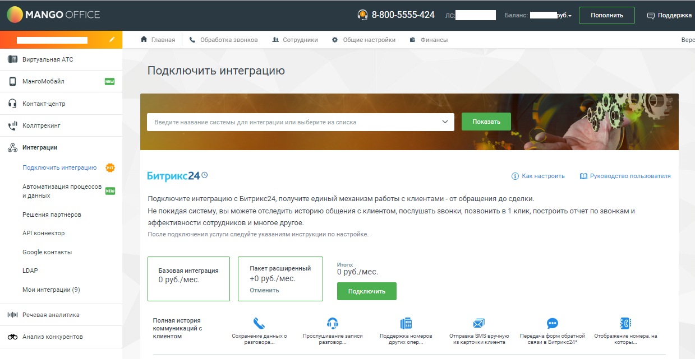
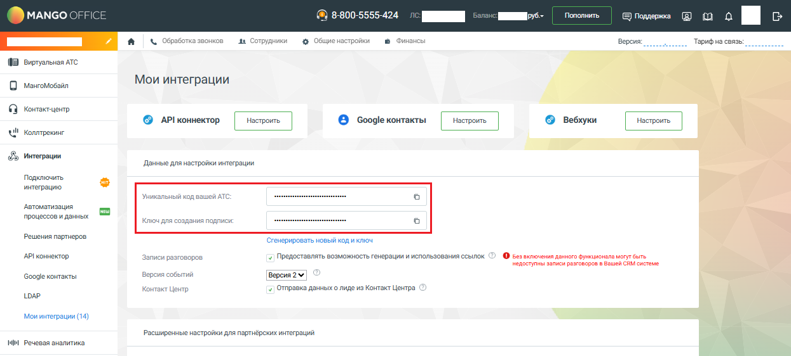
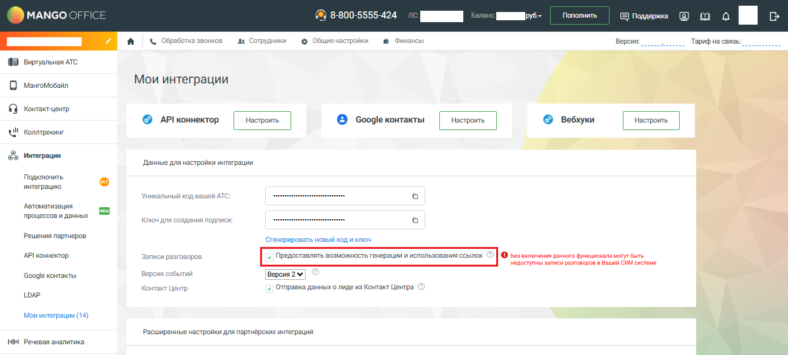

# Шаг 3. Настройка Виртуальной АТС. Выбор пакета интеграции

> Трассировка: PDF §1.1 · сквозные стр. 5-7 · источники: ч.1 `kb/sources/integration-bitrix24/Mango_office_integration_Bitrix24.pdf` с.5-7.

Это нужно сделать, чтобы Виртуальная АТС MANGO OFFICE могла передавать в ваш Битрикс24 данные о звонках. Выполните следующие действия: 1) войдите в Личный кабинет Виртуальной АТС; 2) перейдите в раздел "Интеграции"; 3) нажмите "Подробнее" в блоке "Битрикс24": Интеграция Виртуальной АТС MANGO OFFICE и Битрикс24 | Версия от 03.03.2026

> **Описание иллюстрации INTB24-§1.1-1** (к §1.1 «Шаг 3. Настройка Виртуальной АТС. Выбор пакета интеграции», стр. 6; 1237×546 px). Снимок экрана / схема.
> Относится к тексту руководства: «…нках. Выполните следующие действия: 1) войдите в Личный кабинет Виртуальной АТС; 2) перейдите в раздел "Интеграции"; 3) нажмите "Подробнее" в блоке "Битрикс24":».
> Текст на изображении (OCR, требует сверки): MANGO; FFI; 8-800-5555-424; ино; Пополнить; =) Поддержка; Я Главная; \: обработка звонков; AL Сотрудники; june Hac; © Финансы; Вер; WB виртуальная АТС; Подключить интеграцию; О мамомовайл; an; Показать; Интеграции; Автоматизация проце; иданных; CRM.; Битрикс24©; retail RIM;; BPMs; ПРЯМАЯ ИНТЕГРАЦИЯ; Решения партнеров; Синхронизируйте данные; ‘Фиксируйте все эвонкив; интеграция с BPMSoft; Звоните напрямую из 1C.; атоСВМ и телефонии —; расширит возможности; retallCRM, звоните в один; ‘Сохранение подробной; API коннектор; данные no звонкам,; Битрикс; и Виртуальной; клик, стройте отчеты по; информ…

4) подключите услугу "Базовая интеграция". А если вы хотите получить расширенные возможности интеграции выберите также "Расширенная интеграция";

> **Описание иллюстрации INTB24-§1.1-2** (к §1.1 «Шаг 3. Настройка Виртуальной АТС. Выбор пакета интеграции», стр. 6; 1239×641 px). Снимок экрана / схема.
> Относится к тексту руководства: «…4) подключите услугу "Базовая интеграция". А если вы хотите получить расширенные возможности интеграции выберите также "Расширенная интеграция";».
> Текст на изображении (OCR, требует сверки): MANGO OFF; 8-800-5555-424; ee; Пополнить; оддержка!; Я гпавная; \. Обработка звонков; AL Сотрудники; Общие настройки; Финансы; Верх; WW виртувльная ATC; Подключить интеграцию; О мамомовайл; @ vowrexsuenro; are; Ul колени; Введите название системы для интеграции или выберитеи:; 3 списка; ES интеграции; Подключить интеграцию Op; Битрикс249; © как настроить; | Руководство пользователя; Автоматизация процессов и; иданных; Подключите интеграцию с Битрикс24, получите единый механизм работы с клиентами - от обращения до сделки.; Решения партнеров; He покидая систему, вы можете отследить историю общен…

Далее, будет автоматически открыта страница "Мои интеграции" Личного кабинета MANGO OFFICE. Важно. Не закрывайте страницу "Мои интеграции", вам понадобятся значения параметров "Уникальный код вашей АТС" и "Ключ для создания подписи" при настройке приложения интеграции в Битрикс24: Интеграция Виртуальной АТС MANGO OFFICE и Битрикс24 | Версия от 03.03.2026

> **Описание иллюстрации INTB24-§1.1-3** (к §1.1 «Шаг 3. Настройка Виртуальной АТС. Выбор пакета интеграции», стр. 7; 1245×562 px). Снимок экрана / схема.
> Относится к тексту руководства: «… "Мои интеграции", вам понадобятся значения параметров "Уникальный код вашей АТС" и "Ключ для создания подписи" при настройке приложения интеграции в Битрикс24:».
> Текст на изображении (OCR, требует сверки): Пополнить; MANGO; FICE; @ 8-800-5555-424; me a; Фина; сы; © обработка; „ва Сотрудники; + Общие настройки; Версия:; Тарифна связь; Виртуальная ATC; мангомобайл; Мои интеграции; Контакт-центр,; © АР!коннектор; © Google контакты; © вебхуки; ul; Коллтрекинг; Данные для настройки интеграции.; Подключить; интеграцию; on; Уникальный код вашей ATC:; Автоматизация; процессов и данных; Ключдля создания подлиси:; Решения партнеров; Стенерировать новый код иключ; APL коннектор; Записи разговоров.; -7 Предоставлять возможность генерации и использования ссылок.; © ве вилоения дечного бунеиснала моутвыть; не…

Важно. Если вы используете сервис "Запись разговоров" Виртуальной АТС, но НЕ хотите, чтобы записи попадали в Битрикс24, то ВЫКЛЮЧИТЕ флаг "Предоставлять возможность генерации и использования ссылок" и нажмите кнопку "Сохранить", которая расположена внизу страницы "Мои интеграции":

> **Описание иллюстрации INTB24-§1.1-4** (к §1.1 «Шаг 3. Настройка Виртуальной АТС. Выбор пакета интеграции», стр. 7; 1245×562 px). Снимок экрана / схема.
> Относится к тексту руководства: «…о ВЫКЛЮЧИТЕ флаг "Предоставлять возможность генерации и использования ссылок" и нажмите кнопку "Сохранить", которая расположена внизу страницы "Мои интеграции":».
> Текст на изображении (OCR, требует сверки): Пополнить; MANGO; FICE; @ 8-800-5555-424; me a; Фина; сы; © обработка; „ва Сотрудники; + Общие настройки; Версия:; Тарифна связь; Виртуальная ATC; мангомобайл; Мои интеграции; Контакт-центр,; © АР!коннектор; © Google контакты; © вебхуки; ul; Коллтрекинг; Данные для настройки интеграции.; Подключить; интеграцию; on; Уникальный код вашей ATC:; Автоматизация; процессов и данных; Ключдля создания подлиси:; Решения партнеров; ‘сгенерировать новый код иключ; APL коннектор; Записи разговоров.; © ве вилоения дечного бунеиснала моутвыть; недоступны записи разговоров Вашей CRM састеме; Google контакты; …
