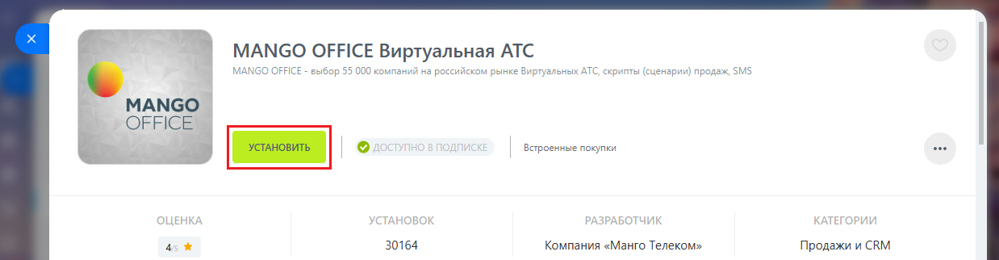
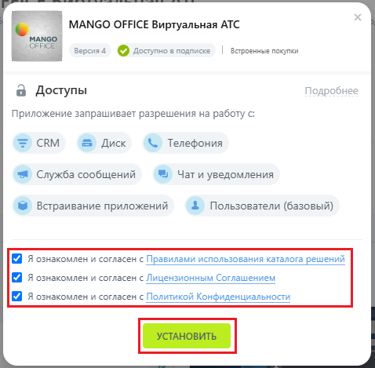
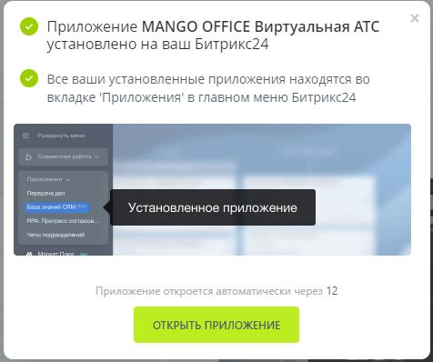
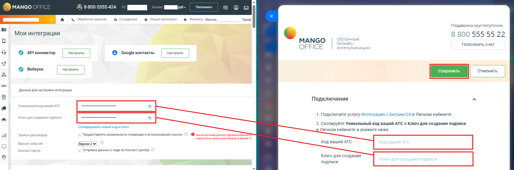

# Шаг 4. Установка приложения интеграции в Битрикс24

> Трассировка: PDF §1.1 · сквозные стр. 7-10 · источники: ч.1 `kb/sources/integration-bitrix24/Mango_office_integration_Bitrix24.pdf` с.7-10.

Чтобы в вашем Битрикс24 установить приложение интеграции MANGO OFFICE, выполните: 1) войдите в ваш Битрикс24 под пользователем с правами администратора; 2) перейдите в раздел "Приложение –> Маркетплейс"; 3) перейдите в раздел "Интеграции" или в поле "Поиск" введите MANGO OFFICE и нажмите кнопку "Enter" на клавиатуре; 4) нажмите на строку с данными приложения "MANGO OFFICE Виртуальная АТС": Интеграция Виртуальной АТС MANGO OFFICE и Битрикс24 | Версия от 03.03.2026

> **Описание иллюстрации INTB24-§1.1-1** (к §1.1 «Шаг 4. Установка приложения интеграции в Битрикс24», стр. 8; 1241×238 px). Снимок экрана / схема.
> Относится к тексту руководства: «…"Интеграции" или в поле "Поиск" введите MANGO OFFICE и нажмите кнопку "Enter" на клавиатуре; 4) нажмите на строку с данными приложения "MANGO OFFICE Виртуальная».
> Текст на изображении (OCR, требует сверки): Маркетплейс; 4440+ приложений; Бесплатные решения; По релевантности; Платные решения; Не нашли; MANGO OFFICE Виртуальная АТС Подписка; Премиум; sco; cg; подходящего; kkk; вэ); 30164; решения?

5) нажмите на кнопку "Установить":

> **Описание иллюстрации INTB24-§1.1-2** (к §1.1 «Шаг 4. Установка приложения интеграции в Битрикс24», стр. 8; 1238×322 px). Снимок экрана / схема.
> Относится к тексту руководства: «…5) нажмите на кнопку "Установить":».
> Текст на изображении (OCR, требует сверки): MANGO OFFICE Виртуальная АТС; MANGO OFFICE - выбор 55 000 компаний на российском рынке Виртуальных ATC, скрипты (сценарии) продаж, SMS; МАМСО; OFFICE; Встроенные покупки; as; 4s; 30164; Компания «Манго Телеком»; Продажи и CRM

6) в открывшемся окне обязательно установите флаги: - Я ознакомлен с Правилами использования каталога решений; - Я ознакомлен и согласен с лицензионным соглашением; - Я ознакомлен и согласен с политикой конфиденциальности; 7) нажмите на кнопку "Установить":

> **Описание иллюстрации INTB24-§1.1-3** (к §1.1 «Шаг 4. Установка приложения интеграции в Битрикс24», стр. 8; 478×469 px). Снимок экрана / схема.
> Относится к тексту руководства: «…лога решений; - Я ознакомлен и согласен с лицензионным соглашением; - Я ознакомлен и согласен с политикой конфиденциальности; 7) нажмите на кнопку "Установить":».
> Текст на изображении (OCR, требует сверки): MANGO OFFICE Виртуальная АТС; CE; Версия 4 © Доступно в подписке | Встроенные покупки; a Доступы; Подробнее; Приложение запрашивает разрешения на работу с:; © Телефония; я Служба сообщений; > Чати уведомления; Га Встраивание приложений; @ Пользователи (базовый); Я ознакомлен и согласен с Правилами использования каталога решений; Я ознакомлен и согласен с Лицензионным Соглашением; Я ознакомлен и согласен с Политикой Конфиденциальности

8) приложение будет установлено в ваш Битрикс24, об этому будет выдано уведомление: Интеграция Виртуальной АТС MANGO OFFICE и Битрикс24 | Версия от 03.03.2026

> **Описание иллюстрации INTB24-§1.1-4** (к §1.1 «Шаг 4. Установка приложения интеграции в Битрикс24», стр. 9; 476×398 px). Снимок экрана / схема.
> Относится к тексту руководства: «… согласен с политикой конфиденциальности; 7) нажмите на кнопку "Установить": 8) приложение будет установлено в ваш Битрикс24, об этому будет выдано уведомление:».
> Текст на изображении (OCR, требует сверки): © Приложение MANGO OFFICE Виртуальная ATC; установлено Ha ваш Битрикс24; © Все ваши установленные приложения находятся во; вкладке 'Приложения' в главном меню Битрикс24; av; роса; Перерлчв,; Установленное приложение; FPA Прогресс cornacou; Mane подржзуюяиний; 12

9) после показа уведомления, будет открыта форма для подключения вашего Битрикс24 к вашей Виртуальной АТС:

> **Описание иллюстрации INTB24-§1.1-5** (к §1.1 «Шаг 4. Установка приложения интеграции в Битрикс24», стр. 9; 847×853 px). Снимок экрана / схема.
> Относится к тексту руководства: «…9) после показа уведомления, будет открыта форма для подключения вашего Битрикс24 к вашей Виртуальной АТС:».
> Текст на изображении (OCR, требует сверки): Поддержка круглосуточно; 8 800 555 55 22; MANGO; облачные; бизнес-; Пополнить счет; OFFICE; коммуникации; Подключение; 1. Подключите услугу Интеграция с Битрикс24 в Личном кабинете.; 2. Скопируйте Уникальный код вашей АТС и Ключ для создания подписи; в Личном кабинете и укажите ниже.; Код вашей АТС; Ключ для создания; подписи; 3. Пропишите внутренние номера сотрудников из личного кабинета MANGO; OFFICE в блоке "Сотрудники" (отобразится после сохранения).; 4. Для совершения исходящих звонков прямо из Битрикс24 вам потребуется; софтфон на компьютер, $1р-телефон либо мобильный.; Остались вопросы?…

10) укажите значения "Уникальный код вашей АТС" и "Ключ для создания подписи", скопированные из Личного кабинета; Интеграция Виртуальной АТС MANGO OFFICE и Битрикс24 | Версия от 03.03.2026 11) нажмите на кнопку "Сохранить" (зеленая кнопка, в верхней части формы настройки приложения):

> **Описание иллюстрации INTB24-§1.1-6** (к §1.1 «Шаг 4. Установка приложения интеграции в Битрикс24», стр. 10; 1687×559 px). Снимок экрана / схема.
> Относится к тексту руководства: «…11) нажмите на кнопку "Сохранить" (зеленая кнопка, в верхней части формы настройки приложения):».
> Текст на изображении (OCR, требует сверки): MANGO OFFICE; 8-800-5555-424; iz ШИ о; Пополнить; в ш; @ | & обработан; Ko; „ва Сотрудники; & Общие настройки; # Финансы Версия:; Тариф; Поддержка круглосуточно; Мои интеграции; 8 800 555 55 22; QO; MANGO; облачные; бизнес-; Пополнить счет; OFFICE; коммуникации; © API KonHeKtop; {© Google контакты; wl; © вебхуки; ны; Данные для настройки интеграции; Подключение; Уникальный код вашей АТС:; 1. Подключите услугу Интеграция с Битрикс24 в Личном кабинете.; Ключ для создания подписи; 2. Скопируйте Уникальный код вашей АТС и Ключ для создания подписи; ‘Стенерировать новый код иключ; в Личном кабинете…

После сохранения кода и ключа, в приложении открывается доступ к настройкам, в зависимости от вашего пакета интеграции.
