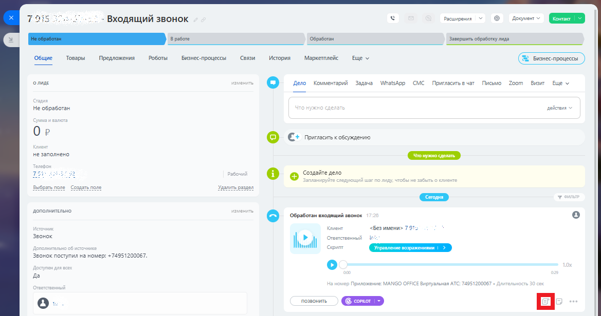
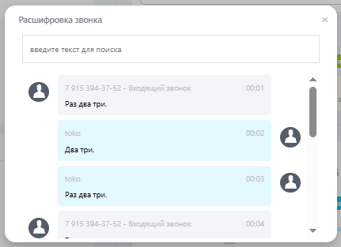

# Как посмотреть распознанный текст

> Трассировка: PDF §2.10 · сквозные стр. 86-87 · источники: ч.1 `kb/sources/integration-bitrix24/Mango_office_integration_Bitrix24.pdf` с.86-87.

Чтобы вывести на экран распознанный текст того или иного разговора, в Битрикс24 следует: 1) открыть лид; 2) кликнуть на ссылку "Показать расшифровку звонка":

> **Описание иллюстрации INTB24-§2.10-1** (к §2.10 «Как посмотреть распознанный текст», стр. 86; 1169×617 px). Снимок экрана / схема.
> Относится к тексту руководства: «…ст Чтобы вывести на экран распознанный текст того или иного разговора, в Битрикс24 следует: 1) открыть лид; 2) кликнуть на ссылку "Показать расшифровку звонка":».
> Текст на изображении (OCR, требует сверки): Расширения; - Входящий звонок; о meer; обработан; Завершить обработку лида; Общие; Товары; Предложения; Роботы; Бизнес процессы; cern; ‘история,; Маркетплейс; Ewe v; oma; Дело; Комментарий; Banaue; WhatsApp СМС Пригласить в var Письмо Zoom; Визит Ewe у; He обработан; дейстия; Ор; © C+ rowman scecmsome; не заполнено; ren; conaare; Сегодня; дополнительно; © xr cs oe; Kean; <Безимени> 7915; Звонок; `отоеттевиный; рип; ee; Звонок поступил на номер: +74951200067.; да; Приложение MANGO ©; ирхувльная ATC: 74951200067; ‘позвонить

3) посмотреть текст Речевой аналитики:

> **Описание иллюстрации INTB24-§2.10-2** (к §2.10 «Как посмотреть распознанный текст», стр. 86; 431×313 px). Снимок экрана / схема.
> Относится к тексту руководства: «…текст того или иного разговора, в Битрикс24 следует: 1) открыть лид; 2) кликнуть на ссылку "Показать расшифровку звонка": 3) посмотреть текст Речевой аналитики:».
> Текст на изображении (OCR, требует сверки): Расшифровка звонка; введите текст для поиска; 791; - Входящий звонок; 00:01; Раз дез три.; токо; 00:02; Aga три.; 00:03; 00:04

Интеграция Виртуальной АТС MANGO OFFICE и Битрикс24 | Версия от 03.03.2026
