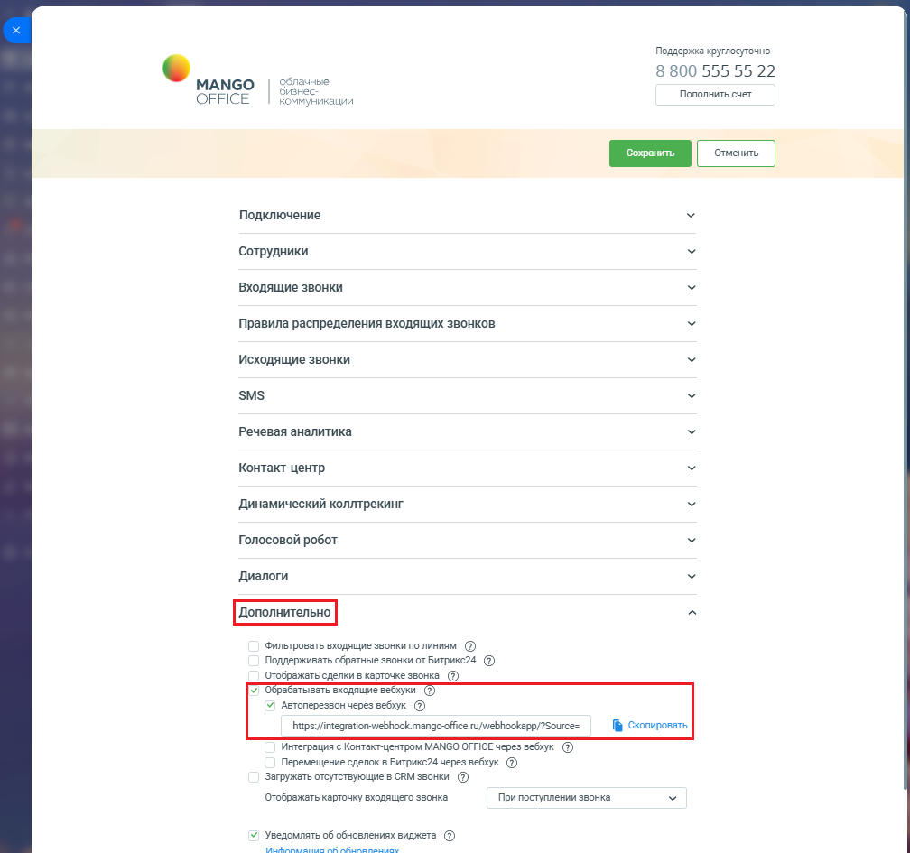

# Как включить автоперезвон через вебхук

> Трассировка: PDF §2.11 · сквозные стр. 89-90 · источники: ч.1 `kb/sources/integration-bitrix24/Mango_office_integration_Bitrix24.pdf` с.89-90.

В настройках интеграции MANGO OFFICE в блоке "Дополнительно", выполните следующие действия: 1) активируйте переключатель "Обрабатывать входящие вебхуки". Появятся дополнительные поля, в которых перечислены все входящие вебхуки; 2) активируйте переключатель "Автоперезвон через вебхук"; 3) нажмите на ссылку "Скопировать" в строке с данными вебхуков, чтобы скопировать URL-адрес вебхуков. Сохраните полученный URL (например, в блокнот); 4) сохраните настройки интеграции, нажав на кнопку "Сохранить" (расположена вверху окна настроек интеграции MANGO OFFICE):

> **Описание иллюстрации INTB24-§2.11-1** (к §2.11 «Как включить автоперезвон через вебхук», стр. 89; 1008×945 px). Снимок экрана / схема.
> Относится к тексту руководства: «…интеграции, нажав на кнопку "Сохранить" (расположена вверху окна настроек интеграции MANGO OFFICE):».
> Текст на изображении (OCR, требует сверки): Поддержка круглосуточно; 8 800 555 55 22; МАМСО; лачные; ec; OFFICE; Пополнить счет; коммуникации; Подключение; Сотрудники; Входящие звонки; Правила распределения входящих звонков; Исходящие звонки; SMS; Речевая аналитика; Контакт-центр; Динамический коллтрекинг; Голосовой робот; Диалоги; «Фильтровать входящие звонки полиниям ©); Поддерживать обратные звонки от Битрикс24 @; Отображать сделки в карточке звонка_®; Обребатывать входящие вебхуки ©); 5 Автоперезвон через вебхук; bhups://integration-webhook mango office /webhookapp/7Source=; № Cxormposars; "Интеграция с Контахттцентром MANGO OFFIGE …

Примечание. Теперь вам нужно настроить робота Битрикс24 на отправку вебхуков в приложение интеграции. Интеграция Виртуальной АТС MANGO OFFICE и Битрикс24 | Версия от 03.03.2026
