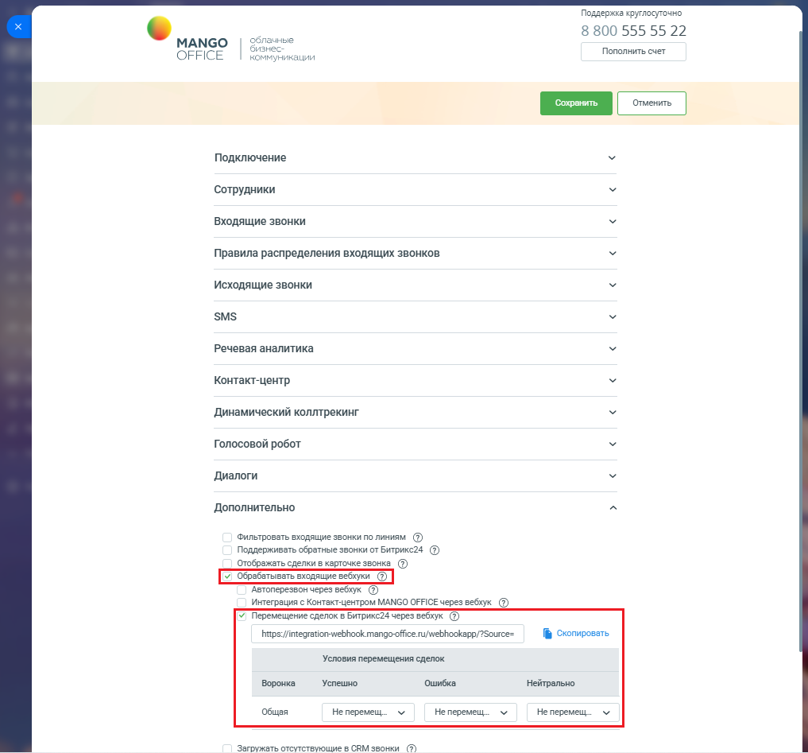
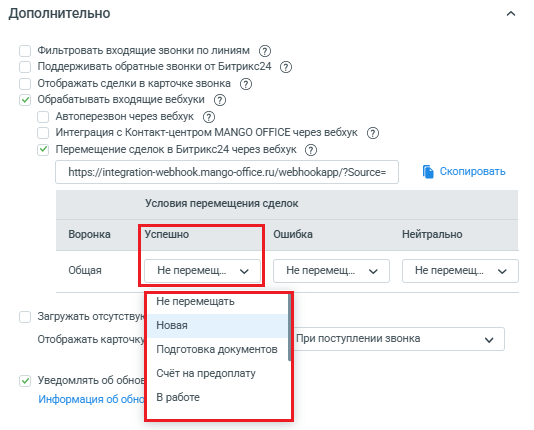
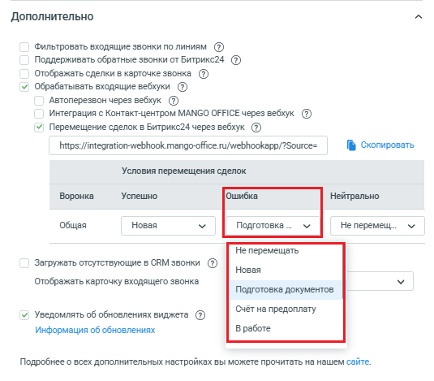
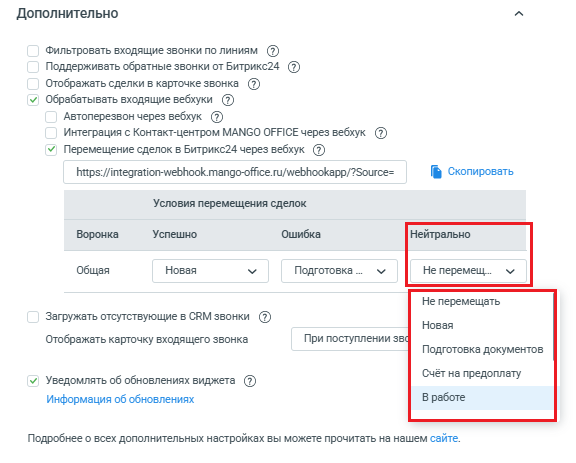
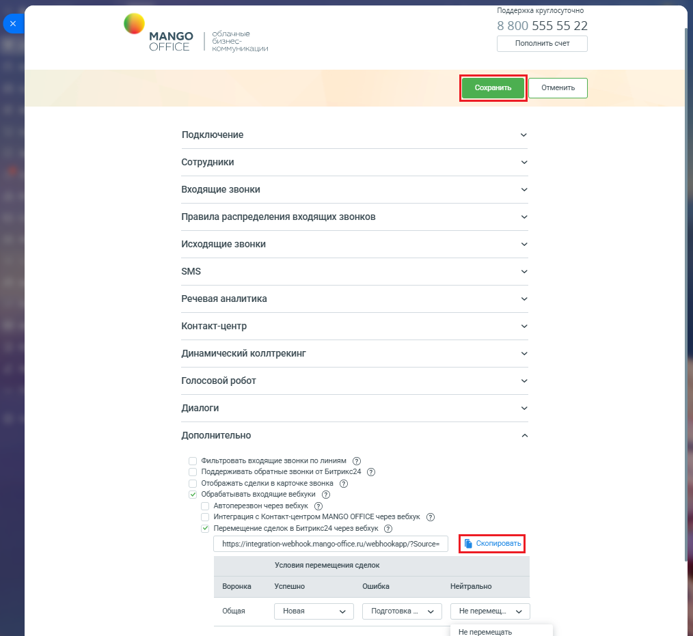

# Настройка вебхука в приложении интеграции Битрикс24

> Трассировка: PDF §2.11 · сквозные стр. 91-94 · источники: ч.1 `kb/sources/integration-bitrix24/Mango_office_integration_Bitrix24.pdf` с.91-94.

Для этого, в форме настройки приложения интеграции в блоке "Дополнительно" необходимо: 1) активировать переключатель "Перемещение сделок в Битрикс24 через вебхук". В форме настройки приложения появится поле, содержащее URL- адрес вебхука, и таблица "Условия перемещения сделок"; 2) в таблице "Условия перемещения сделок" будут перечислены все воронки продаж, имеющиеся в вашем Битрикс24. Вам нужно найти строку с названием воронки продаж, внутри которой будет перемещаться сделка, и в этой строке настроить правило перемещения сделки.

> **Описание иллюстрации INTB24-§2.11-1** (к §2.11 «Настройка вебхука в приложении интеграции Битрикс24», стр. 91; 1017×947 px). Снимок экрана / схема.
> Относится к тексту руководства: «…ем Битрикс24. Вам нужно найти строку с названием воронки продаж, внутри которой будет перемещаться сделка, и в этой строке настроить правило перемещения сделки.».
> Текст на изображении (OCR, требует сверки): Поддержка круглосуточно; 8 800 555 55 22; облачные; МАМСО; нес; Пополнить счет; OFFICE; коммуникация; Подключение; Сотрудники; Входящие звонки; Правила распределения входящих звонков; Исходящие звонки; SMS; Речевая аналитика; Контакт-центр; Динамический коллтрекинг; Голосовой робот; Диалоги; Дополнительно; «Фильтровать входящие звонки полиниям ©); Поддерживать обратные звонки от Битрикс24 @; pes; интеграция c Контакт-центром MANGO OFFICE через sedi; 7 Перемещение сделок в BWTpHKezs через вебхук @); bhnps://integration-webhook mango-ofice u/webhookapp/Source=; № Cxormposars; Условия перемещения…

Интеграция Виртуальной АТС MANGO OFFICE и Битрикс24 | Версия от 03.03.2026 Чтобы настроить правило перемещения сделки, необходимо: 1) в таблице найти строку с названием воронки продаж, внутри которой будет перемещаться сделка; 2) если ваша внешняя система будет передавать в приложение интеграции вебхук с параметром "Result=POSITIVE", то в раскрывающемся списке столбца "Успешно" выберите название этапа, в который должна быть перемещена сделка;

> **Описание иллюстрации INTB24-§2.11-2** (к §2.11 «Настройка вебхука в приложении интеграции Битрикс24», стр. 92; 534×430 px). Снимок экрана / схема.
> Относится к тексту руководства: «…интеграции вебхук с параметром "Result=POSITIVE", то в раскрывающемся списке столбца "Успешно" выберите название этапа, в который должна быть перемещена сделка;».
> Текст на изображении (OCR, требует сверки): Дополнительно; Фильтровать входящие звонки по линиям (7); Поддерживать обратные звонки от Битрикс24 ($); Отображать сделки в карточке звонка (2); v) Обрабатывать входящие вебхуки (2); Автоперезвон через вебхук ($); Интеграция с Контакт-центром MANGO OFFICE через вебхук ($); У Перемещение сделок в Битрикс24 через вебхук (2); https://integration-webhook.mango-office.ru/webhookapp/?Source=; № Скопировать; Условия перемещения сделок; Воронка; Успешно; Ошибка; Нейтрально; Общая; Не перемещ...; He nepemeu...; Не перемещ_.; He перемещать; Загружать отсутст!; Новая; Отображать карточ!; При поступлении…

3) если ваша внешняя система будет передавать в приложение интеграции вебхук с параметром "Result=NEGATIVE", то в раскрывающемся списке столбца "Ошибка" выберите название этапа, в который должна быть перемещена сделка;

> **Описание иллюстрации INTB24-§2.11-3** (к §2.11 «Настройка вебхука в приложении интеграции Битрикс24», стр. 92; 535×469 px). Снимок экрана / схема.
> Относится к тексту руководства: «… интеграции вебхук с параметром "Result=NEGATIVE", то в раскрывающемся списке столбца "Ошибка" выберите название этапа, в который должна быть перемещена сделка;».
> Текст на изображении (OCR, требует сверки): Дополнительно; Фильтровать входящие звонки по линиям (7); Поддерживать обратные звонки от Битрикс24 ($); Отображать сделки в карточке звонка (2); Обрабатывать входящие вебхуки (2); Автоперезвон через вебхук ($); Интеграция с Контакт-центром MANGO OFFICE через вебхук ($); У Перемещение сделок в Битрикс24 через вебхук (2); https://integration-webhook.mango-office.ru/webhookapp/?Source=; № Скопировать; Условия перемещения сделок; Воронка; Успешно; Ошибка; Нейтрально; Общая; Новая; Подготовка ...; He перемещ_.; Не перемещать; Загружать отсутствующие в CRM звонки (2); Отображать карточку входящего …

Интеграция Виртуальной АТС MANGO OFFICE и Битрикс24 | Версия от 03.03.2026 4) если ваша внешняя система будет передавать в приложение интеграции вебхук с параметром "Result=NEUTRAL", то в раскрывающемся списке столбца "Нейтрально" выберите название этапа, в который должна быть перемещена сделка;

> **Описание иллюстрации INTB24-§2.11-4** (к §2.11 «Настройка вебхука в приложении интеграции Битрикс24», стр. 93; 576×463 px). Снимок экрана / схема.
> Относится к тексту руководства: «…теграции вебхук с параметром "Result=NEUTRAL", то в раскрывающемся списке столбца "Нейтрально" выберите название этапа, в который должна быть перемещена сделка;».
> Текст на изображении (OCR, требует сверки): Дополнительно; Фильтровать входящие звонки по линиям (7); Поддерживать обратные звонки от Битрикс24 ($); Отображать сделки в карточке звонка (2); v) Обрабатывать входящие вебхуки (2); Автоперезвон через вебхук ($); Интеграция с Контакт-центром MANGO OFFICE через вебхук ($); У Перемещение сделок в Битрикс24 через вебхук (2); https://integration-webhook.mango-office.ru/webhookapp/?Source=; № Скопировать; Условия перемещения сделок; Воронка; Успешно; Ошибка; Нейтрально; Общая; Новая; Подготовка ...; He перемещ_.; Не перемещать; Загружать отсутствующие в CRM звонки (2); Отображать карточку входяще…

Примечания: - Вы можете настроить правило перемещения сделок для одной, нескольких или всех воронок, указанных в таблице "Условия перемещения сделок"; - в результате настройки правила перемещения сделки, будет изменена структура URL-адреса вебхука. 3) нажмите кнопку "Скопировать", чтобы скопировать URL-адрес вебхука. Сохраните полученный URL, например в Блокнот; 4) нажмите на кнопку "Сохранить" в верхней части формы настройки приложения интеграции и переходите к добавлению во внешнюю систему URL-адреса вебхука перемещения сделок. Интеграция Виртуальной АТС MANGO OFFICE и Битрикс24 | Версия от 03.03.2026

> **Описание иллюстрации INTB24-§2.11-5** (к §2.11 «Настройка вебхука в приложении интеграции Битрикс24», стр. 94; 1014×931 px). Снимок экрана / схема.
> Относится к тексту руководства: «… на кнопку "Сохранить" в верхней части формы настройки приложения интеграции и переходите к добавлению во внешнюю систему URL-адреса вебхука перемещения сделок.».
> Текст на изображении (OCR, требует сверки): "Поддержка круглосуточно; лачные; 8 800 555 55 22; МАМСО; ec; Пополнить счет; OFFICE; коммуникация; Подключение; Сотрудники; Входящие звонки; Правила распределения входящих звонков; Исходящие звонки; SMS; Речевая аналитика; Контакт-центр; Динамический коллтрекинг; Голосовой робот; Диалоги; Дополнительно; «Фильтровать входящие звонки полиниям ©); Поддерживать обратные звонки от Битрикс24 @; Отображать сделки в карточке звонка @; обрабатывать входящие вебхуки @; Автоперезвон через вебхук @®; ‘интеграция с Контакт-центром MANGO OFFICE через вебхук @; У Перемещение сделок в Битрикс24 через вебхук …
