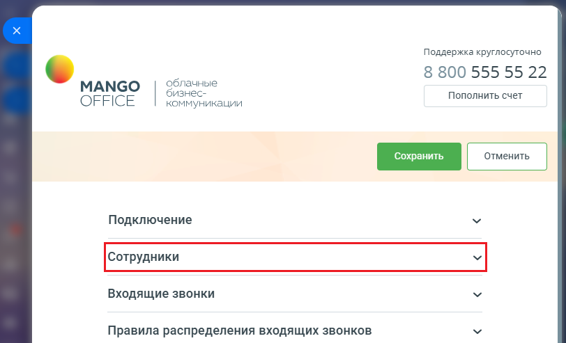
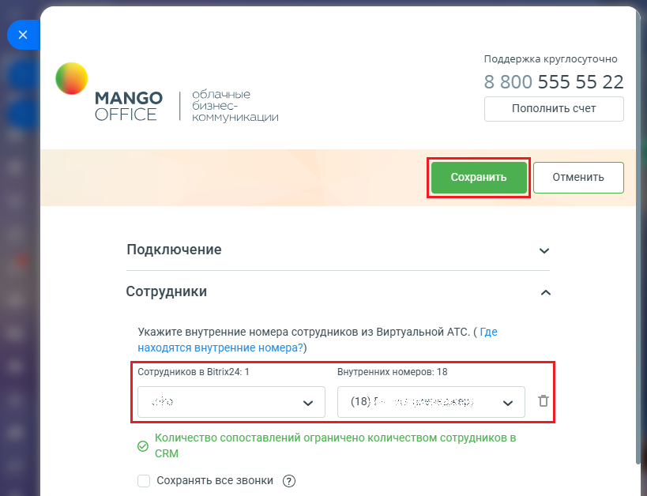

# Как настроить сопоставление сотрудников

> Трассировка: PDF §1.1 · сквозные стр. 11-13 · источники: ч.1 `kb/sources/integration-bitrix24/Mango_office_integration_Bitrix24.pdf` с.11-13.

Для этого в форме настройки приложения: 1) откройте блок "Сотрудники";

> **Описание иллюстрации INTB24-§1.1-1** (к §1.1 «Как настроить сопоставление сотрудников», стр. 11; 812×493 px). Снимок экрана / схема.
> Относится к тексту руководства: «… доступна только в расширенном пакете интеграции. Как настроить сопоставление сотрудников Для этого в форме настройки приложения: 1) откройте блок "Сотрудники";».
> Текст на изображении (OCR, требует сверки): Поддержка круглосуточно; 8 800 555 55 22; облачные; МАМСО; бизнес-; Пополнить счет; OFFICE; коммуникации; Подключение; Входящие звонки; Правила распределения входящих звонков

2) будет показана таблица сопоставления сотрудников, в которой: - в столбце “Сотрудников в Bitrix24:" показан список сотрудников, настроенных в Битрикс24, в том числе уволенных. При этом в названии столбца после двоеточия указано количество сотрудников в вашем Битрикс24; - в столбце "Внутренних номеров" отображается список сотрудников Виртуальной АТС, которым выданы внутренние номера телефонов. При этом в названии столбца после двоеточия указано количество сотрудников в вашей Виртуальной АТС; Интеграция Виртуальной АТС MANGO OFFICE и Битрикс24 | Версия от 03.03.2026 3) укажите соответствие сотрудников Виртуальной АТС и Битрикс24, путем выбора номера из списка или ввода внутреннего номера; 4) нажмите на кнопку "Сохранить" (зеленая кнопка в верхней части формы настройки приложения). После успешной настройки сопоставления сотрудников, будет завершена базовая настройка приложения интеграции.

> **Описание иллюстрации INTB24-§1.1-2** (к §1.1 «Как настроить сопоставление сотрудников», стр. 12; 819×628 px). Снимок экрана / схема.
> Относится к тексту руководства: «…кнопка в верхней части формы настройки приложения). После успешной настройки сопоставления сотрудников, будет завершена базовая настройка приложения интеграции.».
> Текст на изображении (OCR, требует сверки): Поддержка круглосуточно; 8 800 555 55 22; облачные; МАМСО; бизнес-; OFFICE; Пополнить счет; коммуникации; Подключение; Сотрудники; Укажите внутренние номера сотрудников из Виртуальной АТС. ( Где; находятся внутренние номера?); Сотрудников в Bitrix24: 1; Внутренних номеров: 18; bey; Количество сопоставлений ограничено количеством сотрудников в; CRM; Сохранять все звонки (2)

Интеграция Виртуальной АТС MANGO OFFICE и Битрикс24 | Версия от 03.03.2026
