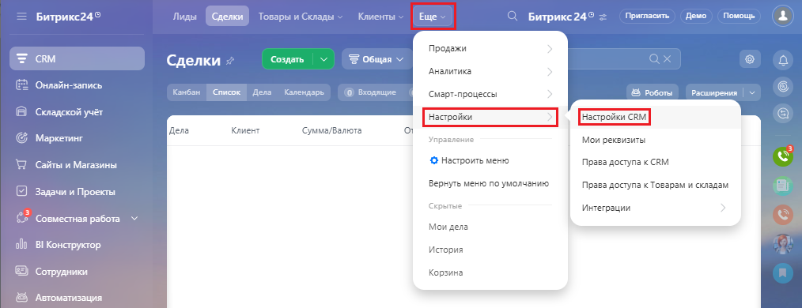
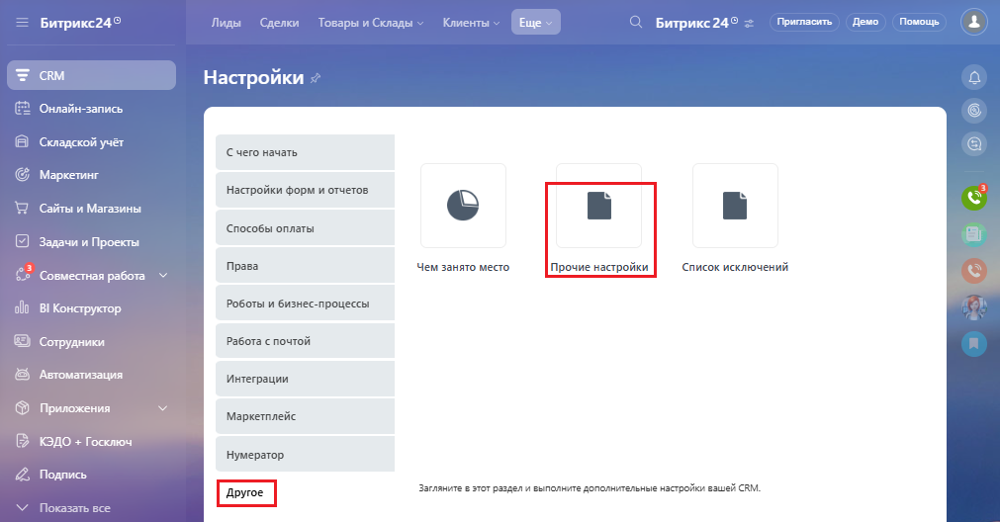
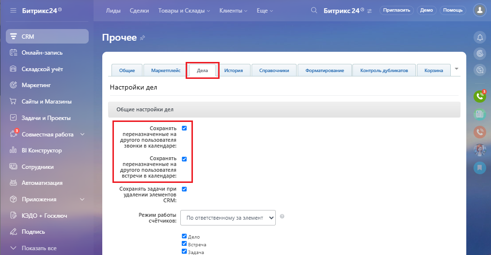
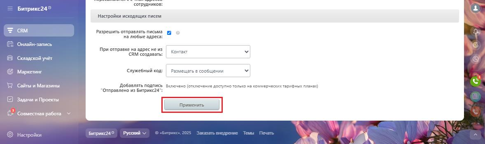

# 2.14. Как включить или выключить показ звонков в календаре

> Трассировка: PDF §2.14 · сквозные стр. 99-101 · источники: ч.1 `kb/sources/integration-bitrix24/Mango_office_integration_Bitrix24.pdf` с.99-101.

При регистрации звонка в календаре Битрикса24 создается соответствующая отметка. Эта функция по умолчанию включена. Если позже вам понадобиться отключить или включить появление звонков в календаре, выполните следующие действия: 1) выберите "CRM", затем выберите "Настройки", затем "Настройки CRM":

> **Описание иллюстрации INTB24-§2.14-1** (к §2.14 «Как включить или выключить показ звонков в календаре», стр. 99; 1014×390 px). Снимок экрана / схема.
> Относится к тексту руководства: «…биться отключить или включить появление звонков в календаре, выполните следующие действия: 1) выберите "CRM", затем выберите "Настройки", затем "Настройки CRM":».
> Текст на изображении (OCR, требует сверки): Битрикс?4'; Лиды; Сделки; apa uC; Битрикс24'; Пригласить; Демо; Помощь; Продажи; см; Создать; 3 Общая v; Аналитика; Онлайн-запись; Kanan; ‘Список | Дела; © веодящие; Смарт.процессы; 2 роботы; расширения; Складской учёт; Настройки; [Настройки CRM; [дела; Клиент; `Сумма/Валюта; Маркетинг; Мои реквизиты; © Настроить меню; "Сайты и Магазины; Права доступа к CRM; Вернуть меню no умолчению; Права доступа к Товарам и складам; Задачи и Проекты; интеграции; Совместная работа; Мои дела; BI Конструктор; история; ® Сотрудники; Корзина; Автоматизация

Интеграция Виртуальной АТС MANGO OFFICE и Битрикс24 | Версия от 03.03.2026 2) нажмите "Другое"; 3) нажмите "Прочие настройки":

> **Описание иллюстрации INTB24-§2.14-2** (к §2.14 «Как включить или выключить показ звонков в календаре», стр. 100; 1011×528 px). Снимок экрана / схема.
> Относится к тексту руководства: «…2) нажмите "Другое"; 3) нажмите "Прочие настройки":».
> Текст на изображении (OCR, требует сверки): = Битрикс249; Лиды; Сделки; вары и Склады:; Клиенты; Ewe; Битрикс24'; Пригласить; Демо; Помощь; см; Настройки; Онлайн.; nice; В Складской учат; Cuero начать; Маркетинг; Настройки форм и отчетов; "Сайты и Магазины; ‘способы оплаты; © apace» Проекты; Права; Чем занято место; Прочие настройки,; ‘список исключений; 2 Совместная работа; об В Koncpyrop; Роботы и бизнес-процессы; ® Сотрудники; работа с почтой; © Автоматизация; Интеграции; © приложения; Маркетплейс; {В ЮО + Госключ; Hyweparop; 2, Полис; Другое; Загляните в тот раздели выполните дополнительные настройки вашей CRM,; Уп; зать все

4) перейдите на закладку "Дела"; 5) чтобы выключить показ звонков в календаре, снимите флаги "Сохранять совершенные звонки в календаре", "Сохранять переназначенные на другого пользователя звонки в календаре". А чтобы включить показ звонков – установите эти флаги;

> **Описание иллюстрации INTB24-§2.14-3** (к §2.14 «Как включить или выключить показ звонков в календаре», стр. 100; 1013×527 px). Снимок экрана / схема.
> Относится к тексту руководства: «… совершенные звонки в календаре", "Сохранять переназначенные на другого пользователя звонки в календаре". А чтобы включить показ звонков – установите эти флаги;».
> Текст на изображении (OCR, требует сверки): Битрикс?4'; Лиды; Caen; овары и Склады; Клиенты; Ewe; Битрикс24'; Пригласить; Демо; Помощь; см; Прочее; Онлайн-запись; В Складской учат; "общие; Mapreraneic; Дела; ‘история; "Справочники; Форматирование; Контроль дубликатов; Корзина; Маркетинг; Настройки дел; "Сайты и Магазины; Общие настройки дел; © залачии Проекты; ‘Сохранять.; ©? Совместная pa6ora; переназначенные на; другого пользователя; Звонки в календаре:; об В Koncpyrop; ‘Сохранять; ® Сотрудники; встречи в календаре:; © Автоматизация; Сохранять задачи при; © приложения; удалении элементов; ‘CRM:; {В ЮО + Госключ; режим работы; ‘счётчик…

Интеграция Виртуальной АТС MANGO OFFICE и Битрикс24 | Версия от 03.03.2026 6) нажмите кнопку "Применить":

> **Описание иллюстрации INTB24-§2.14-4** (к §2.14 «Как включить или выключить показ звонков в календаре», стр. 101; 1178×351 px). Снимок экрана / схема.
> Относится к тексту руководства: «…6) нажмите кнопку "Применить":».
> Текст на изображении (OCR, требует сверки): ‘сотрудников:; Битрикс?; "Настройки исходящих писем; см; Разрешить отправлять письма; на любые адреса:; Онлайн-запись; При отправке на адрес не из; Контакт; (CRM создавать:; Складской учёт; Маркетинг; ‘Служебный код:; размещать сообщении; WD сайты и Магазины; Добавлять подлись; Включено (отключение доступно только на комм; иктарифных планак); Отправлено из Битрикс24"; Задачи и Проекты; Применить.; Совместная работа; © Hecrpoiien; Русский ^^
