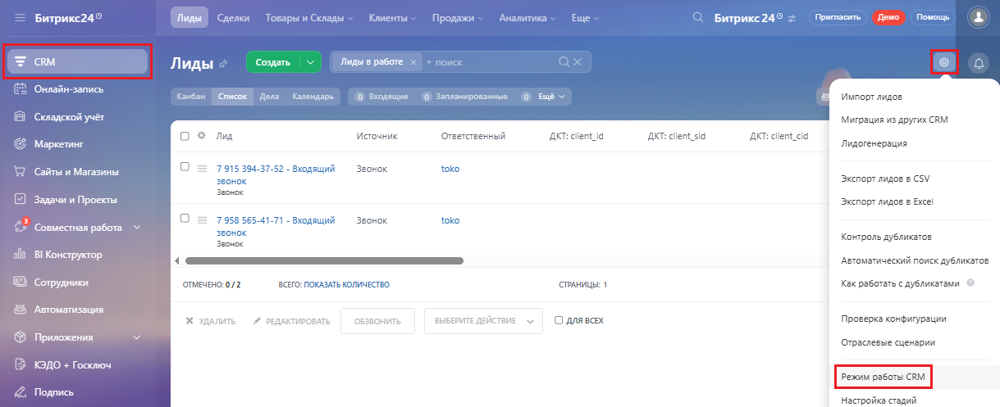
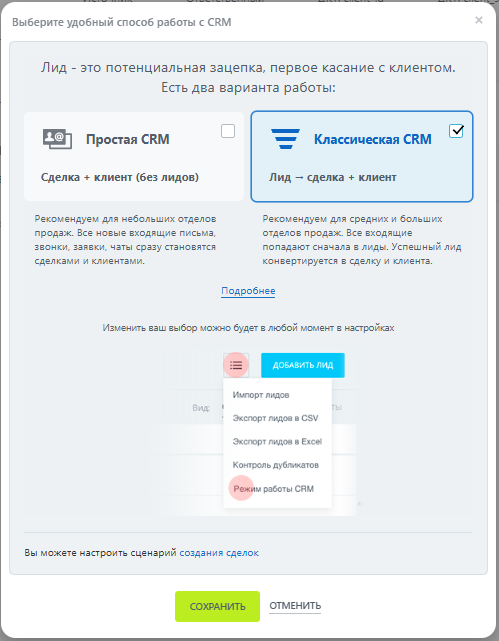
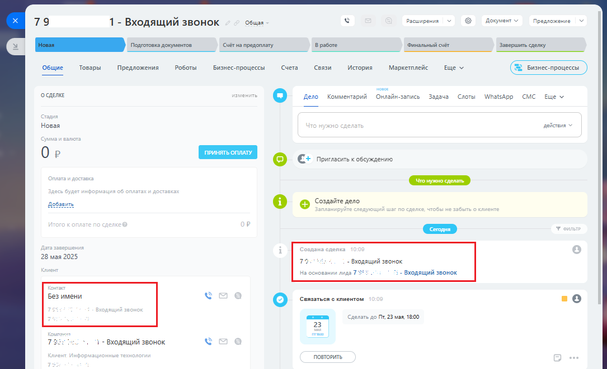

# 2.19. Переключение между режимами работы Битрикс24

> Трассировка: PDF §2.19 · сквозные стр. 102-104 · источники: ч.1 `kb/sources/integration-bitrix24/Mango_office_integration_Bitrix24.pdf` с.102-104.

Приложение интеграции поддерживает разные режимы работы: - классическая CRM Сделка + клиент (без лидов); - простая CRM Лид -> сделка + клиент. Важным различием режима работы является использование лидов в классическом режиме (в режиме простой CRM лиды не используются). Вы можете переключаться между режимами работы: 1) выберите "CRM"; 2) перейдите в раздел "Лиды";

> **Описание иллюстрации INTB24-§2.19-1** (к §2.19 «Переключение между режимами работы Битрикс24», стр. 102; 31×27 px). Пиктограмма (значок элемента интерфейса).
> Относится к тексту руководства: «…классическом режиме (в режиме простой CRM лиды не используются). Вы можете переключаться между режимами работы: 1) выберите "CRM"; 2) перейдите в раздел "Лиды";».
> Текста на изображении нет; назначение элемента — см. текст, к которому он относится.

3) нажмите пиктограмму "Настройки" 4) выберите "Режим работы CRM":

> **Описание иллюстрации INTB24-§2.19-2** (к §2.19 «Переключение между режимами работы Битрикс24», стр. 102; 1219×497 px). Снимок экрана / схема.
> Относится к тексту руководства: «… можете переключаться между режимами работы: 1) выберите "CRM"; 2) перейдите в раздел "Лиды"; 3) нажмите пиктограмму "Настройки" 4) выберите "Режим работы CRM":».
> Текст на изображении (OCR, требует сверки): Битрикс?4'; Лиды; Caen; ae; Клиенты; Продажи; Аналитика; Ewe; Битрикс24'; Townes | lewo | Помощь; ‘Создать; `Лиды в работе; ray; Onna; лись; Kanan; ‘Список | Дела; олени; © веодящие; @ запланы; ван; импорт лидов; В Складской учат; Миграция из других CRM; оз; лид; Источник; "Ответственный; AKT: client ia; AKT: client sia; AKT: client cid; Маркетинг; `Лидогенерация; звонок; toko; WD сайыи Магазины; 7915 394-57-52 - Входящий; Экспорт лидов в CSV; емо; © Saye и Проекты; Экспорт лидов в Excel; 7958 565-41-71 - Входящий; Совместная работа; Контроль дубликатов; об В Koncpycrop; Автоматический поиск д…

Интеграция Виртуальной АТС MANGO OFFICE и Битрикс24 | Версия от 03.03.2026 5) выберите режим работы и нажмите кнопку "Сохранить":

> **Описание иллюстрации INTB24-§2.19-3** (к §2.19 «Переключение между режимами работы Битрикс24», стр. 103; 499×641 px). Снимок экрана / схема.
> Относится к тексту руководства: «…5) выберите режим работы и нажмите кнопку "Сохранить":».
> Текст на изображении (OCR, требует сверки): Выберите удобный способ работы с CRM; Лид - это потенциальная зацепка, первое касание с клиентом.; Есть два варианта работы:; Простая СКМ; “= Классическая CRM; Сделка + клиент (без лидов); Лид — сделка + клиент; Рекомендуем для небольших отделов; Рекомендуем для средних и больших; продаж. Все новые входящие письма,; отделов продаж. Все входящие; звонки, заявки, чаты сразу становятся; попадают сначала в лиды. Успешный лид; сделками и клиентами.; конвертируется в сделку и клиента.; Подробнее; Изменить ваш выбор можно будет в любой момент в настройках; Импорт лидое; Экспорт лидов в CSV; Экспорт л…

В упрощенном режиме работы вместо лидов - автоматически создаются контакты и связанные с ними сделки. Звонки фиксируются в контактах, для звонка указывается номер, на который звонил Клиент:

> **Описание иллюстрации INTB24-§2.19-4** (к §2.19 «Переключение между режимами работы Битрикс24», стр. 103; 1085×661 px). Снимок экрана / схема.
> Относится к тексту руководства: «…есто лидов - автоматически создаются контакты и связанные с ними сделки. Звонки фиксируются в контактах, для звонка указывается номер, на который звонил Клиент:».
> Текст на изображении (OCR, требует сверки): расширения; Документ м; Предложение; 79; 1 - Входящий звонок; "Общая; (Caer na предоплату; B работе; "Финальный cr; Завершить сделку; a Е; Общие; Товары; Предложения; Роботы; Бизнес-процессы; Счета; Связи; история; Маркетплейс; Ewe v; cents; Онлайн -запись; Слоты; Дело; Комментарий; Задача; WhatsApp смс; Новая; действия У; Oe; E+ nournscite к обсуждению; Ae; © Corsine aeno; Сегодня; 28 мая 2025; 73.; - Виодящий звонок; Hs основании лидз 7S; > - Входящий звонок; Сепзвться © клиентом; 206; Сделать до Th, 23 мая 1800; } - Входящий звонок

Обратите внимание, замечено, что Битрикс24 в этом режиме автоматически создает лиды, но не отображает их в приложении. Интеграция Виртуальной АТС MANGO OFFICE и Битрикс24 | Версия от 03.03.2026
