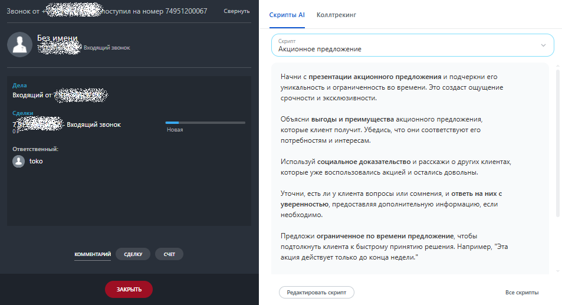
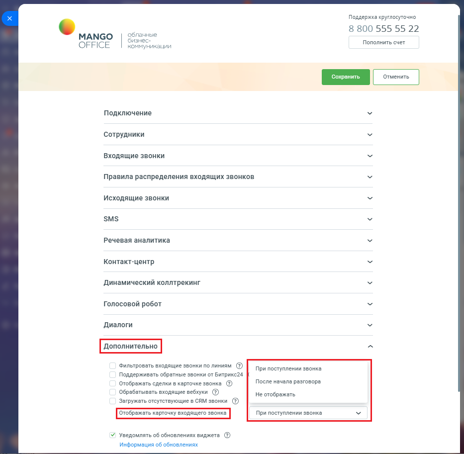

# 2.20. Настройка отображения карточки звонка

> Трассировка: PDF §2.20 · сквозные стр. 104-105 · источники: ч.1 `kb/sources/integration-bitrix24/Mango_office_integration_Bitrix24.pdf` с.104-105.

Вы можете настроить показ карточки входящего звонка (см. рисунок ниже) на экране. Примечание. Настройка доступна в расширенном пакете интеграции.

> **Описание иллюстрации INTB24-§2.20-1** (к §2.20 «Настройка отображения карточки звонка», стр. 104; 953×517 px). Снимок экрана / схема.
> Относится к тексту руководства: «…арточки звонка Вы можете настроить показ карточки входящего звонка (см. рисунок ниже) на экране. Примечание. Настройка доступна в расширенном пакете интеграции.».
> Текст на изображении (OCR, требует сверки): Er; oh; оступил на; ye; ‘Скрипты Al; Коллтрекинг; nau; Акционное предложение; Начни с презентации акционного предложения и подчеркни его; ыы; уникальность и ограниченность во времени. Это создаст ощущение; щий от; ve:; срочности и эксклюзивности,; oe; Объясни выгоды и преимущества акционного предложения,; pL; звонок.; He; которые клиент получит. Убедись, что они соответствуют его; потребностям и интересам.; ответственный:; Используй социальное доказательство и расскажи о других клиентах,; которые уже воспользовались акцией и остались довольны,; Уточни, есть ли y клиента вопросы или сомнения, и…

Чтобы настроить отображение карточки, необходимо: 1) откройте форму настройки приложения интеграции; 2) откройте блок "Дополнительно"; 3) в поле "Отображать карточку входящего звонка" выберите вариант отображения карточки звонка:

| Вариант отображения | Примечание |
| --- | --- |
| При поступлении звонка | Выбран по умолчанию. Карточка отображается одновременно с входящем звонком |
| После начала разговора | Карточка покажется на экране только того, как вы примите входящий звонок (поднимите трубку). |
| Не отображать | Карточка звонка не будет отображаться на экране |

4) нажмите кнопку "Сохранить". Интеграция Виртуальной АТС MANGO OFFICE и Битрикс24 | Версия от 03.03.2026

> **Описание иллюстрации INTB24-§2.20-2** (к §2.20 «Настройка отображения карточки звонка», стр. 105; 933×913 px). Снимок экрана / схема.
> Относится к тексту руководства: «…ане только того, как вы примите входящий звонок (поднимите трубку). Не отображать Карточка звонка не будет отображаться на экране 4) нажмите кнопку "Сохранить".».
> Текст на изображении (OCR, требует сверки): Поддержка круглосуточно; 8 800 555 55 22; MANGO; обла:; ые; OFFICE; бизн; Пополнить счет; коммуникации; Подключение; Сотрудники; Входящие звонки; Правила распределения входящих звонков.; Исходящие звонки; SMS; Речевая аналитика; Контакт-центр; Динамический коллтрекинг; голосовой робот; Диалоги; Фильтровать входящие звонки по линиям @; При поступлении звонка; Поддерживать обратные звонки от Битрикс24; Отображать сделки в карточке звонка @; После начала разговора; Обрабвтывать входящие вебхуки @®); Не отображать; Загружать отсутствующие в CRM звонки; Уведомлять об обновлениях виджета @; ‘информа…
