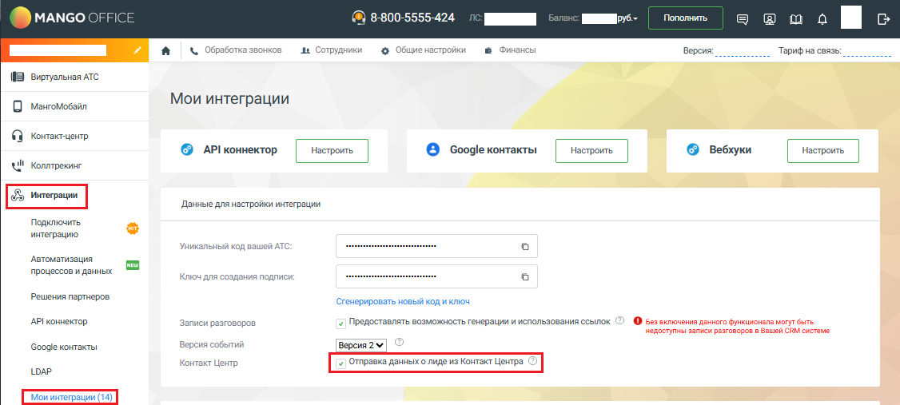
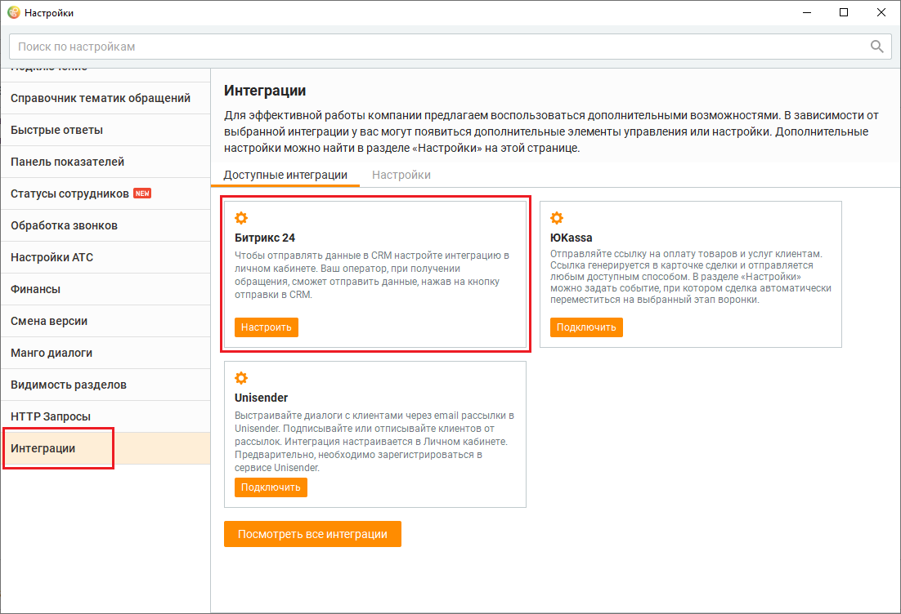

# Настройка интеграции с Контакт-центром MANGO OFFICE. Общие инструкции

> Трассировка: PDF §2.22 · сквозные стр. 106-108 · источники: ч.1 `kb/sources/integration-bitrix24/Mango_office_integration_Bitrix24.pdf` с.106-108.

инструкции Примечание. В этом разделе описано, как настроить интеграцию с Контакт- центром MANGO OFFICE для передачи данных об обращениях и тематиках, а также сохранении истории чатов. Чтобы автоматически добавлять задания в кампанию исходящего обзвона при изменении в воронке продаж Битрикс24, вы можете настроить интеграцию через вебхуки. Чтобы настроить интеграцию с Контакт-центром MANGO OFFICE, необходимо: 1) открыть Личный кабинет MANGO OFFICE; 2) в меню выбрать "Интеграции"; 3) выбрать "Мои интеграции"; 4) поставить "галочку" в поле "Отправка данных о лиде из Контакт-центра"; 5) нажать кнопку "Сохранить":

> **Описание иллюстрации INTB24-§2.22-1** (к §2.22 «Настройка интеграции с Контакт-центром MANGO OFFICE. Общие инструкции», стр. 106; 1126×507 px). Снимок экрана / схема.
> Относится к тексту руководства: «… меню выбрать "Интеграции"; 3) выбрать "Мои интеграции"; 4) поставить "галочку" в поле "Отправка данных о лиде из Контакт-центра"; 5) нажать кнопку "Сохранить":».
> Текст на изображении (OCR, требует сверки): Пополнить; MANGO ©; oe; 00-5555-424; эешо М =; а | & обработка звонков; ва Сотрудники; & Общие настройки; ® Финансы; Версия:; Тарифна связь; 1B оровльшядто; О Masrotosann; Мои интеграции; © копает; © АР!коннектор; {© Google контакты; UW! коллтреюг; Данные для настройки интеграции.; Подключить; интеграцию; on; Уникальный код вашей ATC:; ‘Автоматизация; процессов и данных; Kos ana создания подлиси:; Решения партнеров; ‘стенерировать новый код иключ; `АР/коннектор.; Записи разговоров.; -7 Предоставлять возможность генерации и использования ссылок.; O ве включения денного ункцисналь могут быть; не…

Интеграция Виртуальной АТС MANGO OFFICE и Битрикс24 | Версия от 03.03.2026 Далее проверьте, что интеграция успешно подключена. Для этого необходимо: 1) открыть Контакт-центр MANGO OFFICE; 2) открыть настройки Контакт-центра MANGO OFFICE; 3) открыть раздел "Интеграции"; 4) нажать на пункт "Настроить";

> **Описание иллюстрации INTB24-§2.22-2** (к §2.22 «Настройка интеграции с Контакт-центром MANGO OFFICE. Общие инструкции», стр. 107; 1102×752 px). Снимок экрана / схема.
> Относится к тексту руководства: «…ходимо: 1) открыть Контакт-центр MANGO OFFICE; 2) открыть настройки Контакт-центра MANGO OFFICE; 3) открыть раздел "Интеграции"; 4) нажать на пункт "Настроить";».
> Текст на изображении (OCR, требует сверки): © настройки; Поиск по настройкам; Интеграции; ‘справочник тематик обращений; Для эффективной работы компании предлагаем воспользоваться дополнительными возможностями. В зависимости от; Быстрые ответы; выбранной интеграции у вас могут появиться дополнительные элементы управления или настройки. Дополнительные; настройки можно найти в разделе «Настройки» на этой странице.; Панель показателей; Доступные интеграции; настройки; ‘статусы сотрудников (89; Обработка звонков; Битрикс 24; ЮКазза; Настройки АТС; Чтобы отправлять данные в CRM настройте интеграцию в.; Отправляйте ссылку на оплату товаров и …

Будет открыл ваш Личный кабинет MANGO OFFICE, в котором открыт раздел "Интеграции". Проверьте, что интеграция ВАТС и Битрикс24 подключена. Далее, вы можете настроить передачу данных из Контакт-центр MANGO OFFICE в Битрикс24. Интеграция Виртуальной АТС MANGO OFFICE и Битрикс24 | Версия от 03.03.2026
