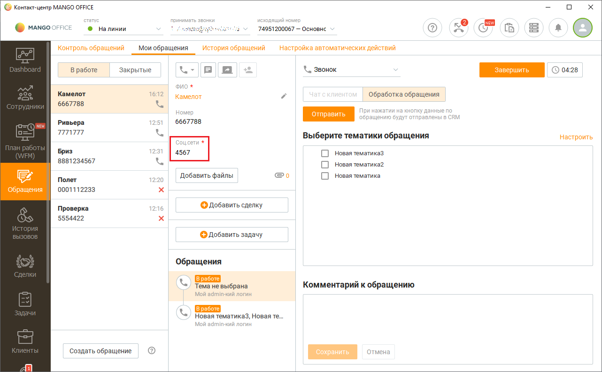
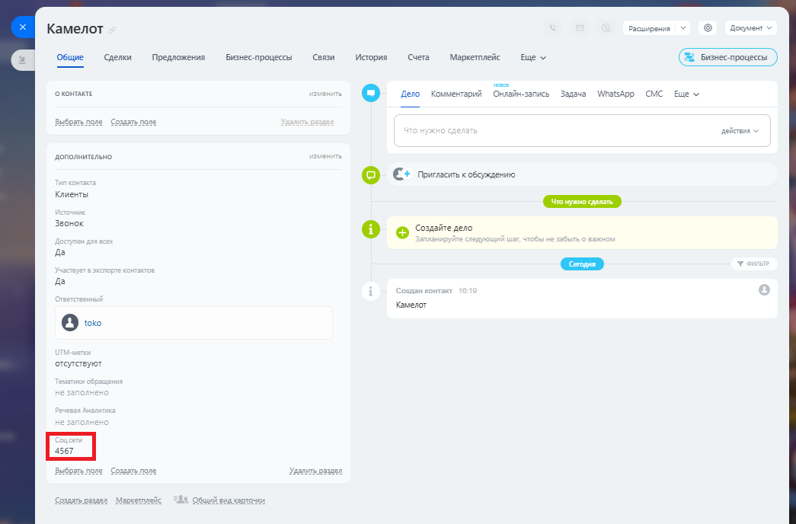

# Импорт данных из "пользовательских" полей

> Трассировка: PDF §2.22 · сквозные стр. 109-110 · источники: ч.1 `kb/sources/integration-bitrix24/Mango_office_integration_Bitrix24.pdf` с.109-110.

В Контакт-центре MANGO OFFICE пользователь может настроить структуру контакта, путем добавления "пользовательских" (своих) полей к стандартным полям контакта. Пример. Если в вашем Контакт-центре MANGO OFFICE имеется "пользовательское" поле "Соц. сети":

> **Описание иллюстрации INTB24-§2.22-1** (к §2.22 «Импорт данных из "пользовательских" полей», стр. 109; 1282×793 px). Снимок экрана / схема.
> Относится к тексту руководства: «…вашем Контакт-центре MANGO OFFICE имеется "пользовательское" поле "Соц. сети":».
> Текст на изображении (OCR, требует сверки): © конта-центр MANGO OFFICE; crave; искодящи; ео; ны; хе; © млнсоонисе; ® Налинии; Sh; aN; 74951200067 — Основнс ©; Контроль обращений; мои обращения; История обращений; настройка автоматических действий; Х.. Звонок; B работе; Закрытые; © 0428; ono *; Камелот; 6:1; Обработка обращения; 6667788; Homep; ри нажатии на; анные по; щению; лены & CRM; we; Ривьера; 77777; Выберите тематики обращения; Настроить; Бриз; 31; О новаятематиказ; 8881234567; О новаятематика; Полет; Добавить файлы; Обращения; 0001112233; Проверка; 16; © Добавить сделку; 5554422; © добавить задачу; iS; Tema He выбрана; Комментар…

То данные из этого поля можно сохранять в контакте Битрикс24 в разделе "Дополнительно":

> **Описание иллюстрации INTB24-§2.22-2** (к §2.22 «Импорт данных из "пользовательских" полей», стр. 109; 1045×688 px). Снимок экрана / схема.
> Относится к тексту руководства: «…MANGO OFFICE имеется "пользовательское" поле "Соц. сети": То данные из этого поля можно сохранять в контакте Битрикс24 в разделе "Дополнительно":».
> Текст на изображении (OCR, требует сверки): Камелот; Расширения; Доме; Общие Сделки; Предложения; Бизнес процессы; Связи; история; cuera; Маркетплейс; вще v; оконтакте; vce; cmc; © tev Koumerrepnit лайн; Задача; WhatsApp; поле; sein >; дополнительно; © с rovemci cosaptoae; Клиенты; Звонок; © ось; да; отсутствуют

Интеграция Виртуальной АТС MANGO OFFICE и Битрикс24 | Версия от 03.03.2026
