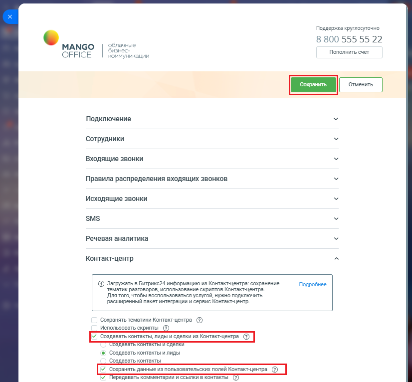

# Как настроить

> Трассировка: PDF §2.22 · сквозные стр. 110-111 · источники: ч.1 `kb/sources/integration-bitrix24/Mango_office_integration_Bitrix24.pdf` с.110-111.

Чтобы импортировать данные из "пользовательских" полей Контакт-центра MANGO OFFICE в ваши контакты Битрикс24, у вас в приложении интеграции следует: 1) открыть блок "Контакт-центр"; 2) активировать переключатель "Создавать контакты, лиды и сделки из Контакт-центра". Будут открыты дополнительные поля; 3) активировать переключатель "Сохранять данные из пользовательских полей Контакт-центра"; 4) нажмите кнопку "Сохранить" в верхней части окна настроек.

> **Описание иллюстрации INTB24-§2.22-1** (к §2.22 «Как настроить», стр. 110; 826×766 px). Снимок экрана / схема.
> Относится к тексту руководства: «…ые поля; 3) активировать переключатель "Сохранять данные из пользовательских полей Контакт-центра"; 4) нажмите кнопку "Сохранить" в верхней части окна настроек.».
> Текст на изображении (OCR, требует сверки): Поддержка круглосуточно; 8 800 555 55 22; 4ble; MANGO; OFFICE; икации; Пополнить счет; Подключение; Сотрудники; Входящие звонки; Правила распределения входящих звонков; Исходящие звонки; SMS; Речевая аналитика; Контакт-центр; @ Загружать в Битрикс24 информацию из Контакт-центра: сохранение; Подробнее; тематик разговоров, использование скриптов Контакт-центра.; Для того, чтобы воспользоваться услугой, нужно подключить; расширенный пакет интеграции и сервис Контакт-центр.; Сохранять тематики Контакт-центра (2); Использовать скрипты; оздавать контакты и сделки; @) Создавать контакты и лиды; Созда…

В таком случае, "пользовательские" поля будут сохраняться в новых контактах и/или добавляться к ранее существующим контактам Битрикс24 в разделе "Дополнительно". Интеграция Виртуальной АТС MANGO OFFICE и Битрикс24 | Версия от 03.03.2026
