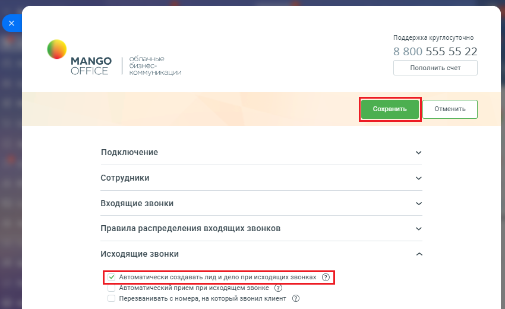
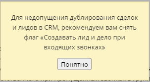
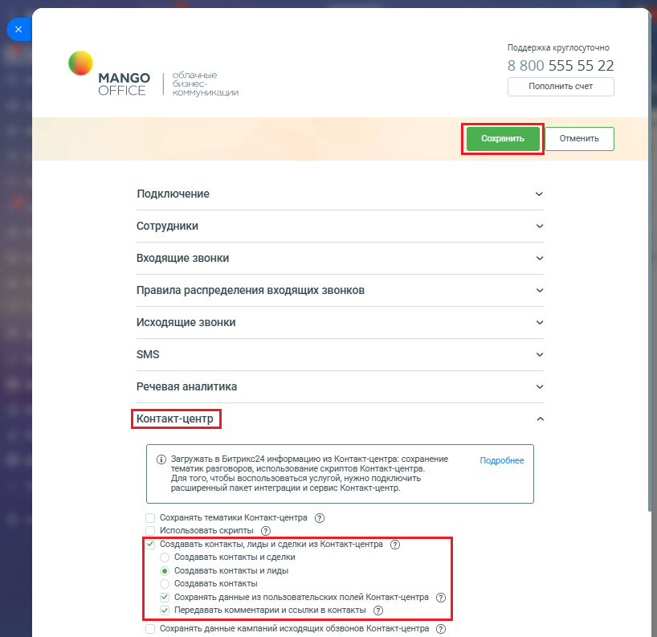

# Как включить автоматическое создание контактов и сделок в Битрикс24

> Трассировка: PDF §2.22 · сквозные стр. 111-113 · источники: ч.1 `kb/sources/integration-bitrix24/Mango_office_integration_Bitrix24.pdf` с.111-113.

Для этого необходимо: 1) открыть форму настройки приложения интеграции; 2) открыть блок "Исходящие звонки"; 3) снять "галочку" в пункте "Автоматически создавать лид и дело при входящих звонках", чтобы избежать дублирования сделок при получении данных из Контакт-центра MANGO OFFICE; 4) нажмите кнопку "Сохранить".

> **Описание иллюстрации INTB24-§2.22-1** (к §2.22 «Как включить автоматическое создание контактов и сделок в Битрикс24», стр. 111; 850×520 px). Снимок экрана / схема.
> Относится к тексту руководства: «…здавать лид и дело при входящих звонках", чтобы избежать дублирования сделок при получении данных из Контакт-центра MANGO OFFICE; 4) нажмите кнопку "Сохранить".».
> Текст на изображении (OCR, требует сверки): Поддержка круглосуточно; 8 800 555 55 22; МАМСО; обла; ые; Ou3; Пополнить счет; OFFICE; KOM; никации; Подключение; Сотрудники; Входящие звонки; Правила распределения входящих звонков; Исходящие звонки; Автоматический прием при исходящем звонке (2); Перезванивать с номера, на который звонил клиент ()

Примечание. Если вы не снимите "галочку" в пункте "Автоматически создавать лид и дело при входящих звонках", то будет выдано следующее сообщение:

> **Описание иллюстрации INTB24-§2.22-2** (к §2.22 «Как включить автоматическое создание контактов и сделок в Битрикс24», стр. 111; 303×166 px). Снимок экрана / схема.
> Относится к тексту руководства: «…у "Сохранить". Примечание. Если вы не снимите "галочку" в пункте "Автоматически создавать лид и дело при входящих звонках", то будет выдано следующее сообщение:».
> Текст на изображении (OCR, требует сверки): Для недопущения дублирования сделок; и лидов в CRM, рекомендуем вам снять; флаг «Создавать лид и дело при; входящих звонках»

Настоятельно рекомендуем, снять "галочку" в пункте "Автоматически создавать лид и дело при входящих звонках". Интеграция Виртуальной АТС MANGO OFFICE и Битрикс24 | Версия от 03.03.2026 5) открыть блок "Контакт-центр" в настройках интеграции; 6) установить в нем галочку "Создавать контакты, лиды и сделки из Контакт- Центра MANGO OFFICE". Будут открыты дополнительные поля; 7) выберите один из вариантов: - Создавать контакты и сделки: при выборе данного пункта в Битрикс24 будут создаваться контакты и сделки по обращениям из Контакт-центра MANGO OFFICE. Лиды создаваться не будут; - Создавать контакты и лиды: в Битрикс24 будут создаваться контакты и лиды. Примечание. Для создания лидов, ваш Битрикс24 должен работать в режиме "Классическая CRM". Если в ваш Битрикс24 работает в другом режиме, то будет выдано соответствующее сообщение: 8) установите галочку "Сохранять данные из пользовательских полей Контакт- Центра MANGO OFFICE", если хотите импортировать данные из пользовательских полей Контакт-центра MANGO OFFICE; 9) установите галочку "Передавать комментарии и ссылки в контакте", если вы хотите, чтобы в ваш Битрикс24 из Контакт-Центра MANGO OFFICE передавалась история коммуникаций; 10) нажмите кнопку "Сохранить" в верху формы настройки приложения интеграции. Интеграция Виртуальной АТС MANGO OFFICE и Битрикс24 | Версия от 03.03.2026

> **Описание иллюстрации INTB24-§2.22-3** (к §2.22 «Как включить автоматическое создание контактов и сделок в Битрикс24», стр. 113; 818×793 px). Снимок экрана / схема.
> Относится к тексту руководства: «…Контакт-Центра MANGO OFFICE передавалась история коммуникаций; 10) нажмите кнопку "Сохранить" в верху формы настройки приложения интеграции.».
> Текст на изображении (OCR, требует сверки): Поддержка круглосуточно; 8 800 555 55 22; MANGO; 12; Пополнить счет; OFFICE; икации; Подключение; Сотрудники; Входящие звонки; Правила распределения входящих звонков; Исходящие звонки; SMS; Речевая аналитика; @ Загружать в Битрикс24 информацию из Контакт-центра: сохранение; Подробнее; тематик разговоров, использование скриптов Контакт-центра.; Для того, чтобы воспользоваться услугой, нужно подключить; расширенный пакет интеграции и сервис Контакт-центр.; Сохранять тематики Контакт-центра ($); Использовать скрипты (2); Создавать контакты, лиды и сделки из Контакт-центра (2); Создавать контакты …
