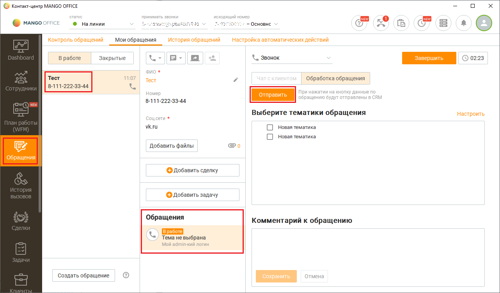
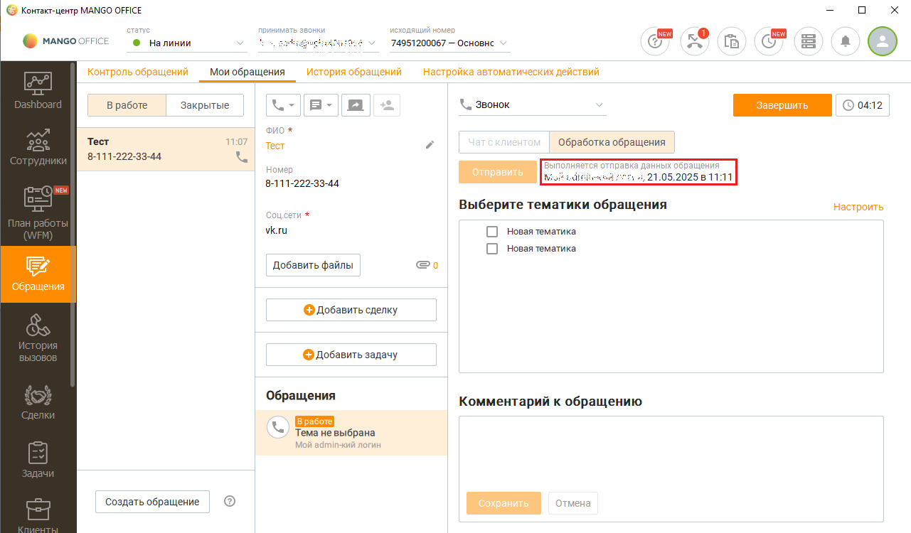

# Как отправить данные о лидах в Битрикс24

> Трассировка: PDF §2.22 · сквозные стр. 113-115 · источники: ч.1 `kb/sources/integration-bitrix24/Mango_office_integration_Bitrix24.pdf` с.113-115.

Чтобы из Контакт-центра MANGO OFFICE в Битрикс24 отправить обращение Клиента, нужно: 1) создать новое обращение Клиента, либо найти ранее созданное обращение Клиента; 2) если по Клиенту зафиксировано несколько обращений, то выбрать обращение, которое надо отправить; 3) нажать кнопку "Отправить": Интеграция Виртуальной АТС MANGO OFFICE и Битрикс24 | Версия от 03.03.2026

> **Описание иллюстрации INTB24-§2.22-1** (к §2.22 «Как отправить данные о лидах в Битрикс24», стр. 114; 1282×752 px). Снимок экрана / схема.
> Относится к тексту руководства: «…е созданное обращение Клиента; 2) если по Клиенту зафиксировано несколько обращений, то выбрать обращение, которое надо отправить; 3) нажать кнопку "Отправить":».
> Текст на изображении (OCR, требует сверки): © конта-центр MANGO OFFICE; стат; AAU; ео; Ys; ro; © млнсоонисе; ® Налинии; зв:; ‘Основнс ©; Gal; fa; Контроль обращений; мои обращения; История обращений; настройка автоматических действий; B работе; Закрытые; Х.. Звонок; ono *; Тест; 11:07; Обработка обращения; 8111; 33-44; Homer; ажатии на Ke; анные; щению; лены в С; 8-111-222-33-44; we; Соцсети *; Выберите тематики обращения; Настроить; vk.ru; О новаятематика; Добавить файлы; Обр:; ия; © Добавить сделку; © добавить задачу; Обращения; Комментарий к обращению; Tema He выбрана; Мой аатип-кий логин; Создать обращение

Данные об обращении будут отправлены в ваш Битрикс24, при этом в Контакт- центре MANGO OFFICE будет выдано сообщение о том, кто и когда отправил обращение:

> **Описание иллюстрации INTB24-§2.22-2** (к §2.22 «Как отправить данные о лидах в Битрикс24», стр. 114; 1281×750 px). Снимок экрана / схема.
> Относится к тексту руководства: «…Данные об обращении будут отправлены в ваш Битрикс24, при этом в Контакт- центре MANGO OFFICE будет выдано сообщение о том, кто и когда отправил обращение:».
> Текст на изображении (OCR, требует сверки): © контакт-центр MANGO OFFICE; стат; искодящи; ео; ro; © млнсоонисе; ® Налинии; оровы; mH; 74951200067 — Основнс ©; Gal; fa; Контроль обращений; мои обращения; История обращений; настройка автоматических действий; B работе; Закрытые; Х.. Звонок; © oan2; ono *; Тест; Обработка обращения; 8-111-222-33-44; Homer; we; Выберите тематики обращения; Настроить; Соцсети *; vk.ru; О новаятематика; Добавить файлы; Обр:; ия; © Добавить сделку; © добавить задачу; Обращения; Комментарий к обращению; Tema He выбрана; Мой аатип-кий логин; Создать обращение

Интеграция Виртуальной АТС MANGO OFFICE и Битрикс24 | Версия от 03.03.2026
