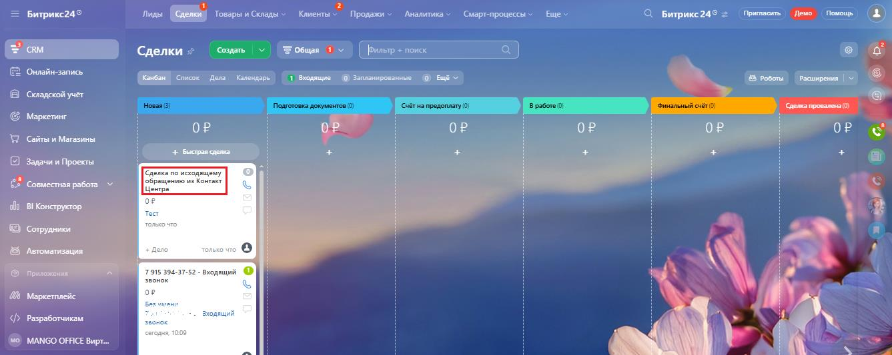
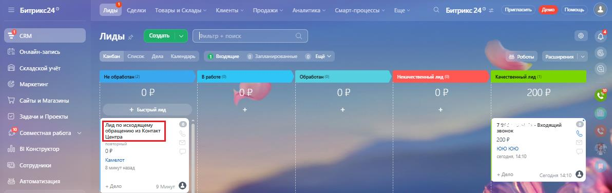

# Как в Битрикс24 посмотреть контакты и сделки, созданные по входящему обращению Контакт-центра MANGO OFFICE

> Трассировка: PDF §2.22 · сквозные стр. 115-116 · источники: ч.1 `kb/sources/integration-bitrix24/Mango_office_integration_Bitrix24.pdf` с.115-116.

обращению Контакт-центра MANGO OFFICE После отправки данных об обращениях из Контакт-центра MANGO OFFICE, в вашем Битрикс24 вы увидите: • новый контакт в разделе "Контакты". Этот контакт будет добавлен в список всех ранее созданных контактов; • новую сделку в группе "Новая" в разделе "Сделки". Новая сделка всегда добавляется в группу "Новая". Чтобы увидеть сделки, относящиеся к Контакт-центру MANGO OFFICE, нужно открыть раздел "Сделки". Сделки, созданные по данным из Контакт-центра, будут иметь название "Сделка по исходящему обращению из Контакт-центра":

> **Описание иллюстрации INTB24-§2.22-1** (к §2.22 «Как в Битрикс24 посмотреть контакты и сделки, созданные по входящему обращению Контакт-центра MANGO OFFICE», стр. 115; 1337×533 px). Снимок экрана / схема.
> Относится к тексту руководства: «…O OFFICE, нужно открыть раздел "Сделки". Сделки, созданные по данным из Контакт-центра, будут иметь название "Сделка по исходящему обращению из Контакт-центра":».
> Текст на изображении (OCR, требует сверки): Битрикс249; ages; nc,; FepeeGpnes Белы > Petes Aunts (ee eee В; ©. Битрикеа4® =; Пригтавить; Сделки >; Онлайн-запись; Кабан | Список; Дела Календарь; 1 водщие — © Зэпязнированные @® ЕщЕ; 18 роботы; Расширения | ©; Складской учёт; Сделка провалена ©); ес; ` Маркетинг; "Сайта и Магазины; ОР; oP; + Быстрая сдвлка; Задачи и Проекты; "Совместная рабов У; oh; lo; BI Конструктор,; Сотрудники; Автоматизация; Приложения; 4-3; входящий; atin; Маркетплейс; oF; Разработчикам; an; oe; nf; MANGO OFFICE Вирт...

Чтобы увидеть лиды, относящиеся к Контакт-центру MANGO OFFICE, нужно открыть раздел "Лиды". Лиды, созданные по данным из Контакт-центра, будут иметь название "Лид по исходящему обращению из Контакт-центра":

> **Описание иллюстрации INTB24-§2.22-2** (к §2.22 «Как в Битрикс24 посмотреть контакты и сделки, созданные по входящему обращению Контакт-центра MANGO OFFICE», стр. 115; 1192×376 px). Снимок экрана / схема.
> Относится к тексту руководства: «…ру MANGO OFFICE, нужно открыть раздел "Лиды". Лиды, созданные по данным из Контакт-центра, будут иметь название "Лид по исходящему обращению из Контакт-центра":».
> Текст на изображении (OCR, требует сверки): Битрикс24°; (ВЫ сель томансомы- Кметы» pom Avance Capr-npouecad~ Ee»; С Битрике24 = Memom Дыю Гожию (B); CRM; `онлайн-зались; ИЕ; 1 Bogie; @) Sannwepocame; @ may; 15 боты Расширения | ©; B складской учёт; G маркетинг; oP; 200 P; WD сайты и Магазины; 4 рый ag; Задачи и Проекты; водящий; звонок; 2 совместная работа м; oF; oly BI Конструктор,; ююк; 8 сотрудники; © Автоматизация:; on

Интеграция Виртуальной АТС MANGO OFFICE и Битрикс24 | Версия от 03.03.2026
