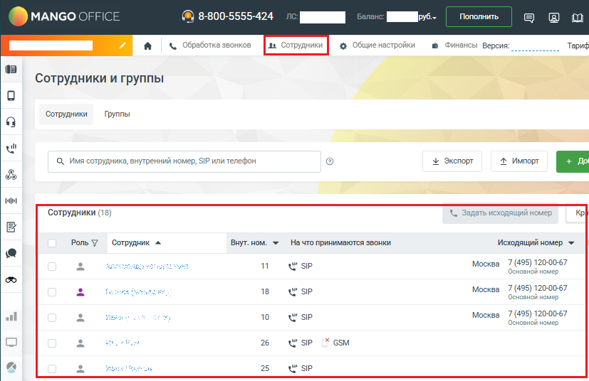
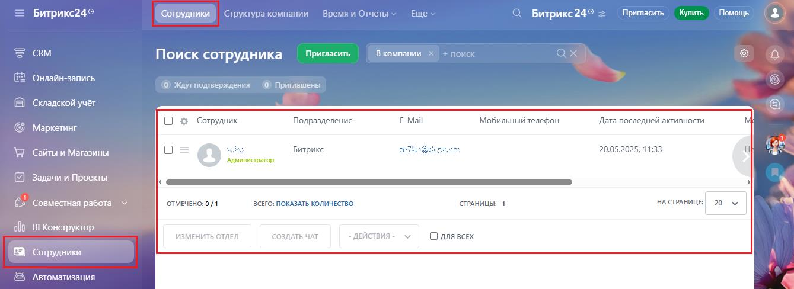

# Как посмотреть списки сотрудников ВАТС и сотрудников Битрикс24

> Трассировка: PDF §1.1 · сквозные стр. 14-15 · источники: ч.1 `kb/sources/integration-bitrix24/Mango_office_integration_Bitrix24.pdf` с.14-15.

В Вашей Виртуальной АТС есть список сотрудников. Посмотреть этот список сотрудников вы можете в Личном кабинете MANGO OFFICE: 1) откройте личный кабинет по ссылке https://lk.mango-office.ru/ 2) откройте раздел "Сотрудники"; Вы увидите список сотрудников вашей Виртуальной АТС:

> **Описание иллюстрации INTB24-§1.1-1** (к §1.1 «Как посмотреть списки сотрудников ВАТС и сотрудников Битрикс24», стр. 14; 827×536 px). Снимок экрана / схема.
> Относится к тексту руководства: «…O OFFICE: 1) откройте личный кабинет по ссылке https://lk.mango-office.ru/ 2) откройте раздел "Сотрудники"; Вы увидите список сотрудников вашей Виртуальной АТС:».
> Текст на изображении (OCR, требует сверки): MANGO OFF!; 8-800-5555-424; as.; Пополнить; оики; HCb; Версия; Тариф; Сотрудники и группы; Сотрудники; Группы; wl; Q Имя сотрудника, внутренний номер, SIP или телефон; ЗУ Экспорт; Л Импорт; ce); мы; Сотрудники (18); \. Задать исходящий номер; Роль У; Сотрудник ^; На что принимаются звонки; Исходящий номер *; 11; SIP; Москва; 7 (495) 120-00-67; we; Основной номер; 18; al; 10; ue; 26; * GSM; us; 25

Интеграция Виртуальной АТС MANGO OFFICE и Битрикс24 | Версия от 03.03.2026 А также, в Вашем Битрикс24 есть список сотрудников. Вы можете его посмотреть в вашем Битрикс24:

> **Описание иллюстрации INTB24-§1.1-2** (к §1.1 «Как посмотреть списки сотрудников ВАТС и сотрудников Битрикс24», стр. 15; 1339×488 px). Снимок экрана / схема.
> Относится к тексту руководства: «…А также, в Вашем Битрикс24 есть список сотрудников. Вы можете его посмотреть в вашем Битрикс24:».
> Текст на изображении (OCR, требует сверки): Битрикс249; ‘Структура компании; Время и Отчеты v; Еще ~; С Битрикс24® =; Пригласить — Купить; Помощь; ее; CRM; Пригласить; Вкомпании x + поиск; ах; Поиск сотрудника; 'Онлайн-запись; Ждут подтверждения; @ приглашены; Складской учёт; О & сотрудник; Подразделение; E-Mail; Мобильный телефон; Aata последней активности; Маркетинг; ‘Сайты и Магазины; Битрикс; te?; 20.05.2025, 11:33; `Администратор; Задачи и Проекты; ED; ‘Совместная работа; ОТМЕЧЕНО: 0/1; ВСЕГО: ПОКАЗАТЬ КОЛИЧЕСТВО; СТРАНИЦЫ: 1; НА СТРАНИЦЕ 20 У; alo; BI Конструктор; ИЗМЕНИТЬ ОТДЕЛ; СОЗДАТЬ ЧАТ; - ДЕЙСТВИЯ -; О для ВСЕХ; Сотрудники; …
