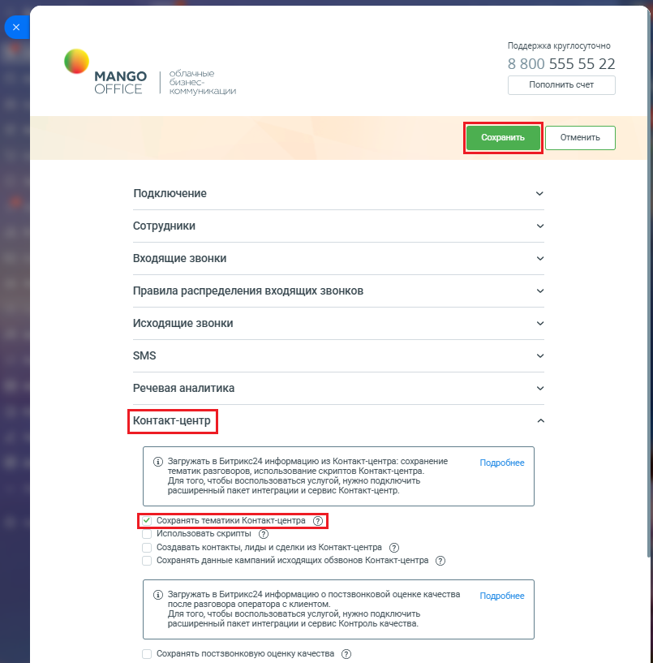

# Как включить настройку

> Трассировка: PDF §2.22 · сквозные стр. 119-120 · источники: ч.1 `kb/sources/integration-bitrix24/Mango_office_integration_Bitrix24.pdf` с.119-120.

Чтобы включить настройку, необходимо: 1) откройте форму настройки приложения интеграции; 2) открыть блок "Контакт-центр"; 3) установите флаг "Сохранять тематики Контакт-Центра"; 4) нажмите кнопку "Сохранить" в верхней части формы настройки приложения интеграции.

> **Описание иллюстрации INTB24-§2.22-1** (к §2.22 «Как включить настройку», стр. 119; 805×817 px). Снимок экрана / схема.
> Относится к тексту руководства: «…в верхней части формы настройки приложения интеграции.».
> Текст на изображении (OCR, требует сверки): Поддержка круглосуточно; 8 800 555 55 22; ачные; МАМСО; OFFICE; чикации; Пополнить счет; Подключение; Сотрудники; Входящие звонки; Правила распределения входящих звонков; Исходящие звонки; SMS; Речевая аналитика; @ Загружать в Битрикс24 информацию из Контакт-центра: сохранение; Подробнее; тематик разговоров, использование скриптов Контакт-центра.; Для того, чтобы воспользоваться услугой, нужно подключить; расширенный пакет интеграции и сервис Контакт-центр.; Использовать скрипты; Создавать контакты, лиды и сделки из Контакт-центра (2); Сохранять данные кампаний исходящих обзвонов Контакт-центр…

Интеграция Виртуальной АТС MANGO OFFICE и Битрикс24 | Версия от 03.03.2026
