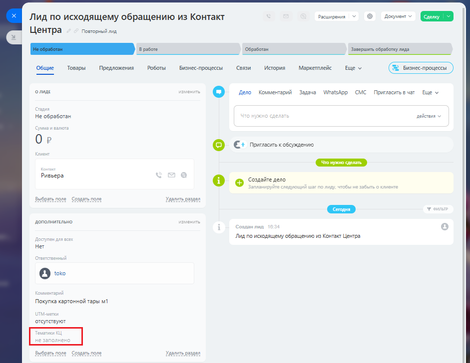

# Как посмотреть тематику Контакт-Центра

> Трассировка: PDF §2.22 · сквозные стр. 120 · источники: ч.1 `kb/sources/integration-bitrix24/Mango_office_integration_Bitrix24.pdf` с.120.

Тематики сохраняются в контакте, компании или лиде Битрикс24 в поле под названием "Тематики КЦ". Например, на рисунке ниже красным выделено это поле в лиде:

> **Описание иллюстрации INTB24-§2.22-1** (к §2.22 «Как посмотреть тематику Контакт-Центра», стр. 120; 941×728 px). Снимок экрана / схема.
> Относится к тексту руководства: «…тра Тематики сохраняются в контакте, компании или лиде Битрикс24 в поле под названием "Тематики КЦ". Например, на рисунке ниже красным выделено это поле в лиде:».
> Текст на изображении (OCR, требует сверки): Jing по исходящему обращению из Контакт; Расширения; @ Bowen; Повторный лид; Центра; обработан; Завершить обработку лида; Роботы; cern; Общие; Товары; Предложения; Бизнес процессы; ‘история,; Маркетплейс; Ewe v; oma; Дело; Комментарий; Задача; WhatsApp СМС Притаситьечат Еще у; He обработан; дейстия >; Ор; © С: Penman cosontenne; Ривьера; © 9 wmiescr; est,; pagar. 20!; vie pane; дополниильно; Лад по исходящему обращению из Контакт Центра; Her; Покупка картонной тары м1; ‘отсутствуют; Seat,; здать поле; Yeas pasnen
