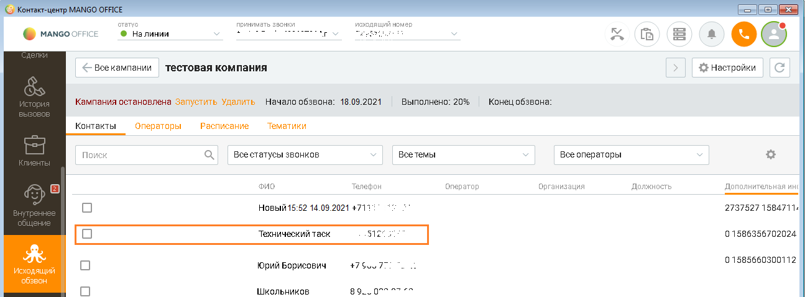

# Понятие "Технический таск" в кампании исходящего обзвона

> Трассировка: PDF §2.22 · сквозные стр. 121-122 · источники: ч.1 `kb/sources/integration-bitrix24/Mango_office_integration_Bitrix24.pdf` с.121-122.

После того как вы настроили интеграцию с Контакт-центром MANGO OFFICE через вебхуки и первый номер Клиента был добавлен выбранную вам кампанию исходящего обзвона, вы можете, открыв карточку кампании в Контакт-центре MANGO OFFICE, увидеть технический таск. Вот так:

> **Описание иллюстрации INTB24-§2.22-1** (к §2.22 «Понятие "Технический таск" в кампании исходящего обзвона», стр. 121; 1295×479 px). Снимок экрана / схема.
> Относится к тексту руководства: «…та был добавлен выбранную вам кампанию исходящего обзвона, вы можете, открыв карточку кампании в Контакт-центре MANGO OFFICE, увидеть технический таск. Вот так:».
> Текст на изображении (OCR, требует сверки): crane; принимать звонки; исходящий номер; @ Налинии; ry; © намсоонисе; fa; <= Bee кампании; тестовая компания; $} Настройки; Кампания остановлена запустить Удалить; Начало обзвона: 18.09.2021; выполнено: 20%; Конец обзвона; Контакты; Операторы; Расписание; Тематики; Поиск; Всестатусы звонков; всетемы; Все операторы; Фи; Телефон; оператор; Организация; Должность; Дополнительная инс; Новый15:52 14.09.2021 +711; 2737527 1584711.; Технический таск; sie; 0.1586356702024; 0.1585660300112; яций; Юрий Борисович; 475; звон; Школьников; 89.; green

Технический таск – это служебная задача кампании исходящего обзвона, согласно которой ваша Виртуальная АТС должна выполнить автозвонок (звонок самое себе). Этот автозвонок необходим, чтобы кампания исходящего обзвона не была завершена автоматически (не перешла в статус "Завершена"). Примечание. Статус "Завершена" означает, что кампания исходящего обзвона полностью остановлена, вы не можете добавлять в нее номера Клиентов, не можете повторно ее запустить. Подробнее о статусах кампаний вы можете прочитать в Руководстве пользователя КЦ. Интеграция Виртуальной АТС MANGO OFFICE и Битрикс24 | Версия от 03.03.2026 Автозвонок создается автоматически при первом добавлении номера в кампанию исходящего обзвона через вебхуки. При втором и последующих добавлениях номеров, такой таск не создается (потому что он там уже есть).
