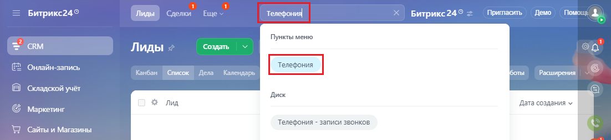
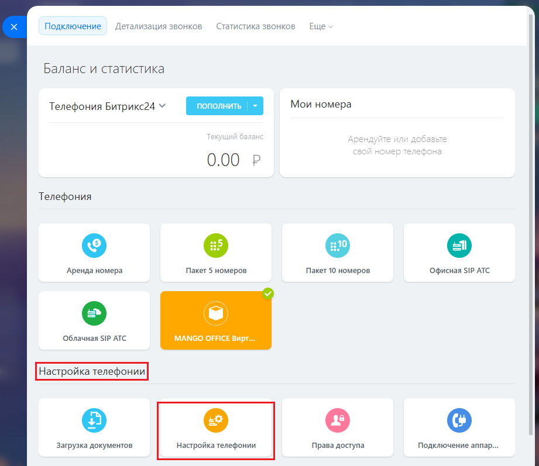
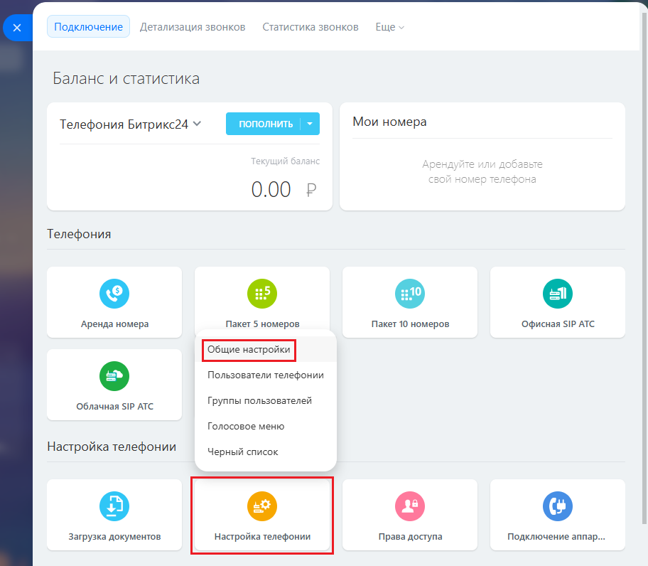
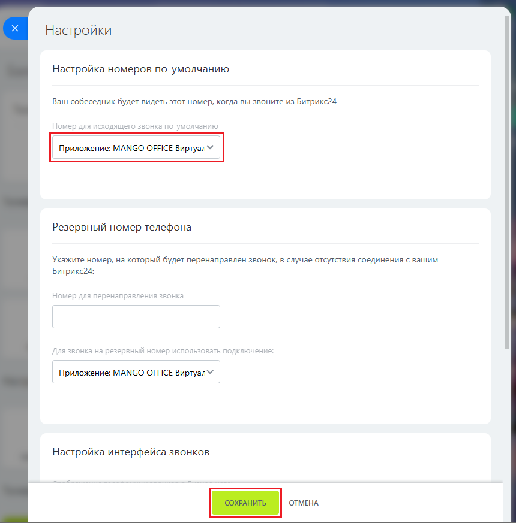

# Шаг 6. Проверка настройки телефонии

> Трассировка: PDF §1.1 · сквозные стр. 15-18 · источники: ч.1 `kb/sources/integration-bitrix24/Mango_office_integration_Bitrix24.pdf` с.15-18.

Обычно настройки телефонии устанавливаются одновременно с установкой приложения интеграции, но в некоторых случаях они могут быть не установлены автоматически. Чтобы проверить установлены ли настройки телефонии, откройте раздел "Телефония" вашего Битрикс24 и выполните следующие действия: 1) нажмите кнопку "Настройка телефонии" или в поле "Поиск" введите "Телефония";

> **Описание иллюстрации INTB24-§1.1-1** (к §1.1 «Шаг 6. Проверка настройки телефонии», стр. 15; 1102×254 px). Снимок экрана / схема.
> Относится к тексту руководства: «…ии, откройте раздел "Телефония" вашего Битрикс24 и выполните следующие действия: 1) нажмите кнопку "Настройка телефонии" или в поле "Поиск" введите "Телефония";».
> Текст на изображении (OCR, требует сверки): Bwrpuxc24°; TED Gren Ewe v; Телефония; Притасить — flewo Помс; Битрикс24® =; Пункты меню; cRM; Лиды; Создать; Онлайн-запись; Канбан; Список | Дела Календарь; Расширения; Складской учет; Диск; tug; Дата создания у; Маркетинг; Сайты и Магазины; "Телефония - записи звонков

Интеграция Виртуальной АТС MANGO OFFICE и Битрикс24 | Версия от 03.03.2026 2) в группе полей "Настройки телефонии" нажмите на кнопку "Настройки телефонии":

> **Описание иллюстрации INTB24-§1.1-2** (к §1.1 «Шаг 6. Проверка настройки телефонии», стр. 16; 921×797 px). Снимок экрана / схема.
> Относится к тексту руководства: «…2) в группе полей "Настройки телефонии" нажмите на кнопку "Настройки телефонии":».
> Текст на изображении (OCR, требует сверки): Подключение; Детализация звонков:; Статистика звонков; Еще; Баланс и статистика; Телефония Битрикс24 ¥; Мои номера; 0.00; Телефония; `дренда номера; Пакет 5 номеров; Пакет 10 номеров.; Офисная SIP АТС; Облачная ЯР АТС; MANGO OFFICE Вирт...; Загрузка документов; 'Настройка телефонии; Права доступа; Подключение аппар.

Интеграция Виртуальной АТС MANGO OFFICE и Битрикс24 | Версия от 03.03.2026 В открывшемся меню нажмите "Общие настройки”:

> **Описание иллюстрации INTB24-§1.1-3** (к §1.1 «Шаг 6. Проверка настройки телефонии», стр. 17; 912×796 px). Снимок экрана / схема.
> Относится к тексту руководства: «…В открывшемся меню нажмите "Общие настройки”:».
> Текст на изображении (OCR, требует сверки): Подключение; Детализация звонков:; Статистика звонков; Еще; Баланс и статистика; Мои номера; Телефония Битрикс24 ¥; енд}; 0.00 Р; Телефония; `дренда номера; Пакет 5 номеров; Пакет 10 номеров.; Офисная SIP АТС; Пользователи телефонии; Облачная ЯР АТС; Группы пользователей; Голосовое меню; Настройка телефонии; Черный список; Загрузка документов; 'Настройка телефонии; Права доступа; Подключение аппар.

Интеграция Виртуальной АТС MANGO OFFICE и Битрикс24 | Версия от 03.03.2026 3) в открывшейся форме "Настройки" проверьте, что в поле "Настройка номеров по умолчанию" указано значение Приложение: MANGO OFFICE 4) Если там указано иное значение, то вам нужно: - в поле "Настройка номеров по умолчанию" выбрать "Приложение: MANGO OFFICE"; - нажать кнопку "Сохранить" в нижней части формы "Настройки":

> **Описание иллюстрации INTB24-§1.1-4** (к §1.1 «Шаг 6. Проверка настройки телефонии», стр. 18; 860×873 px). Снимок экрана / схема.
> Относится к тексту руководства: «…чение, то вам нужно: - в поле "Настройка номеров по умолчанию" выбрать "Приложение: MANGO OFFICE"; - нажать кнопку "Сохранить" в нижней части формы "Настройки":».
> Текст на изображении (OCR, требует сверки): Настройки; Настройка номеров по-умолчанию; Ваш собеседник будет видеть этот номер, когда вы звоните из Битрикс24; Ня; Aas; ра; аня; As; CxO; аник; Резервный номер телефона; Укажите номер, на который будет перенаправлен звонок, в случае отсутствия соединения с вашим; Битрикс24:; лер; Нан; ена; ae; авлен; аа; 3B; ne see; РА ать НАЯкЯ; а на; ер; спо; 30; BaTb; юч; ен; Приложение: MANGO OFFICE Buptyas ¥; Настройка интерфейса звонков

Вы установили и настроили интеграцию между Виртуальной АТС и Битрикс24.
