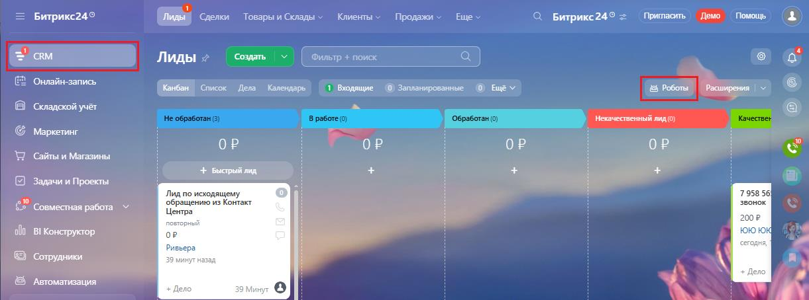
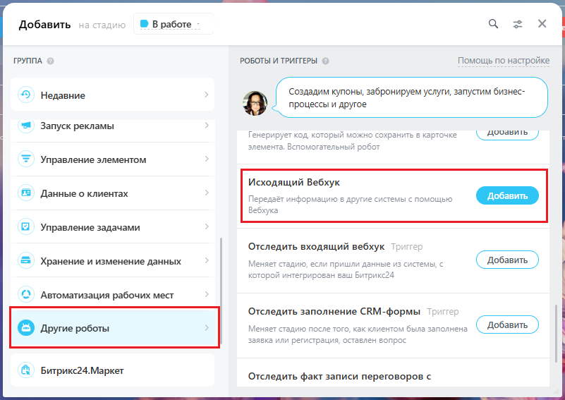
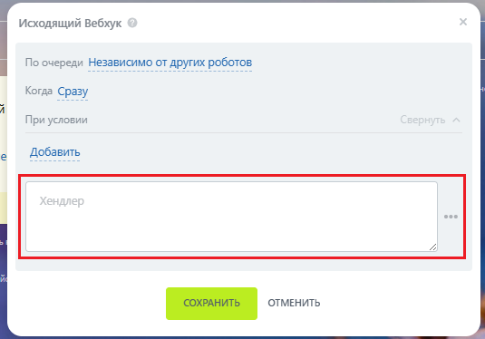
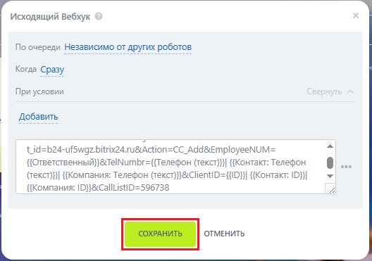

# Как добавить вебхуки интеграции в робота в Битрик24

> Трассировка: PDF §2.22 · сквозные стр. 124-126 · источники: ч.1 `kb/sources/integration-bitrix24/Mango_office_integration_Bitrix24.pdf` с.124-126.

В Битрикс24 выполните следующие действия: 1) выберите пункт "CRM"; 2) выберите пункт "Роботы:

> **Описание иллюстрации INTB24-§2.22-1** (к §2.22 «Как добавить вебхуки интеграции в робота в Битрик24», стр. 124; 1221×454 px). Снимок экрана / схема.
> Относится к тексту руководства: «…Как добавить вебхуки интеграции в робота в Битрик24 В Битрикс24 выполните следующие действия: 1) выберите пункт "CRM"; 2) выберите пункт "Роботы:».
> Текст на изображении (OCR, требует сверки): = Битрикс24®; Сделки Товары и Склады v; Клиенты »; Продажи »; _ Демо; Wiicwue; С Битрикс24® =; Лиды х; Создать |“ | | Фильтр + поиск; Онлайн-запись; (5 Роботы; Bei; Список lena Календарь; 1 Бодящие (©) Запланированные (0) Ewe v; Расширения | ~; Складской учёт; Е Ею; Маркетинг; ОР; Сайты и Магазины; + Быстрый лид.; Задачи и Проекты:; Jing по исходящему; 7958 56; ex; обращению из Контакт; вонок; ‘Совместная работа; Центра; 100 P; ный; ola; BI Конструктор; oP; 10; дня,; Ривьер:; Сотрудники; 39 мину; ‘Автоматизация

3) выберите этап воронки продаж, в котором нужно создать робота и нажмите кнопку "Добавить" (плюс);

> **Описание иллюстрации INTB24-§2.22-2** (к §2.22 «Как добавить вебхуки интеграции в робота в Битрик24», стр. 124; 1225×455 px). Снимок экрана / схема.
> Относится к тексту руководства: «…ействия: 1) выберите пункт "CRM"; 2) выберите пункт "Роботы: 3) выберите этап воронки продаж, в котором нужно создать робота и нажмите кнопку "Добавить" (плюс);».
> Текст на изображении (OCR, требует сверки): бо; ul; ть; iT; bI; eons; ботан; B работе; Обработан,; rep; изн; B mrsavinepe Бизнес-; Popacriposar в asap бек; процессов; процессое; Pepacraponare 8; действия; Групповые дебствия; Групповые действия; групвовые)

Интеграция Виртуальной АТС MANGO OFFICE и Битрикс24 | Версия от 03.03.2026 4) выберите пункт "Другие роботы"; 5) в строке "Исходящий вебхук" нажмите "Добавить":

> **Описание иллюстрации INTB24-§2.22-3** (к §2.22 «Как добавить вебхуки интеграции в робота в Битрик24», стр. 125; 801×567 px). Снимок экрана / схема.
> Относится к тексту руководства: «…4) выберите пункт "Другие роботы"; 5) в строке "Исходящий вебхук" нажмите "Добавить":».
> Текст на изображении (OCR, требует сверки): ® В работе; oe; Добавить; ГРУППА; РОБОТЫ И ТРИГГЕРЫ; Помощь по настройке; > Недавние; Создадим купоны, забронируем услуги, запустим бизнес-; процессы и другое; Запуск рекламы; Генери; орый; хранить в ка; чке; \ дооавить ); элемента. Бспомога; льный робо; Управление элементом; Исходящий Вебхук; Данные о клиентах; Передаёт; нформацию в другие системы с помощью; Управление задачами; Отследить входящий вебхук; Хранение и изменение данных; Меняет с; ные; истемы; и пришл; ко’; рован ваш Битрикс.; Автоматизация рабочих мест; Отследить заполнение СКМ-формы; ся; © Tor; TO; го, как клиентом была; © Друг…

6) в поле "Хендлер" вставьте ранее скопированный вами вебхуки;

> **Описание иллюстрации INTB24-§2.22-4** (к §2.22 «Как добавить вебхуки интеграции в робота в Битрик24», стр. 125; 535×374 px). Снимок экрана / схема.
> Относится к тексту руководства: «…4) выберите пункт "Другие роботы"; 5) в строке "Исходящий вебхук" нажмите "Добавить": 6) в поле "Хендлер" вставьте ранее скопированный вами вебхуки;».
> Текст на изображении (OCR, требует сверки): Исходящий Вебхук; По очереди Независимо от других роботов; Когда Сразу; При условии; Добавить; eee

7) нажмите кнопку "Сохранить":

> **Описание иллюстрации INTB24-§2.22-5** (к §2.22 «Как добавить вебхуки интеграции в робота в Битрик24», стр. 125; 528×371 px). Снимок экрана / схема.
> Относится к тексту руководства: «…Другие роботы"; 5) в строке "Исходящий вебхук" нажмите "Добавить": 6) в поле "Хендлер" вставьте ранее скопированный вами вебхуки; 7) нажмите кнопку "Сохранить":».
> Текст на изображении (OCR, требует сверки): Исходящий Вебхук; По очереди Независимо от других роботов; eer a; Когда Сразу; weet; При условии; Добавить; ЕО; tid=b24-ufSwqz.bitrix24.ru&Action=CC_Add@&EmployeeNUM=; {{Ответственный}} &Те!МитЬг={Телефон (TeKct)}| {{Контакт: Телефон; (текст)}}| {Компания: Телефон (TeKkct)}}&ClientID={{ID}}| {{Контакт: 12} |; {{Компания: |D}}&CallListID=596738

Настройка робота завершена. Интеграция Виртуальной АТС MANGO OFFICE и Битрикс24 | Версия от 03.03.2026
