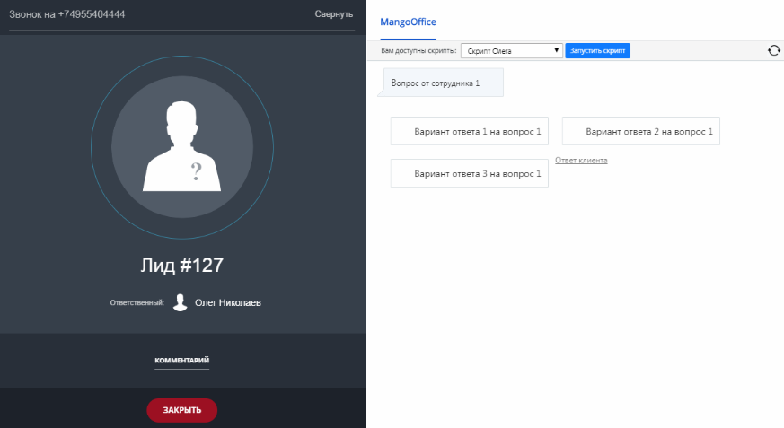
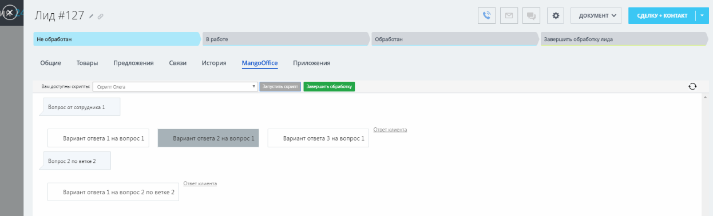

# Скрипты

> Трассировка: PDF §2.22 · сквозные стр. 126-127 · источники: ч.1 `kb/sources/integration-bitrix24/Mango_office_integration_Bitrix24.pdf` с.126-127.

Если вы хотите: ● повысить продажи, средний чек и удовлетворенность Клиентов; ● обучать сотрудников и повышать компетенцию компании; ● сообщать Клиентам и получать у Клиентов точную информацию, то начните использовать скрипты разговора в Битрикс24. Прямо в интерфейсе Битрикс24 при поступлении звонка, у сотрудника открывается диалоговое окно с вопросом, который он задает Клиенту и вариантами ответа на него:

> **Описание иллюстрации INTB24-§2.22-1** (к §2.22 «Скрипты», стр. 126; 873×477 px). Снимок экрана / схема.
> Относится к тексту руководства: «…Прямо в интерфейсе Битрикс24 при поступлении звонка, у сотрудника открывается диалоговое окно с вопросом, который он задает Клиенту и вариантами ответа на него:».
> Текст на изображении (OCR, требует сверки): 44; 9554; Cae; MangoOffice; Вам; =i ск; сх; Олега; era; Во; яр; отрудника; Вариант; cl; Ha в; Orne:; Вариант о; a3H; Лид #127; Ответственный 3 Олег Николаев; КОММЕНТАРИЙ; cull

Интеграция Виртуальной АТС MANGO OFFICE и Битрикс24 | Версия от 03.03.2026

> **Описание иллюстрации INTB24-§2.22-2** (к §2.22 «Скрипты», стр. 127; 907×492 px). Снимок экрана / схема.
> Относится к тексту руководства: «…Прямо в интерфейсе Битрикс24 при поступлении звонка, у сотрудника открывается диалоговое окно с вопросом, который он задает Клиенту и вариантами ответа на него:».
> Текст на изображении (OCR, требует сверки): нь; Скрипты Al; wes; oe; р. Входящий звонок; Акционное предложение; Начни с презентации акционного предложения и подчеркни его; уникальность и ограниченность во времени, Это создаст ощущение; срочности и эксклюзивности,; ыы; Оттетствеиный; Объясни выгоды и преимущества экционного предложения,; которые клиент получит. Убедись, что они соответствуют его; потребностям и интересам,; используй социальное доказательство и расскажи о других клиентах,; которые уже воспользовались экцией и остались довольны.; Youn, есть ли у клиента вопросы или сомнения, и ответь на них с; уверенностью, предоставляя до…

Сотрудник выбирает вариант ответа Клиента, при необходимости дополняет его комментарием. При необходимости уточнить данные по Клиенту, сотрудник переходит в карточку Клиента и там же продолжает прохождение скрипта, и тут же обновляя данные о Клиенте:

> **Описание иллюстрации INTB24-§2.22-3** (к §2.22 «Скрипты», стр. 127; 1246×378 px). Снимок экрана / схема.
> Относится к тексту руководства: «…ри необходимости уточнить данные по Клиенту, сотрудник переходит в карточку Клиента и там же продолжает прохождение скрипта, и тут же обновляя данные о Клиенте:».
> Текст на изображении (OCR, требует сверки): Ax; Лид #127 7 2; КЕ]; ema i; завершить обработкулида:; Связи; Общие; Товары; Предложения; ‘История; ‘Mangooffice; Приложения; fm gery eer; oper One; cs); Вопрос or conpyanuna; Сената; Вариант ответа 3 на eonpoc 1; Вопрос 2 no vente 2; Вариант ответа 1 на вопрос 2 по ветке?

Работа со скриптами доступна только во время звонка или после окончания звонка, если во время звонка было начато прохождение скрипта.
