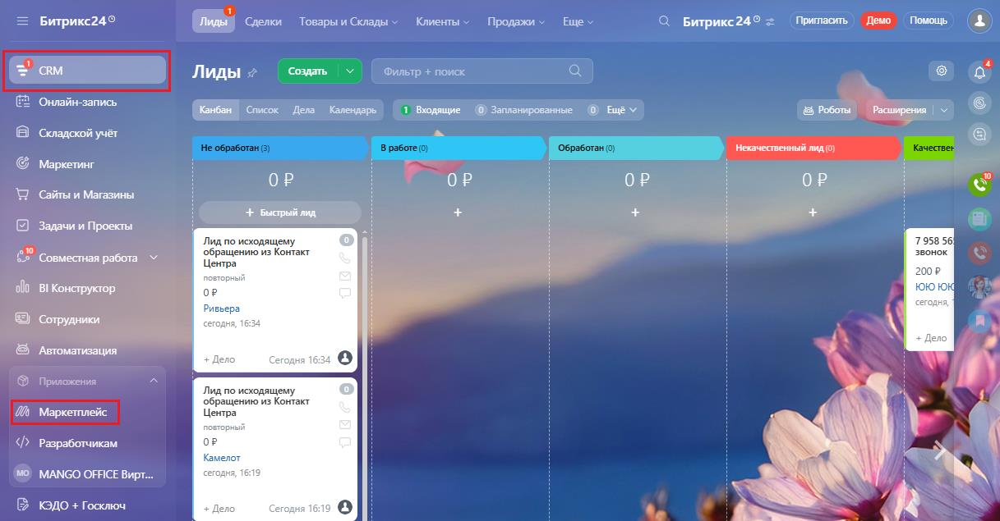
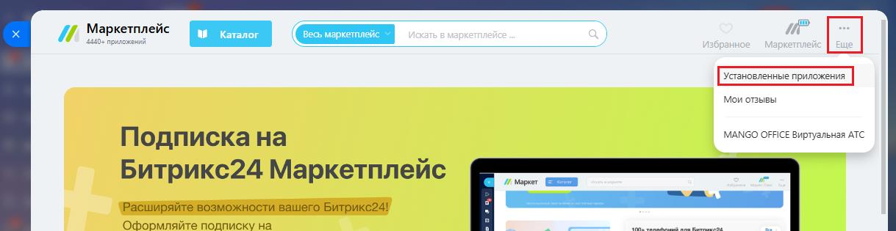
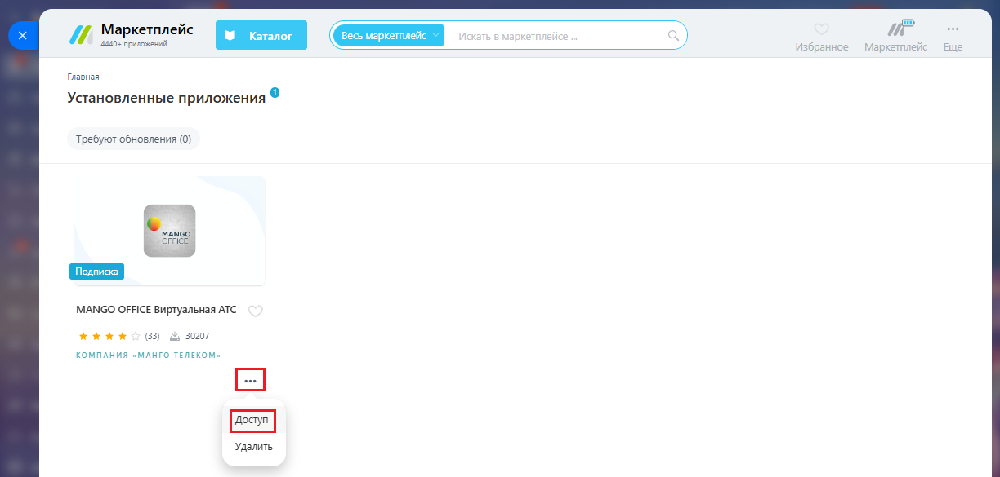
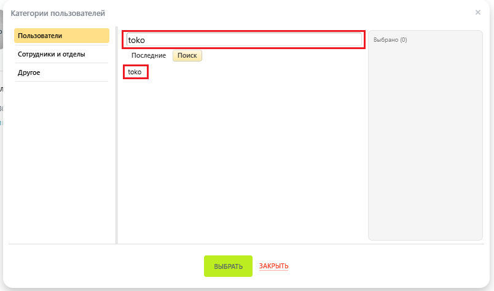
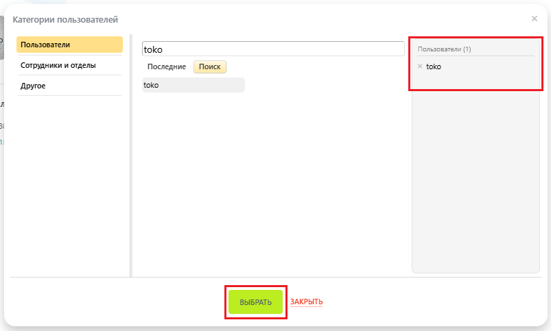

# Как выдать или снять права доступа к приложению интеграции

> Трассировка: PDF §2.22 · сквозные стр. 128-130 · источники: ч.1 `kb/sources/integration-bitrix24/Mango_office_integration_Bitrix24.pdf` с.128-130.

Для этого, в вашем Битрикс24 выполните следующие действия: 1) нажмите на пункт "Маркетплейс" в блоке "Приложения":

> **Описание иллюстрации INTB24-§2.22-1** (к §2.22 «Как выдать или снять права доступа к приложению интеграции», стр. 128; 1217×635 px). Снимок экрана / схема.
> Относится к тексту руководства: «…и снять права доступа к приложению интеграции Для этого, в вашем Битрикс24 выполните следующие действия: 1) нажмите на пункт "Маркетплейс" в блоке "Приложения":».
> Текст на изображении (OCR, требует сверки): ЕЕ; = Битрикс24®; Г бе fini: Game ge ЧЕр; С Битрикс24® =; Лиды № сомть = | оилыр поиск; Онлайн-запись; _1 Бодящие — ©) Запланированные; @ tev; & Роботы; Расширения |; Канбан | Список Дела Календарь; Складской учёт; 'Некачественный mma (0; Маркетинг; с tts; Сайты и Магазины; ОР; oy; + Bucrpuit лид.; Задачи и Проекты:; eo; Лид по исходящему; звонок; 7958 56; oe; Совместная работа Y; Центра; обращению из Контакт; ola; BI Конструктор; op; 10K; Ривы; Автоматизация; Приложения.; 'Маркетплейс; Разработчикам; MANGO OFFICE Вирт.; АТ.; SS; КЭДО + Госключ

2) нажмите на пункт "Еще", затем выберите пункт "Установленные приложения":

> **Описание иллюстрации INTB24-§2.22-2** (к §2.22 «Как выдать или снять права доступа к приложению интеграции», стр. 128; 1219×315 px). Снимок экрана / схема.
> Относится к тексту руководства: «…"Еще", затем выберите пункт "Установленные приложения":».
> Текст на изображении (OCR, требует сверки): Мо; ‚вы; MANGO OFFICE Виртуальная ATC; Подписка Ha; Битрикс24 Маркетплейс; И может; rz; Расширяйте возможности вашего Битрикс241; Оформляйте подписку на

Интеграция Виртуальной АТС MANGO OFFICE и Битрикс24 | Версия от 03.03.2026 3) нажмите на кнопку с тремя точками, затем нажмите на пункт "Доступ":

> **Описание иллюстрации INTB24-§2.22-3** (к §2.22 «Как выдать или снять права доступа к приложению интеграции», стр. 129; 1224×585 px). Снимок экрана / схема.
> Относится к тексту руководства: «…3) нажмите на кнопку с тремя точками, затем нажмите на пункт "Доступ":».
> Текст на изображении (OCR, требует сверки): до; Маркетплейс; 40 приложений; Главная; Установленные приложения; Требуют обновления (0); mango; orice; MANGO OFFICE Виртуальная ATC; жжжх; КОМПАНИЯ МАНГО TEREKOM~; EJ; Удалить

4) введите имя сотрудника или отдела, которым будет предоставлен доступ к приложению интеграции. Будет показан список соответствующих сотрудников; 5) нажмите на имя сотрудника, которому будет предоставлен доступ;

> **Описание иллюстрации INTB24-§2.22-4** (к §2.22 «Как выдать или снять права доступа к приложению интеграции», стр. 129; 804×474 px). Снимок экрана / схема.
> Относится к тексту руководства: «…Будет показан список соответствующих сотрудников; 5) нажмите на имя сотрудника, которому будет предоставлен доступ;».
> Текст на изображении (OCR, требует сверки): Категории пользователей; Сотрудники и отделы; Последние; Поиск; Другое

Интеграция Виртуальной АТС MANGO OFFICE и Битрикс24 | Версия от 03.03.2026 6) выбранный сотрудник будет показан в списке "Пользователи"; 7) нажмите кнопку "Выбрать":

> **Описание иллюстрации INTB24-§2.22-5** (к §2.22 «Как выдать или снять права доступа к приложению интеграции», стр. 130; 803×483 px). Снимок экрана / схема.
> Относится к тексту руководства: «…6) выбранный сотрудник будет показан в списке "Пользователи"; 7) нажмите кнопку "Выбрать":».
> Текст на изображении (OCR, требует сверки): Категории пользователей; Ea; [око; Пользователи (1); Сотрудники и отделы; Последние; Поиск; > toko; toko; Apyroe; ЗАКРЫТЬ
