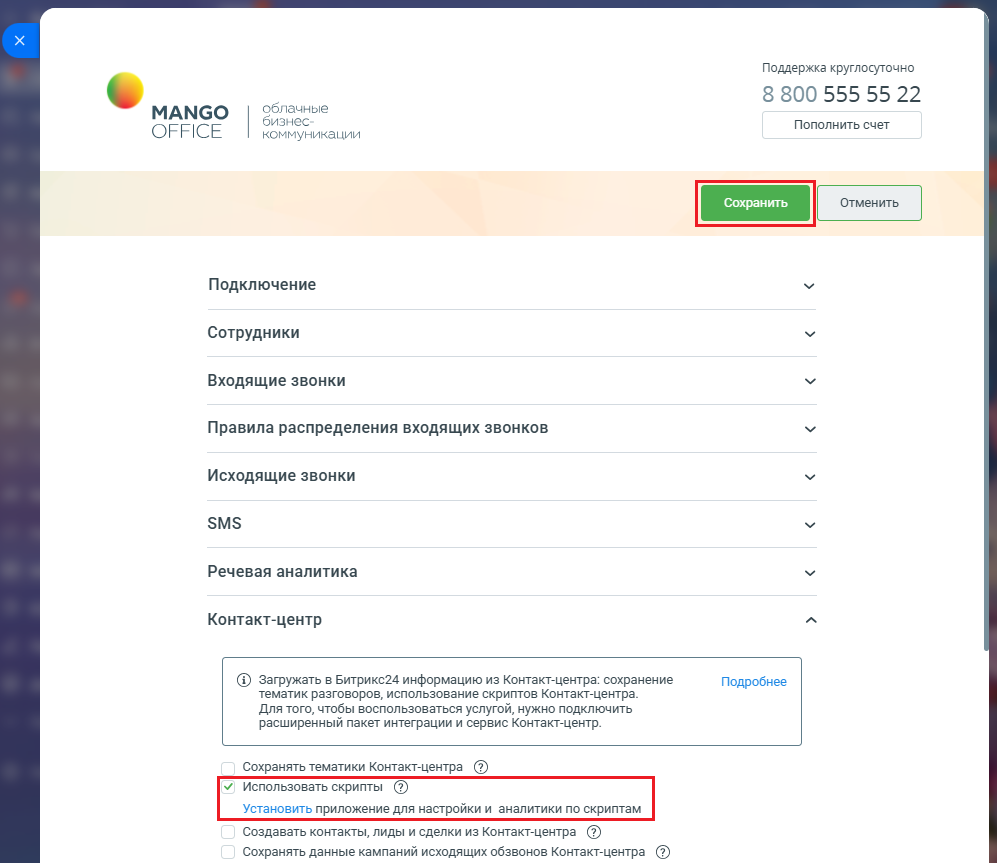

# Как включить использование скриптов в приложении

> Трассировка: PDF §2.22 · сквозные стр. 130-132 · источники: ч.1 `kb/sources/integration-bitrix24/Mango_office_integration_Bitrix24.pdf` с.130-132.

Для начала убедитесь, что вы используете расширенный пакет интеграции и Контакт-центр, с доступом к скриптам. Кроме того, включать использование скриптов могут только сотрудники Битрикс24, которым предоставлен доступ к приложению интеграции. Чтобы включить использованием скриптов, в вашем Битрикс24 необходимо: 1) откройте форму настройки приложения интеграции; 2) откройте блок "Контакт-центр"; 3) установите флаг "Использовать скрипты"; Примечание. Приложение интеграции с Битрикс24 должно быть настроено в соответствии с требованиями, чтобы в нем был доступен флаг "Использовать скрипты". 4) нажмите кнопку "Сохранить" в верхней части формы настройки приложения интеграции: Интеграция Виртуальной АТС MANGO OFFICE и Битрикс24 | Версия от 03.03.2026

> **Описание иллюстрации INTB24-§2.22-1** (к §2.22 «Как включить использование скриптов в приложении», стр. 131; 997×863 px). Снимок экрана / схема.
> Относится к тексту руководства: «…в верхней части формы настройки приложения интеграции:».
> Текст на изображении (OCR, требует сверки): Поддержка круглосуточно; 8 800 555 55 22; Облачные; МАМСО; бизнес:; Пополнить счет; OFFICE; коммуникации; Подключение; Сотрудники; Входящие звонки; Правила распределения входящих звонков; Исходящие звонки; SMS; Речевая аналитика; Контакт-центр; © загружать в Битрикс24 информацию из Контакт-центра: сохранение; Подробнее; тематик разговоров, использование скриптов Контакт-центра.; Для того, чтобы воспользоваться услугой, нужно подключить; расширенный пакет интеграции и сервис Контакт-центр.; Сохранять тематики Контактиентра_@); ‘Создавать контакты, лиды и сделки из Контактцентра @; ‘Сохранять да…

Интеграция Виртуальной АТС MANGO OFFICE и Битрикс24 | Версия от 03.03.2026
