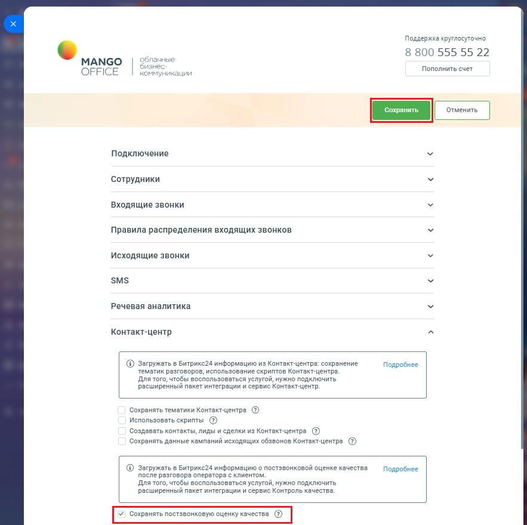

# Сохранять постзвонковую оценку качества

> Трассировка: PDF §2.22 · сквозные стр. 132-133 · источники: ч.1 `kb/sources/integration-bitrix24/Mango_office_integration_Bitrix24.pdf` с.132-133.

После разговора Клиент может оценить качество диалога с оператором, эта информация автоматически сохраняется в Контакт-центре MANGO OFFICE. А если вы включите настройку "Сохранять постзвонковую оценку качества", то оценка, которую поставил Клиент будет автоматически загружаться в информацию о звонке в Битрикс24. Чтобы включить загрузку оценки диалога с оператором, выданную Клиентом, в вашем Битрикс24 необходимо: 1) откройте форму настройки приложения интеграции; 2) откройте блок "Контакт-центр"; 3) установите флаг "Сохранять постзвонковую оценку качества"; 4) нажмите кнопку "Сохранить" в верхней части формы настройки приложения интеграции:

> **Описание иллюстрации INTB24-§2.22-1** (к §2.22 «Сохранять постзвонковую оценку качества», стр. 132; 883×880 px). Снимок экрана / схема.
> Относится к тексту руководства: «…в верхней части формы настройки приложения интеграции:».
> Текст на изображении (OCR, требует сверки): Поддержка круглосуточно; SS; 8 800 555 55 22; MANGO; лачные; знес; Пополнить счет; OFFICE; коммуникации; Подключение; Сотрудники; Входящие звонки; Правила распределения входящих звонков; Исходящие звонки; SMS; Речевая аналитика; Контакт-центр; @ Загружать в Битрикс24 информацию из Контакт-центра: сохранение; Подробнее; тематик разговоров, использование скриптов Контакт-центра.; Для того, чтобы воспользоваться услугой, нужно подключить; расширенный пакет интеграции и сервис Контакт-центр.; Сохранять тематики Контакт-центра (@); Использовать скрипты (2); Создавать контакты, лиды и сделки из Конт…

Интеграция Виртуальной АТС MANGO OFFICE и Битрикс24 | Версия от 03.03.2026
