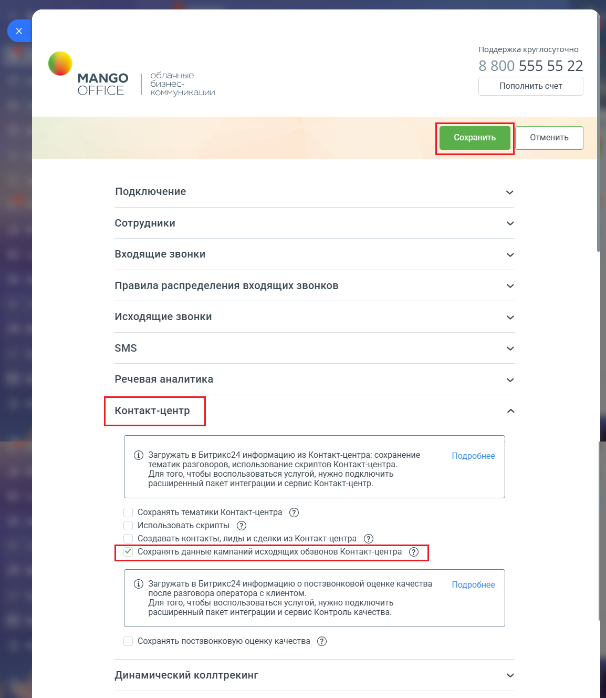

# Сохранять данные кампаний исходящих обзвонов Контакт-центра

> Трассировка: PDF §2.22 · сквозные стр. 133-134 · источники: ч.1 `kb/sources/integration-bitrix24/Mango_office_integration_Bitrix24.pdf` с.133-134.

Если данная настройка включена, то интеграция в вашем Битрикс24 будет автоматически создавать лиды и контакты, в которые будет сохранять данные о клиентах, указанных в кампании исходящего обзвона в Контакт-центра. Эти лиды и контакты создаются в момент проведения кампании исходящего обзвона в Контакт-центре. Важно. Если вы включили данную настройку, то создание лидов и контактов выполняется независимо от статуса настройки "Автоматически создавать лид и дело при исходящих звонках" (включена \ выключена). Чтобы включить данную настройку, в вашем Битрикс24 необходимо: 1) откройте форму настройки приложения интеграции; 2) откройте блок "Контакт-центр"; 3) установите флаг "Сохранять данные кампаний исходящих обзвонов Контакт- центра"; 4) нажмите кнопку "Сохранить" в верхней части формы настройки приложения интеграции:

> **Описание иллюстрации INTB24-§2.22-1** (к §2.22 «Сохранять данные кампаний исходящих обзвонов Контакт-центра», стр. 133; 1154×1328 px). Снимок экрана / схема.
> Относится к тексту руководства: «…в верхней части формы настройки приложения интеграции:».
> Текст на изображении (OCR, требует сверки): Поддержка круглосуточно; 8 800 555 55 22; облачные; МАМСО; бизнес-; Пополнить счет; OFFICE; коммуникации; Подключение; Сотрудники; Входящие звонки; Правила распределения входящих звонков; Исходящие звонки; SMS; Речевая аналитика; ® загружать в Битрикс24 информацию из Контакт-центра: сохранение; Подробнее; тематик разговоров, использование скриптов Контакт-центр.; Для того, чтобы воспользоваться услугой, нужно подключить; расширенный пакет интеграции и сервис Контакт-центр.; Сохранять тематики Контакт-центра @; Использовать скрипты @); Создавать контакты, лиды и сделки из Контакт-центра (@); @ …

Интеграция Виртуальной АТС MANGO OFFICE и Битрикс24 | Версия от 03.03.2026
