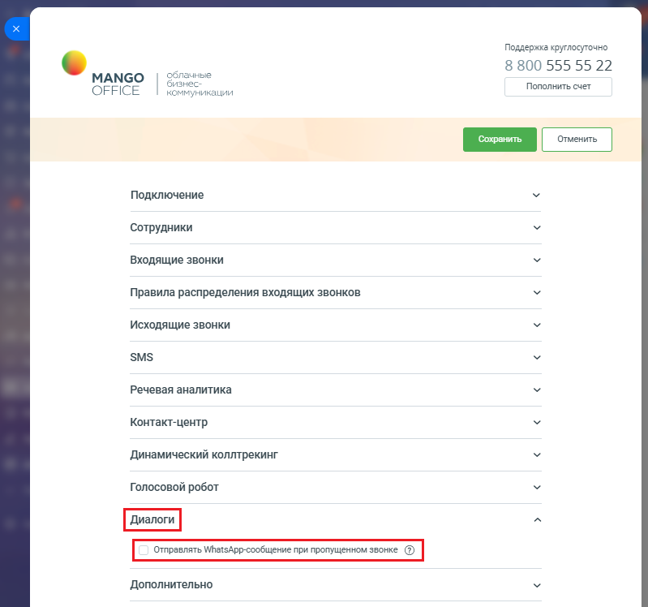
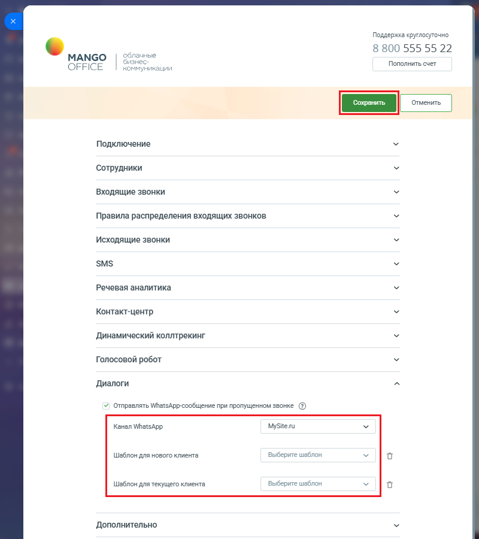

# Как включить

> Трассировка: PDF §2.23 · сквозные стр. 135-137 · источники: ч.1 `kb/sources/integration-bitrix24/Mango_office_integration_Bitrix24.pdf` с.135-137.

Перед тем как отправлять Клиенту в WhatsApp сообщения по какому-либо шаблону прочитайте статью "Шаблоны WhatsApp". В ней описано что такое и как настраивать шаблон WhatsApp. Чтобы включить настройку, в вашем Битрикс24 необходимо: 1) откройте форму настройки приложения интеграции; 2) откройте блок "Диалоги"; 3) установите флаг "Отправлять WhatsApp-сообщение при пропущенном звонке":

> **Описание иллюстрации INTB24-§2.23-1** (к §2.23 «Как включить», стр. 135; 799×748 px). Снимок экрана / схема.
> Относится к тексту руководства: «…одимо: 1) откройте форму настройки приложения интеграции; 2) откройте блок "Диалоги"; 3) установите флаг "Отправлять WhatsApp-сообщение при пропущенном звонке":».
> Текст на изображении (OCR, требует сверки): Поддержка круглосуточно; чные; 8 800 555 55 22; МАМСО; OFFICE; Пополнить счет; никации; Подключение; Сотрудники; Входящие звонки; Правила распределения входящих звонков; Исходящие звонки; SMS; Речевая аналитика; Контакт-центр; Динамический коллтрекинг; Голосовой робот; Дополнительно

Интеграция Виртуальной АТС MANGO OFFICE и Битрикс24 | Версия от 03.03.2026 4) выберите канал коммуникаций WhatsApp, настроенный вами ранее в Манго Диалогах; 5) выберите: - Шаблон для нового клиента: укажите шаблон сообщения по пропущенным звонкам с новых номеров; - Шаблон для текущего клиента: укажите шаблон сообщения по пропущенным звонкам от Клиентов, зарегистрированных в Битрикс24; 6) нажмите кнопку "Сохранить" в верхней части формы настройки приложения интеграции:

> **Описание иллюстрации INTB24-§2.23-2** (к §2.23 «Как включить», стр. 136; 800×900 px). Снимок экрана / схема.
> Относится к тексту руководства: «…общения по пропущенным звонкам от Клиентов, зарегистрированных в Битрикс24; 6) нажмите кнопку "Сохранить" в верхней части формы настройки приложения интеграции:».
> Текст на изображении (OCR, требует сверки): Поддержка круглосуточно; 8 800 555 55 22; МАМСО; ные; Пополнить счет; OFFICE; KOR; никации; Подключение; Сотрудники; Входящие звонки; Правила распределения входящих звонков; Исходящие звонки; SMS; Речевая аналитика; Контакт-центр; Динамический коллтрекинг; Голосовой робот; Диалоги; У Отправлять МТатзАрр-сообщение при пропущенном звонке (2); Канал WhatsApp; MySite.ru; Шаблон для нового клиента; Выберите шаблон; Шаблон для текущего клиента; Дополнительно

Интеграция Виртуальной АТС MANGO OFFICE и Битрикс24 | Версия от 03.03.2026
