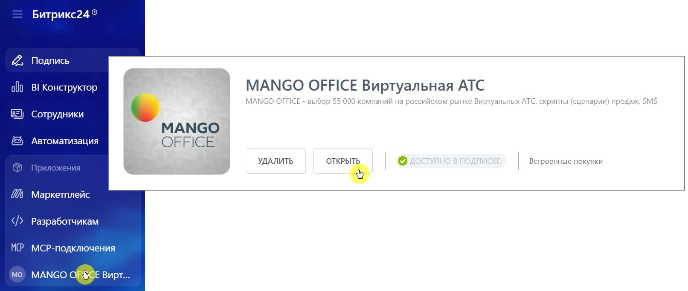
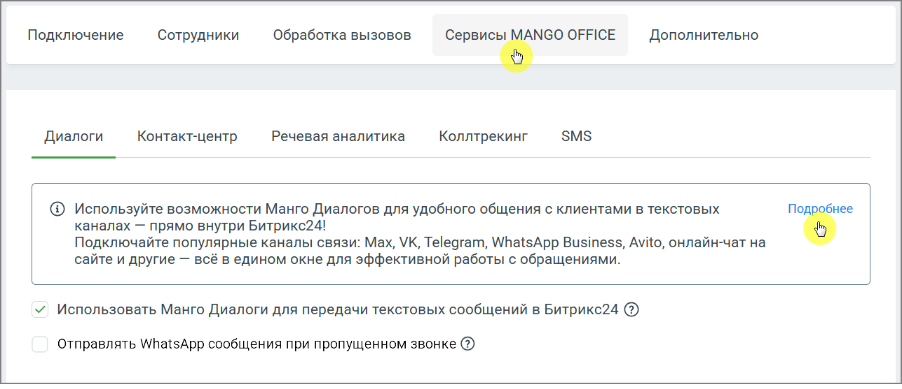

# 2.24.4. Активируйте использование Манго Диалогов для передачи текстовых сообщений

> Трассировка: PDF §2.24.4 · сквозные стр. 139-140 · источники: ч.1 `kb/sources/integration-bitrix24/Mango_office_integration_Bitrix24.pdf` с.139-140.

сообщений Для включения работы диалогов: • В блоке Приложения меню Битрикс24 выберите MANGO OFFICE Виртуальная АТС. • Нажмите кнопку Открыть на виджете ВАТС.

> **Описание иллюстрации INTB24-§2.24.4-1** (к §2.24.4 «Активируйте использование Манго Диалогов для передачи текстовых сообщений», стр. 139; 1613×684 px). Снимок экрана / схема.
> Относится к тексту руководства: «…ых сообщений Для включения работы диалогов: • В блоке Приложения меню Битрикс24 выберите MANGO OFFICE Виртуальная АТС. • Нажмите кнопку Открыть на виджете ВАТС.».
> Текст на изображении (OCR, требует сверки): Битрикс24°; Ра; Подпись; alo; BI Конструктор; MANGO OFFICE Виртуальная ATC; MANGO OFFICE - выбор 55 000 компаний Ha российском рынке Виртуальных ATC, скрипты (сценарии) продаж, SMS; Сотрудники; Oa; Автоматизация; УДАЛИТЬ; ТУПНО В ПОДПЬ; Встроенные покупки; Маркетплейс; Разработчикам; MCP; MCP-nogknroueHua; мо; MANGO ОРШСЕ Вирт...

• Откроется меню настроек виджета. В меню настроек перейдите на вкладку Сервисы MANGO OFFICE → Диалоги. • Установите флажок: Использовать Манго Диалоги для передачи текстовых сообщений в Битрикс24. • Нажмите Применить.

> **Описание иллюстрации INTB24-§2.24.4-2** (к §2.24.4 «Активируйте использование Манго Диалогов для передачи текстовых сообщений», стр. 139; 1287×557 px). Снимок экрана / схема.
> Относится к тексту руководства: «…те на вкладку Сервисы MANGO OFFICE → Диалоги. • Установите флажок: Использовать Манго Диалоги для передачи текстовых сообщений в Битрикс24. • Нажмите Применить.».
> Текст на изображении (OCR, требует сверки): Подключение Сотрудники Обработка вызовов Сервисы ь” ОРЕСЕ Дополнительно; Диалоги; Контакт-центр; Речевая аналитика; Коллтрекинг; @® Используйте возможности Манго Диалогов для удобного общения с клиентами в текстовых; каналах — прямо внутри Битрикс24!; Подключайте популярные каналы связи: Max, VK, Telegram, WhatsApp Business, Avito, онлайн-чат на; сайте и другие — всё в едином окне для эффективной работы с обращениями.; vy. Использовать Манго Диалоги для передачи текстовых сообщений в Битрикс24 (@); Отправлять WhatsApp сообщения при пропущенном звонке @)

Интеграция Виртуальной АТС MANGO OFFICE и Битрикс24 | Версия от 03.03.2026 Нажатие на кнопку Подробнее открывает Личный кабинет ВАТС, раздел Диалоги.
