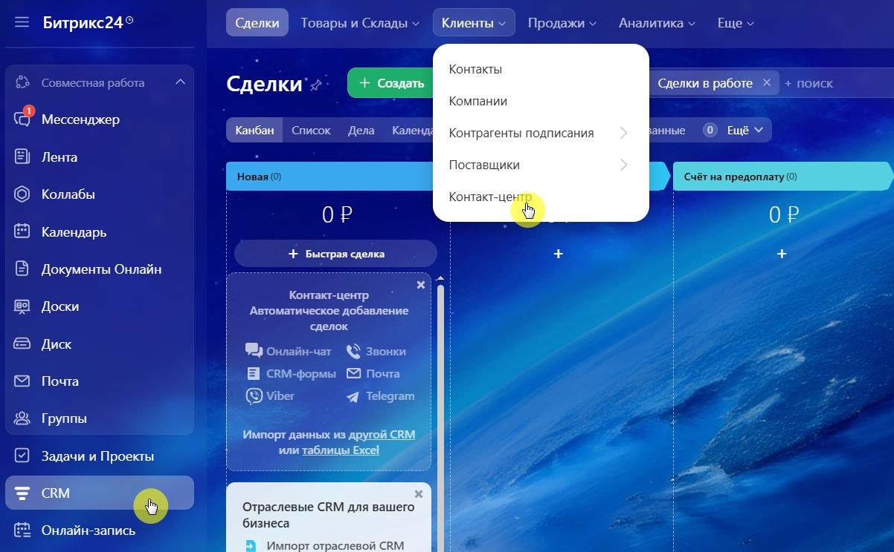
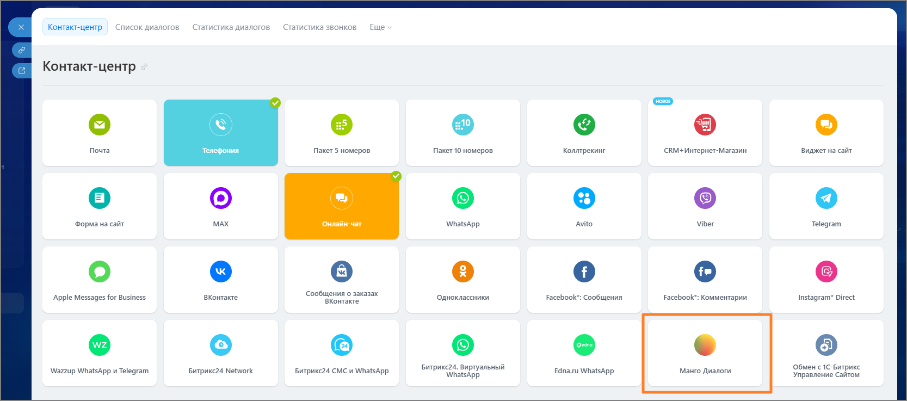
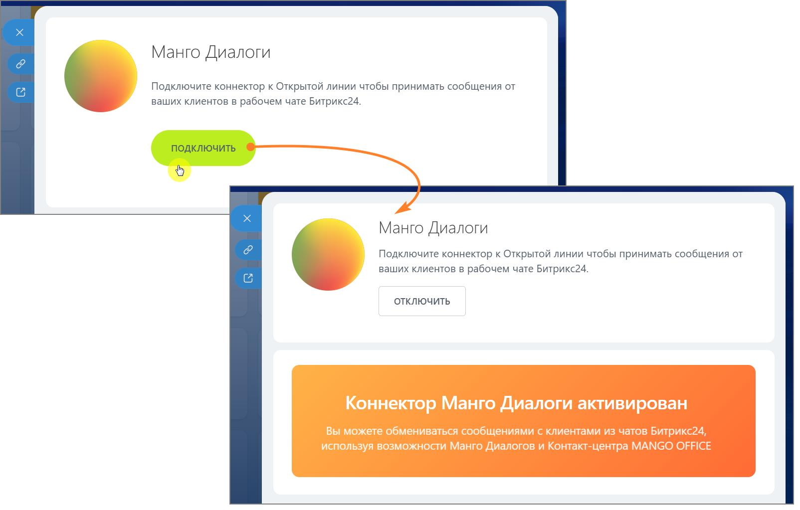

# 2.24.5. Проверьте подключение виджета Манго Диалоги в Битрикс24

> Трассировка: PDF §2.24.5 · сквозные стр. 140-141 · источники: ч.1 `kb/sources/integration-bitrix24/Mango_office_integration_Bitrix24.pdf` с.140-141.

В Битрикс24: • Откройте раздел CRM → Клиенты → Контакт-центр.

> **Описание иллюстрации INTB24-§2.24.5-1** (к §2.24.5 «Проверьте подключение виджета Манго Диалоги в Битрикс24», стр. 140; 1202×744 px). Снимок экрана / схема.
> Относится к тексту руководства: «…ичный кабинет ВАТС, раздел Диалоги. 2.24.5 Проверьте подключение виджета Манго Диалоги в Битрикс24 В Битрикс24: • Откройте раздел CRM → Клиенты → Контакт-центр.».
> Текст на изображении (OCR, требует сверки): Битрикс24®; Сделки; Товары и Склады v; Клиенты ~; Продажи ~; Аналитика ~; Еще v; такты; ‘Сделки в работе Хх; поиск; ипании; & Мессенджер; Канбан; Список; Дела; Kanenni; анные; 0) Ещё v; Ко; трагенты по; ния; Лента; щики; Новая (0); Счёт на предоплату (0); © коллабы; так; ОР; Календарь; + Быстрая сделка; Документы Онлайн; Контакт-центр,; Доски; Автоматическое добавление; ‘сделок; Диск; рее; №} Онлайн-чат &\ Звонки; Почта; Е свм-формы © Почта; © Viber; Telegram; Группы; 'Импорт данных из; или табли!; Задачи и Проекты; CRM; Отраслевые CRM для вашег; бизнеса; 'Онлайн-запись; лпорт отра

• Убедитесь, что подключенный виджет Манго Диалоги отображается в списке виджетов.

> **Описание иллюстрации INTB24-§2.24.5-2** (к §2.24.5 «Проверьте подключение виджета Манго Диалоги в Битрикс24», стр. 140; 1667×737 px). Снимок экрана / схема.
> Относится к тексту руководства: «…оги в Битрикс24 В Битрикс24: • Откройте раздел CRM → Клиенты → Контакт-центр. • Убедитесь, что подключенный виджет Манго Диалоги отображается в списке виджетов.».
> Текст на изображении (OCR, требует сверки): Контакт-центр; диа; Ста; стика диалогов; ка звонков; Eu; Почта; Телефония; Пакет 5 номеров; Пакет 10 номеров; Коллтрекинг; сВМ+ Интернет-Магазин; Виджет на сайт; Форма на сайт; МАХ; Онлайн-чат; WhatsApp; Avito; Viber; Telegram; Apple Messages for Business; ВКонтакте; Сообщения о заказах; `Одноклассники; Facebook":; сообщения; ‹омментарии; Instagram* Direct; Wazzup WhatsApp и Telegram; Битрикс24 Network; Битрикс24 CMC и WhatsApp; Битрикс24. Виртуальный; Edna.ru WhatsApp; Манго Диалоги; Обмен с1С-Битрикс; Управление Сайтом

• Нажмите на иконку виджета и в открывшемся окне нажмите кнопку Подключить. Интеграция Виртуальной АТС MANGO OFFICE и Битрикс24 | Версия от 03.03.2026

> **Описание иллюстрации INTB24-§2.24.5-3** (к §2.24.5 «Проверьте подключение виджета Манго Диалоги в Битрикс24», стр. 141; 1604×1023 px). Снимок экрана / схема.
> Относится к тексту руководства: «…. • Убедитесь, что подключенный виджет Манго Диалоги отображается в списке виджетов. • Нажмите на иконку виджета и в открывшемся окне нажмите кнопку Подключить.».
> Текст на изображении (OCR, требует сверки): Манго Диалоги; Подключите коннектор к Открытой линии чтобы принимать сообщения от; ваших клиентов в рабочем чате Битрикс24.; ОТКЛЮЧИТЬ; Коннектор Манго Диалоги активирован; Вы можете обмениваться сообщениями с клиентами из чатов Битрикс24,; используя возможности Манго Диалогов и Контакт-центра MANGO OFFICE

В списке виджетов иконка виджета «Манго Диалоги» станет активной.

> **Описание иллюстрации INTB24-§2.24.5-4** (к §2.24.5 «Проверьте подключение виджета Манго Диалоги в Битрикс24», стр. 141; 358×218 px). Снимок экрана / схема.
> Относится к тексту руководства: «…В списке виджетов иконка виджета «Манго Диалоги» станет активной.».

Вы активировали коннектор «Манго Диалоги» в Битрикс24. Далее переходите к настройкам Открытой линии.
