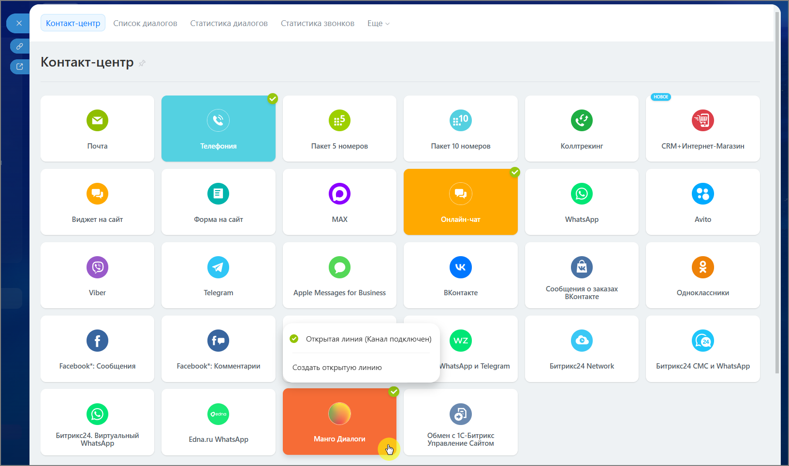
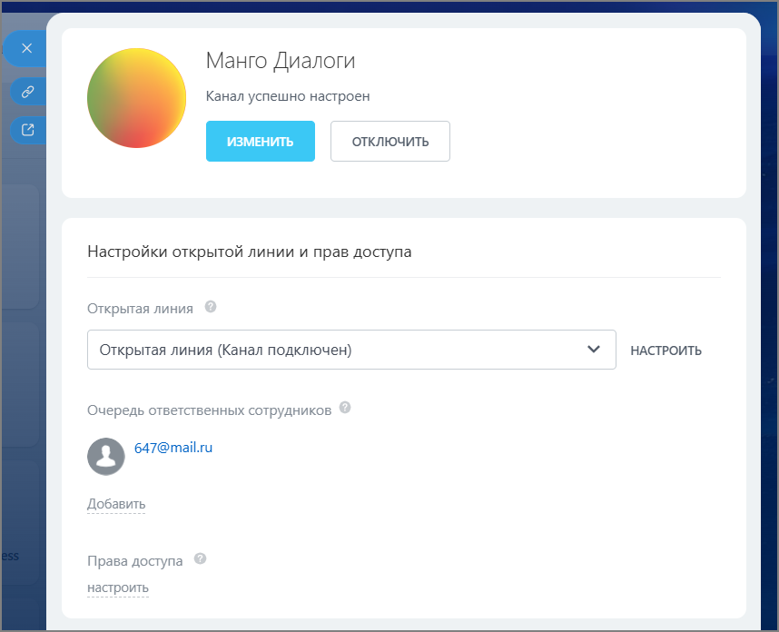
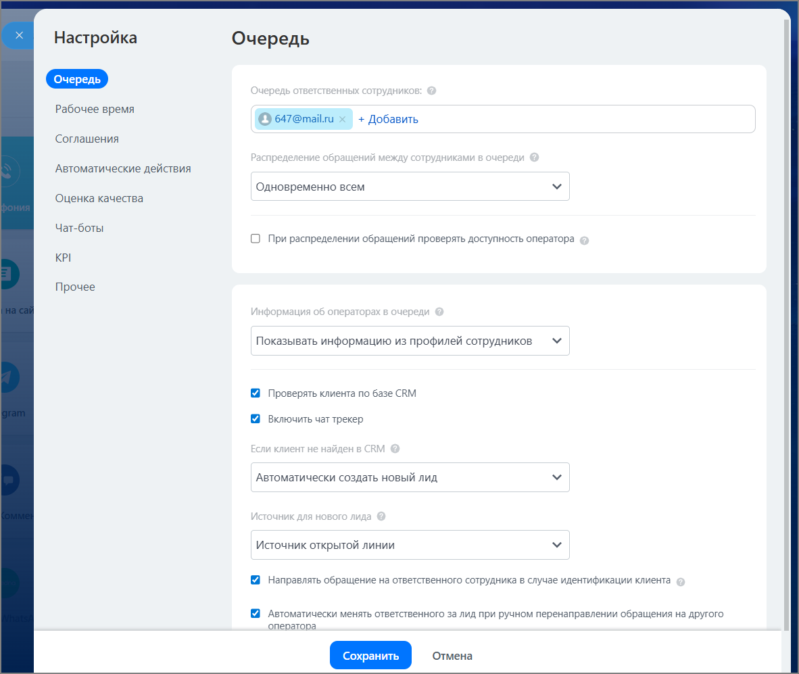

# 2.24.6. Настройте «Открытую линию» в Битрикс24

> Трассировка: PDF §2.24.6 · сквозные стр. 141-143 · источники: ч.1 `kb/sources/integration-bitrix24/Mango_office_integration_Bitrix24.pdf` с.141-143.

Открытая линия в Битрикс24 — это инструмент, который собирает все сообщения от клиентов из разных каналов в одном месте и автоматически распределяет их между сотрудниками. Все входящие сообщения из подключенных каналов «Манго Диалоги» попадают в один интерфейс Битрикс24. Менеджеру не нужно переключаться между десятком приложений - он отвечает на все вопросы в одном окне Контакт-центра. Внимание! Настраивать Открытые линии могут администратор Битрикс24 и сотрудники с ролью Администратор в правах доступа. Для настройки Открытой линии нажмите на активный виджет «Манго Диалоги» и выберите существующую линию для настройки или создайте новую. Интеграция Виртуальной АТС MANGO OFFICE и Битрикс24 | Версия от 03.03.2026

> **Описание иллюстрации INTB24-§2.24.6-1** (к §2.24.6 «Настройте «Открытую линию» в Битрикс24», стр. 142; 1632×966 px). Снимок экрана / схема.
> Относится к тексту руководства: «…тратор в правах доступа. Для настройки Открытой линии нажмите на активный виджет «Манго Диалоги» и выберите существующую линию для настройки или создайте новую.».
> Текст на изображении (OCR, требует сверки): ‘Список диалогов; Статистика диалогов; Статистика звонков; Еще; Контакт-центр,; Контакт-центр; Почта; Телефония; Пакет 5 номеров; Пакет 10 номеров; Коллтрекинг; СВМ+ Интернет-Магазин; Виджет на сайт; МАХ; Онлайн-чат; Avito; Форма на сайт; WhatsApp; Viber; Telegram; Apple Messages for Business; ВКонтакте; ‘Сообщения о заказах; Одноклассники; © открытая линия (Канал подключен) ©; Facebook": Сообщения; Facebook": Комментарии; WhatsApp Telegram; Битрикс24 Network; Битрикс24 CMC и WhatsApp; Создать открытую линию; Битрикс?4. Виртуальный; Edna.ru WhatsApp; Манго Диалоги; Обмен с 1С-Битрикс; Управлен…

Откроется окно Открытой линии.

> **Описание иллюстрации INTB24-§2.24.6-2** (к §2.24.6 «Настройте «Открытую линию» в Битрикс24», стр. 142; 858×696 px). Снимок экрана / схема.
> Относится к тексту руководства: «…Откроется окно Открытой линии.».
> Текст на изображении (OCR, требует сверки): Манго Диалоги; Канал успешно настроен; Е се; Настройки открытой линии и прав доступа; Открытая линия; Открытая линия (Канал подключен); НАСТРОИТЬ; Очередь ответственных сотрудников; О 647@mail.ru; Добавить; Права доступа

Добавьте ответственных сотрудников, которые будут иметь доступ к обработке сообщений из каналов «Манго Диалоги». Добавьте права доступа для ролей. Интеграция Виртуальной АТС MANGO OFFICE и Битрикс24 | Версия от 03.03.2026 Нажмите кнопку Настроить и в открывшемся окне произведите необходимые настройки Открытой линии.

> **Описание иллюстрации INTB24-§2.24.6-3** (к §2.24.6 «Настройте «Открытую линию» в Битрикс24», стр. 143; 1182×997 px). Снимок экрана / схема.
> Относится к тексту руководства: «…Нажмите кнопку Настроить и в открывшемся окне произведите необходимые настройки Открытой линии.».
> Текст на изображении (OCR, требует сверки): Настройка; Очередь; ков; Рабочее время; © 647@mailru; + Добавить; Соглашения; во; ‘Автоматические действия; Одновременно всем; Оценка качества; Чат-боты; О При распределении обращений проверять доступность оператора; KPI; Прочее; Показывать информацию из профилей сотрудников; Проверять клиента по базе CRM; Включить чат трекер; Автоматически создать новый лид; кд,; Источник открытой линии; Направлять обращение на ответственного сотрудника в случае идентификации клиента; Автоматически менять ответственного за лид при ручном перенаправлении обращения на другого; оператора

Подробная инструкция по настройке Открытой линии приведена на официальном портале техподдержки Битрикс24: https://helpdesk.bitrix24.ru/open/25004908/
