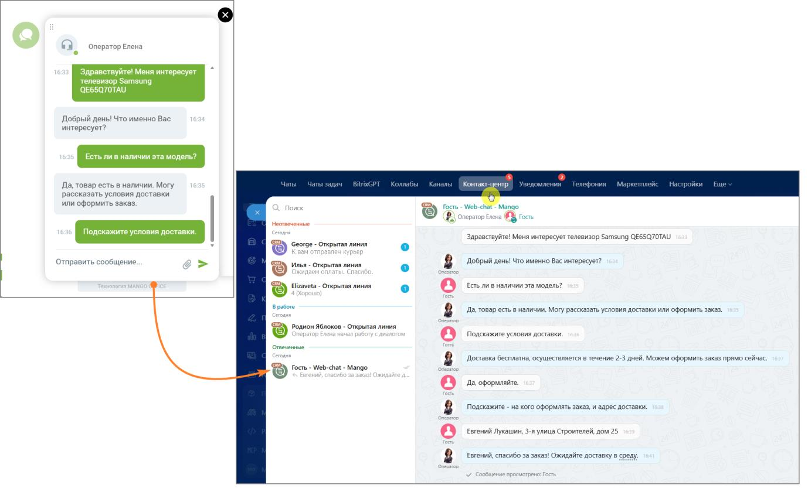
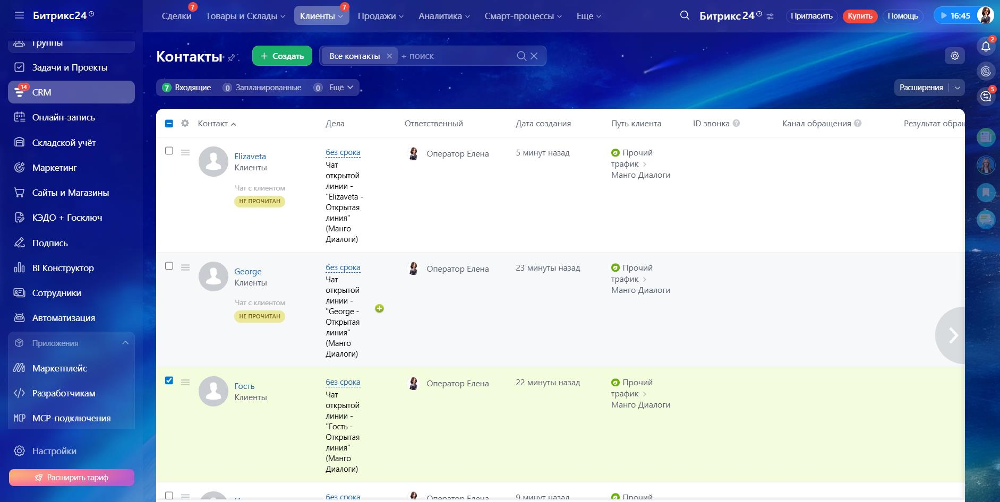
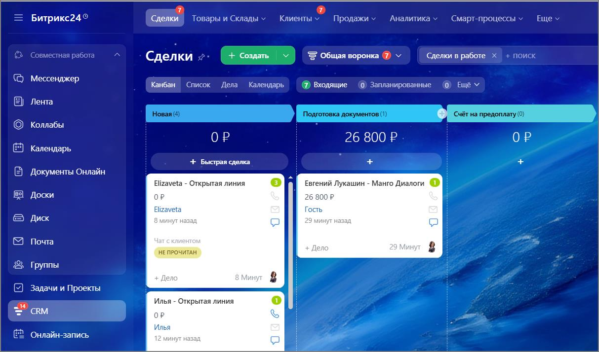
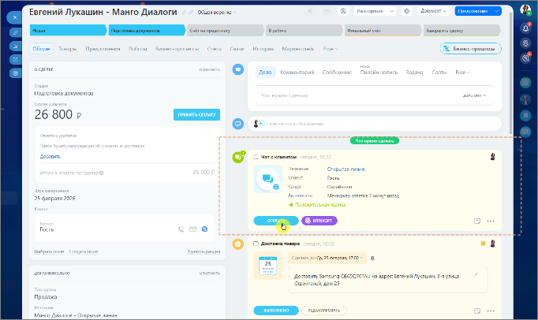
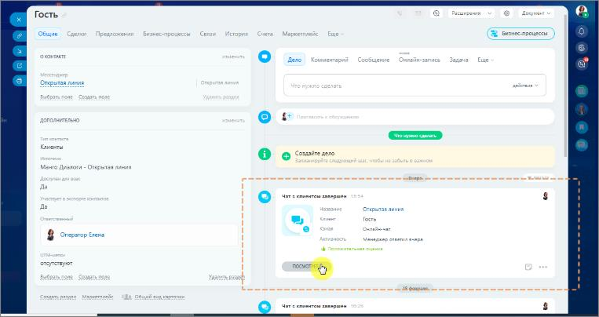

# 2.24.7. Как обрабатывать чаты в Контакт-центре Битрикс24

> Трассировка: PDF §2.24.7 · сквозные стр. 143-146 · источники: ч.1 `kb/sources/integration-bitrix24/Mango_office_integration_Bitrix24.pdf` с.143-146.

Как это работает: • Посетитель сайта открывает виджет «Манго Диалоги» и выбирает способ связи из каналов Диалогов, подключенных вами в разделе Подключение каналов «Манго Диалоги» (например, MAX или Чат на сайте).

> **Описание иллюстрации INTB24-§2.24.7-1** (к §2.24.7 «Как обрабатывать чаты в Контакт-центре Битрикс24», стр. 143; 828×552 px). Снимок экрана / схема.
> Относится к тексту руководства: «…т «Манго Диалоги» и выбирает способ связи из каналов Диалогов, подключенных вами в разделе Подключение каналов «Манго Диалоги» (например, MAX или Чат на сайте).».
> Текст на изображении (OCR, требует сверки): ly; ated; Divas; ги; Se; Fi; el; vy

Интеграция Виртуальной АТС MANGO OFFICE и Битрикс24 | Версия от 03.03.2026 • После отправки сообщения обращение мгновенно попадает в Контакт- центр Битрикс24. • Оператор получает уведомление и отвечает клиенту прямо из окна Мессенджер → Контакт-центр на портале - без переключения между приложениями.

> **Описание иллюстрации INTB24-§2.24.7-2** (к §2.24.7 «Как обрабатывать чаты в Контакт-центре Битрикс24», стр. 144; 1378×845 px). Снимок экрана / схема.
> Относится к тексту руководства: «…- центр Битрикс24. • Оператор получает уведомление и отвечает клиенту прямо из окна Мессенджер → Контакт-центр на портале - без переключения между приложениями.».
> Текст на изображении (OCR, требует сверки): ©. oneparop Enon; Здравствуйте! Меня интересует; телевизор Samsung; ОЕББОТОТАИ; Добрый дены Что именно Bac; ‘интересует?; Де, товар есть в наличии. Могу; рассказать условия доставки; ‘или оформить заказ.; Гость - Web-chs; Mango; B one; гор Елена @ № гость; Homewise; Здравствуйте! Меня интересует телевизор Samsung QE6SQTOTAU; George - Открытая линия; курьер; Отправить сообщение.; Илья - Открытая линия; 8 добрый лены что именно Bac интересует?; ЕСТЬ ли в наличии эта модель?; @ Elizaveta - Открытая линия; работе; Ala, товар есть в наличии. Mory рассказать условия доставки или оформить заказ.; @ Р…

Чат с клиентом автоматически привязывается к контакту клиента в окне CRM → Клиенты → Контакты.

> **Описание иллюстрации INTB24-§2.24.7-3** (к §2.24.7 «Как обрабатывать чаты в Контакт-центре Битрикс24», стр. 144; 1883×946 px). Снимок экрана / схема.
> Относится к тексту руководства: «…→ Контакт-центр на портале - без переключения между приложениями. Чат с клиентом автоматически привязывается к контакту клиента в окне CRM → Клиенты → Контакты.».
> Текст на изображении (OCR, требует сверки): пи; ‘Аналитика v; упить; омош; Битрикс24‹; Сделки.; Товары и Склады » | Клиенты; Продажи v; ‘Смарт-процессы v; Ewe v; С вБитрикс24® =; Пригласить; ee; труппы; 282; Контакты; + Создать; Все контакты Х; + поиск; Задачи и Проекты; P Входящие; © Запланированные; © tev; Расширения; CRM; 'Онлайн-запись; Kontakt ^; Дела; Ответственный; Дата создания; Путь клиента; ID звонка; Канал обращения; Результат обра; Складской учёт; Elizaveta; без срока; 8 оператор Елена; 5 минут назад; © Прочий; Чат; Маркетинг; Клиенты; трафик; открытой; Манго Диалоги; ом; линии -; ‘Сайты и Магазины; “Elizaveta; Открытая; КЭД…

Интеграция Виртуальной АТС MANGO OFFICE и Битрикс24 | Версия от 03.03.2026 Также автоматически создается сделка в окне CRM → Сделки, которую далее можно передвигать по воронке продаж.

> **Описание иллюстрации INTB24-§2.24.7-4** (к §2.24.7 «Как обрабатывать чаты в Контакт-центре Битрикс24», стр. 145; 1213×714 px). Снимок экрана / схема.
> Относится к тексту руководства: «…Также автоматически создается сделка в окне CRM → Сделки, которую далее можно передвигать по воронке продаж.».
> Текст на изображении (OCR, требует сверки): Битрикс24®; ‘Сделки; Товары и Склады; Клиенты; Продажи v; Аналитика; Смарт-процессы; Еще; Общая воронка ® \; Сделки в работе x; Сделки; Мессенджер; Канбан:; Список; Дела; Календарь; ® входящие; ©) Запланированные; Лента; Коллабы; 26 800 Р; ОР; + Быстрая сделка; Документы Онлайн; Elizaveta; рытая линия; Евгений Лукашин - Манго Диалоги; Доски; oP; El; Диск; ae; Почта; HE; группы; Задачи и Проекты; Илья; Открытая линия; = crm; 'Онлайн-запись

Просмотреть сообщения чата можно из окна сделки. К просмотру сообщения чата также можно перейти из карточки клиента.

> **Описание иллюстрации INTB24-§2.24.7-5** (к §2.24.7 «Как обрабатывать чаты в Контакт-центре Битрикс24», стр. 145; 682×406 px). Снимок экрана / схема.
> Относится к тексту руководства: «… далее можно передвигать по воронке продаж. Просмотреть сообщения чата можно из окна сделки. К просмотру сообщения чата также можно перейти из карточки клиента.».
> Текст на изображении (OCR, требует сверки): джус; Евгений Лукашин - Манго Диалоги; ОБиза ворс к; Barscyanen; mee бони; пракикиу; Bovtew; ‘руналинай чат; Задать самку; oo; Ty; зенния; Был; Re; anne; Hegre; xa; ито; 26 800 р; МНЯ; Ary; woven; Creperze линий; Foun; 25 вопро; aa; Paver; omtente Farge наз; # Позожитолина одна; Гель; oe; рии; © 0 aenea ome; pear noch Fe омеравл 1726; 25; ох; nH; we; Достань Somsurg CEGSGTO TY мо ацрес Еолений Лусшим 3-2 yD; cipow; Mp; ya; reascneroge; Nae; личи»

> **Описание иллюстрации INTB24-§2.24.7-6** (к §2.24.7 «Как обрабатывать чаты в Контакт-центре Битрикс24», стр. 145; 763×404 px). Снимок экрана / схема.
> Относится к тексту руководства: «… далее можно передвигать по воронке продаж. Просмотреть сообщения чата можно из окна сделки. К просмотру сообщения чата также можно перейти из карточки клиента.».
> Текст на изображении (OCR, требует сверки): ирония; Гость; ке; Общие; жен; vie; ле; Ce; Марке; RE визяес-процессы; eral; ение; pita:; Ст,; тая лин; РВ; tuo; АНИТЕЛЬНО; Клиемты; e @ Comite zero; Ma; тая линия; Cs) Чат г emmeurens samepinit; As; линия; sa; nar; Vane; пря; aurarease очима; отсутствуют; or; Чит с кливитеы пжжжршен

Благодаря интеграции Манго Диалоги с Битрикс24 все обращения с сайта попадают напрямую операторам Контакт-центра Битрикс24. Клиент пишет сообщение в виджете на сайте, а сотрудник компании отвечает ему уже в знакомом интерфейсе Битрикс24 - на компьютере или в мобильном приложении. Единое окно для всех каналов связи. Интеграция Виртуальной АТС MANGO OFFICE и Битрикс24 | Версия от 03.03.2026
