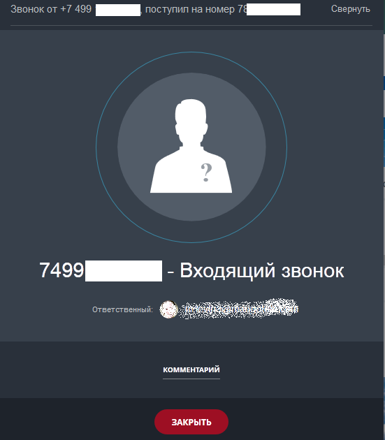
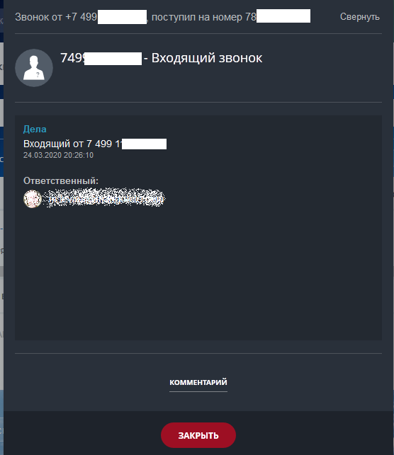
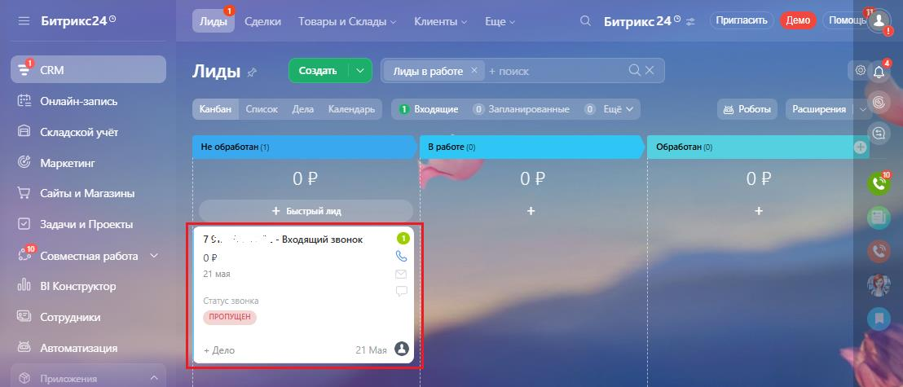
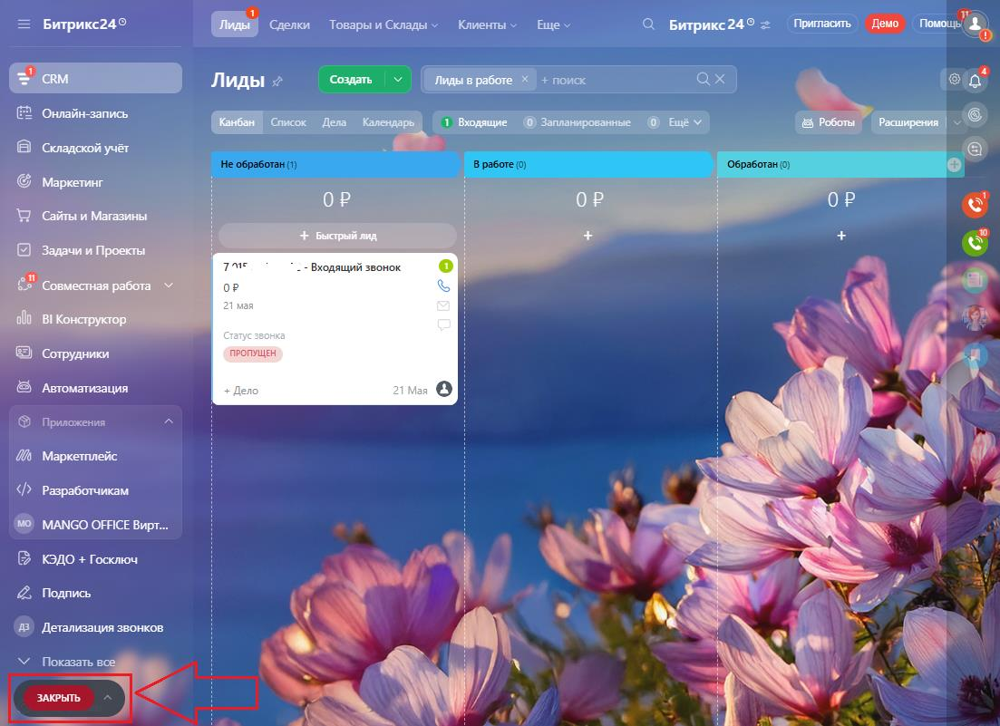

# 3.1. Входящий звонок

> Трассировка: PDF §3.1 · сквозные стр. 146-149 · источники: ч.1 `kb/sources/integration-bitrix24/Mango_office_integration_Bitrix24.pdf` с.146-149.

При входящем звонке у сотрудника зазвонит телефон (указанный в карточке сотрудника в Личном кабинете в качестве средства приема вызова), а в Битрикс24 покажется карточка звонка: • если Клиент звонит вам впервые, то карточка входящего звонка будет выглядеть так:

> **Описание иллюстрации INTB24-§3.1-1** (к §3.1 «Входящий звонок», стр. 146; 551×630 px). Снимок экрана / схема.
> Относится к тексту руководства: «…в качестве средства приема вызова), а в Битрикс24 покажется карточка звонка: • если Клиент звонит вам впервые, то карточка входящего звонка будет выглядеть так:».
> Текст на изображении (OCR, требует сверки): Свернуть; 3B0HOK oT +7 499 ИН [|; 7490 - Входящий звонок; Ответственный: &; КОММЕНТАРИЙ; acre

Интеграция Виртуальной АТС MANGO OFFICE и Битрикс24 | Версия от 03.03.2026 • если Клиент звонит вам повторно, то карточка звонка будет выглядеть так:

> **Описание иллюстрации INTB24-§3.1-2** (к §3.1 «Входящий звонок», стр. 147; 556×643 px). Снимок экрана / схема.
> Относится к тексту руководства: «…• если Клиент звонит вам повторно, то карточка звонка будет выглядеть так:».
> Текст на изображении (OCR, требует сверки): Звонок от +7 7 | поступил на номер Е |; Свернуть; | BS 749 И - Входящий звонок; Дела; 24.03.2020 20:26:10; Ответст; КОММЕНТАРИЙ

При этом в Битрикс24 автоматически будет создан лид, если соответствующая настройка включена ("Номер телефона" - Входящий звонок):

> **Описание иллюстрации INTB24-§3.1-3** (к §3.1 «Входящий звонок», стр. 147; 1108×475 px). Снимок экрана / схема.
> Относится к тексту руководства: «…а звонка будет выглядеть так: При этом в Битрикс24 автоматически будет создан лид, если соответствующая настройка включена ("Номер телефона" - Входящий звонок):».
> Текст на изображении (OCR, требует сверки): Битрикс249; | Чет ео; С Битрикс249; Притасить — Dew; CRM; Лиды <; Лиды в pal; сх; Онлайн-запись; Список Дель Календарь; 1 Выодещие; © Запланированные; 8 Роботы | Рааширения | ~; Складской учет; G Маркетинг; ОР; WY сайыи Магазины; 4 Бектрый лид; Задачи и Проекты; 7s; - Входящий звонок; 2? Совместная работа У; op; 21 mas; old BI Koncrpyxrop; ©) сотрудники; pone; Автоматизация; Ф Приложения

Интеграция Виртуальной АТС MANGO OFFICE и Битрикс24 | Версия от 03.03.2026 Сотрудник принимает звонок на своем телефоне и разговаривает с абонентом. Во время разговора, сотрудник может свернуть карточку звонка, нажав кнопку "Свернуть" в левом верхнем углу этой карточки. Тогда, в вашем Битрикс24 будет отображена кнопка "Закрыть":

> **Описание иллюстрации INTB24-§3.1-4** (к §3.1 «Входящий звонок», стр. 148; 1103×801 px). Снимок экрана / схема.
> Относится к тексту руководства: «…отрудник может свернуть карточку звонка, нажав кнопку "Свернуть" в левом верхнем углу этой карточки. Тогда, в вашем Битрикс24 будет отображена кнопка "Закрыть":».
> Текст на изображении (OCR, требует сверки): Битрикс24®; ( Мет еоенть fame eo; С Битрикс249 > Mownacm, Демо” пы"; ‘Создать; ах; Г ЖЕ; 2 Онлайн-запись; fe; В Складской учёт; ОР; щий; NV; ‘Автоматизация; Приложения,; `Маркетплейс; Разработчикам; az; MANGO OFFICE Вирт..; КЭДО + Госключ; Подпись,; `Детализация звонков:; Показать ва; SS; We; ua

> **Описание иллюстрации INTB24-§3.1-5** (к §3.1 «Входящий звонок», стр. 148; 11×16 px). Пиктограмма (значок элемента интерфейса).
> Относится к тексту руководства: «…отрудник может свернуть карточку звонка, нажав кнопку "Свернуть" в левом верхнем углу этой карточки. Тогда, в вашем Битрикс24 будет отображена кнопка "Закрыть":».
> Текста на изображении нет; назначение элемента — см. текст, к которому он относится.

Чтобы выйти из режима свернутого окна, нажмите кнопку . Будет открыта карточка звонка. Интеграция Виртуальной АТС MANGO OFFICE и Битрикс24 | Версия от 03.03.2026
