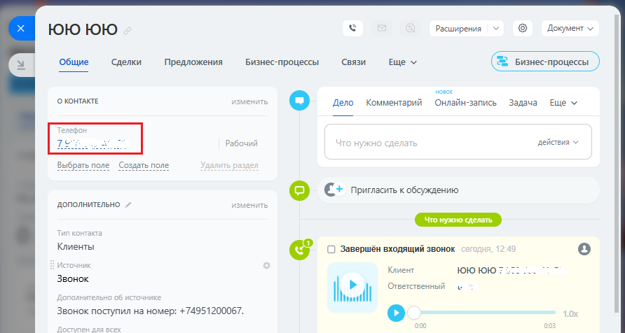
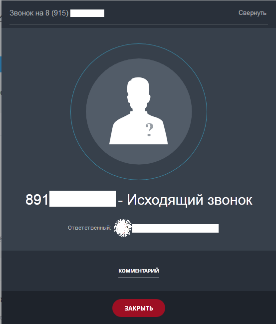

# 3.2. Исходящий звонок

> Трассировка: PDF §3.2 · сквозные стр. 149-150 · источники: ч.1 `kb/sources/integration-bitrix24/Mango_office_integration_Bitrix24.pdf` с.149-150.

Сотрудник может кликнуть на номер телефона в Битрикс24, набрать его в номеронабирателе Битрикс24:

> **Описание иллюстрации INTB24-§3.2-1** (к §3.2 «Исходящий звонок», стр. 149; 892×476 px). Снимок экрана / схема.
> Относится к тексту руководства: «…3.2 Исходящий звонок Сотрудник может кликнуть на номер телефона в Битрикс24, набрать его в номеронабирателе Битрикс24:».
> Текст на изображении (OCR, требует сверки): ЮЮюЮюЮюЮ; Расширения; Документ м; Общие; Сделки; Предложения; Бизнес-процессы; Связи; Еще м; НОВОЕ; О КОНТАКТЕ; 3M; Дело; Комментарий; Онлайн-запись; Задача; Рабочий; делать; действия у; Что нуж; Set ee as; Выбрать поле Создать поле; НИЕ; © €+ Пригласить к обсуждению; ДОПОЛНИТЕЛЬНО /; Клиенты; © С) Завершён входящий звонок; Клиент; Звонок; Допо; aa; ьно об; 06; Звонок поступил на номер: +74951200067.

или набрать его на своем рабочем телефоне. При этом, если сотрудник кликнул на номер телефона в Битрикс24, то сначала зазвонит его рабочий телефон, и только после того как сотрудник поднимет трубку – начнется звонок на выбранный номер телефона. При этом, в Битрикс24 будет показана карточка исходящего звонка:

> **Описание иллюстрации INTB24-§3.2-2** (к §3.2 «Исходящий звонок», стр. 149; 553×649 px). Снимок экрана / схема.
> Относится к тексту руководства: «… только после того как сотрудник поднимет трубку – начнется звонок на выбранный номер телефона. При этом, в Битрикс24 будет показана карточка исходящего звонка:».
> Текст на изображении (OCR, требует сверки): Звонок на 8 (915); Свернуть; 891 по - Исходящий звонок; КОММЕНТАРИЙ

Интеграция Виртуальной АТС MANGO OFFICE и Битрикс24 | Версия от 03.03.2026
