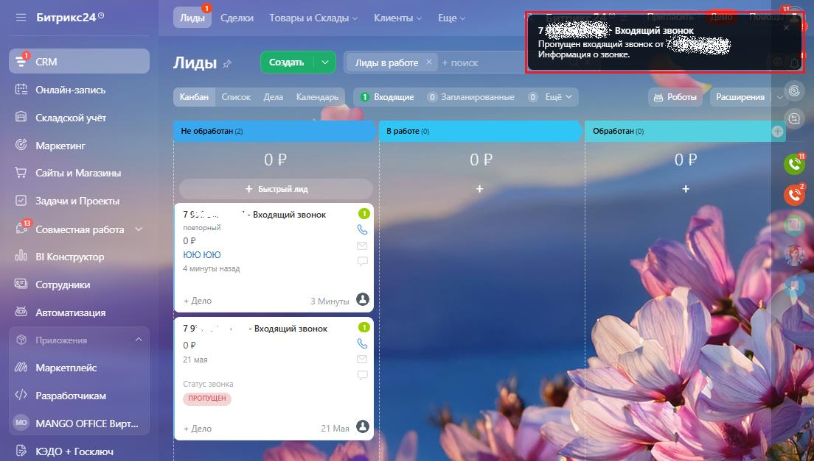
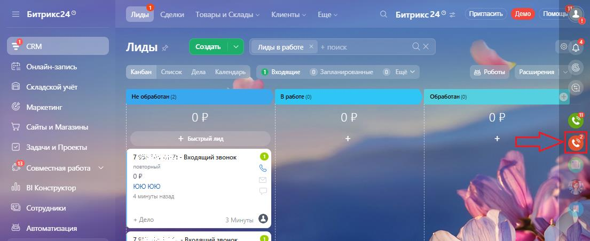
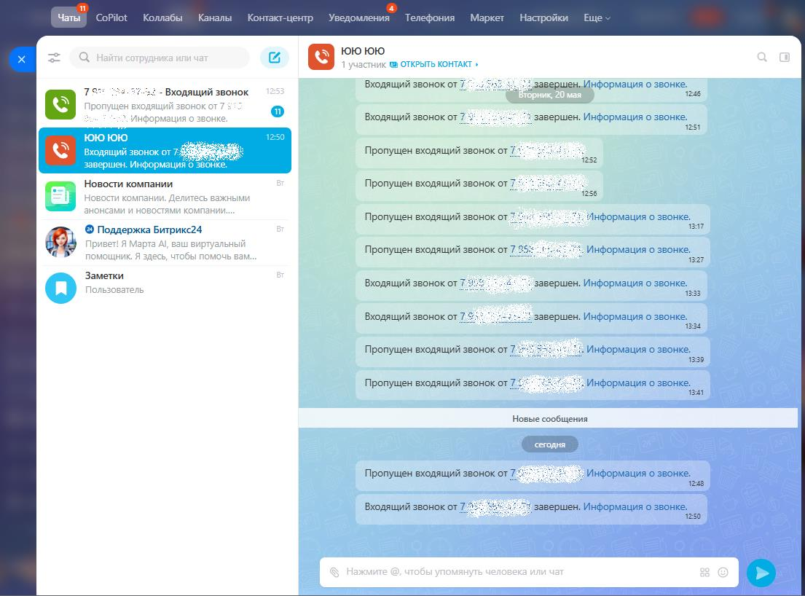

# 3.3. Пропущенные звонки

> Трассировка: PDF §3.3 · сквозные стр. 150-152 · источники: ч.1 `kb/sources/integration-bitrix24/Mango_office_integration_Bitrix24.pdf` с.150-152.

Если сотрудник отсутствовал на рабочем месте и были пропущенные звонки, то вне зависимости, был открыт Битрикс24 у него или не был открыт, в Битрикс24 попадет информация о пропущенных звонках. Сначала информация о пропущенном звонке видна в окне уведомления в углу экрана. Примечание. Если в вашем браузере или на мобильном устройстве с установленным приложением Битрикс24 разрешен показ всплывающих сообщений, то информация о пропущенном звонке будет видна во всплывающем сообщении.

> **Описание иллюстрации INTB24-§3.3-1** (к §3.3 «Пропущенные звонки», стр. 150; 1104×627 px). Снимок экрана / схема.
> Относится к тексту руководства: «… устройстве с установленным приложением Битрикс24 разрешен показ всплывающих сообщений, то информация о пропущенном звонке будет видна во всплывающем сообщении.».
> Текст на изображении (OCR, требует сверки): Битрикс249; 5 <-> toepanceamy meme швы; Е Входящий звонок.; Пропущен входящий эвонокот; aM; Лиды +; ME; + поиск; ] Информация о звонке.; [53; 'Онлайн-запись; БЫ cme tow ом; 1 модящие (©) Запланированные © ще; © Роботы и.; Складской учёт; Маркетинг; oP; "Сайты и Магазины; Задачи и Проекты; ‹одящий звонок; рез; Совместная работа Y; oll; BI Конструктор; Сотрудники; ' Автоматизация; 79; Входящий звонок; Приложения:; 'Маркетплейс; 2 a; Ry; Разработчикам; ПРОПУЩЕН; MANGO OFFICE Вирт.; fon ©; КЭДО + Госключ; Ss

Если есть пропущенные звонки, то на значке "красный телефон" в углу будет указано количество звонков, в том числе пропущенных:

> **Описание иллюстрации INTB24-§3.3-2** (к §3.3 «Пропущенные звонки», стр. 150; 1105×452 px). Снимок экрана / схема.
> Относится к тексту руководства: «…т видна во всплывающем сообщении. Если есть пропущенные звонки, то на значке "красный телефон" в углу будет указано количество звонков, в том числе пропущенных:».
> Текст на изображении (OCR, требует сверки): Битрикс24©; Г бе оао Ее Pee; О Битрике24® = (Towa. Демо 1 wou &; dl; Лиды 2; "Создать:; 'вработе Хо + поисе; ах; ela"; 2 Онлайн-запись; (Канбын | crwcox Дела Календарь; © запланированные @ Ewe ¥; Складской учёт.; Бе; (© Маркетинг; ОР; WD сайты и Магазины; + Быстрый лид.; Задачи и Проекты:; 7 - Входящий звонок; $5 Совместная работа“; oo; зу; op; olf В! Конструктор:; ми; ©) сотрудники; © Автоматизация; ow ЛА

Интеграция Виртуальной АТС MANGO OFFICE и Битрикс24 | Версия от 03.03.2026 Чтобы увидеть все пропущенные звонки, необходимо кликнуть на этот значок:

> **Описание иллюстрации INTB24-§3.3-3** (к §3.3 «Пропущенные звонки», стр. 151; 1105×818 px). Снимок экрана / схема.
> Относится к тексту руководства: «…Чтобы увидеть все пропущенные звонки, необходимо кликнуть на этот значок:».
> Текст на изображении (OCR, требует сверки): Чаты; CoPilot; лабы; Каналы; Контакт-центр; Уведомления; Телефония; Маркет; "Настройки; Ewe; ror 1010; Pb; bk; on; Входящий звонокот 7; 78; Входящий звонок; : завершен, Информация о звонке; 246; cr; or; воно OF; ин; ия; звонке; Входящий звонок от 7 2; 3 завершен. Информация о звонке.; west; is; te; Пропущен входящий звонок oF 7; ase; ‚инфо; sy; Новости компании; Пропущен входящий звонок от 7; и комп:; ажными; 55; юонсами и; ювостями KO!; лан; Пропущен входящий звонок от 7.; :}. Информация о звонке.; © Поддержка Битрикс24; 1817; При; я Марта Al, ва; ый; мощник; мочь; Пропущен входящий звонок от…

Также, вы можете посмотреть информацию о звонках в календаре, только если в вашем Битрикс24 включена соответствующая настройка. Чтобы посмотреть звонки в календаре, выполните: 1) перейдите в раздел "CRM", выберите "Лиды", затем нажмите ссылку "Календарь"; 2) в открывшемся календаре будут отмечены звонки:

> **Описание иллюстрации INTB24-§3.3-4** (к §3.3 «Пропущенные звонки», стр. 151; 1100×756 px). Снимок экрана / схема.
> Относится к тексту руководства: «…звонки в календаре, выполните: 1) перейдите в раздел "CRM", выберите "Лиды", затем нажмите ссылку "Календарь"; 2) в открывшемся календаре будут отмечены звонки:».
> Текст на изображении (OCR, требует сверки): = Битрикс24°; `делки; Товары и Склады; Кл; нты; Euy; Битрикс24®; Пратаоть) feo Mowou; Создать; лиды в работе; Онлайн-запись; 3 Входящие; О) Запланированные; & Роботы; Расширения; Складской учет; Маркетинг; Месяц; та создания) ¥; < Сегодня; Май, 2025; Сайты и Магазины; пн; чт; ag; 28; 29; 30; 1 мая; Задачи и Проекты; en; 62; Совместная работа Y; al) BI Конструктор; Сотрудники; 10; rN; Asromarveayna; Mapxemnneiic; Разработчикам; 12; 13; 15; 16; 18; MANGO OFFICE Вир; КЭДО + Госключ; Подпись; 19; 20; 21; 22; 24; 25; Детализация звонков:; ет,; 07935; 5 4.1248; Tox; ль все

Интеграция Виртуальной АТС MANGO OFFICE и Битрикс24 | Версия от 03.03.2026 Кроме этого, вы можете открыть отчет телефонии "Детализация звонков" и посмотреть информацию о пропущенных звонках. Подробнее о том, как открыть отчет описано в Приложении А.
